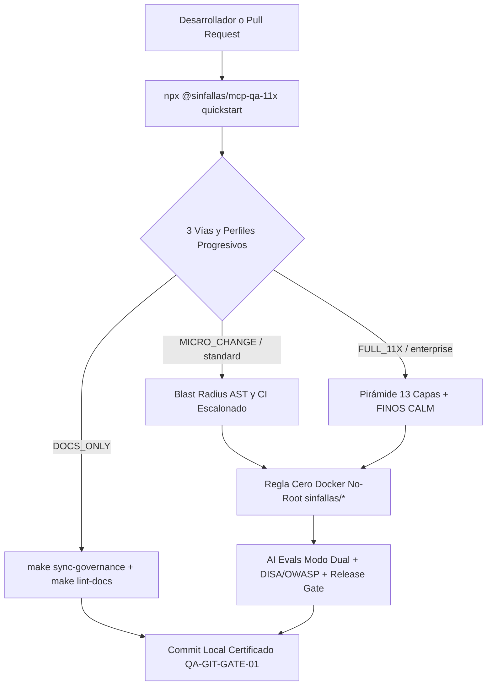

> 🌐 **Idioma:** [🇺🇸 English (Canonical)](README.md) · **Español (Espejo 1:1)**

<p align="center">
  
</p>

# QA Testing Blueprints (`QA-11X v3.12` — Estándar Corporativo Nivel 11X)

**Blueprint Zero-Infra de QA Agéntico, Evaluaciones de IA y Gobernanza DevSecOps**

[](LICENSE)
[](TESTING.es.md)
[](SECURITY.es.md)
[-6f42c1)](.agents/skills/qa-11x-architect/SKILL.md)
[](docs/agent-setup.es.md)
[](architecture/qa-11x.calm.json)

**QA-11X v3.12** transforma tanto a **Agentes de Inteligencia Artificial** (28 agentes soportados incluyendo Google Antigravity, Claude Code, Cursor, Windsurf, Codex, Copilot, Hermes Agent y 21 clientes adicionales) como a **equipos humanos de ingeniería** en operadores deterministas de QA y DevSecOps nivel Staff. Toda validación corre dentro de **contenedores Docker efímeros y no-root (`Rule Zero`)** sin contaminar el host, imponiendo cobertura `>= 95%`, paridad real con bases de datos/contratos, evaluaciones de IA en modo dual y controles **DISA ASD STIG V6R5 + OWASP v4.2** desde el día uno.

---

## ⚡ Inicio Rápido en 30 Segundos (Fricción Cero)

> [!IMPORTANT]
> **Prerrequisito Físico Obligatorio — Docker Engine (`Rule Zero` es Innegociable):** Toda estación de trabajo o runner CI **DEBE** contar con un demonio Docker activo para ejecutar `qa-11x` (`qa-11x doctor` bloquea con `exit 1` si Docker no está instalado o está detenido). Incluso al delegar análisis SAST/SCA a herramientas externas (`Semgrep`, `Trivy`, `CodeQL`) sin un MCP compañero activo, toda ejecución CLI corre **exclusivamente en contenedores efímeros no-root** (`--rm --restart=no --network none`) serializados bajo `QA_MAX_CONCURRENT_CONTAINERS=1`.

Inicializa y protege cualquier repositorio en 30 segundos sin clonar este monorepo:

```bash
# Autodetecta stacks, solicita tier en TTY (o aplica `standard` en modo no interactivo), genera .qa-11x.json v3, AGENTS.md y workflow PR:
npx -y @sinfallas/mcp-qa-11x@latest quickstart

# Con perfil explícito, plantillas contextuales de gobernanza, política de idioma, selección de agentes o vista previa --dry-run:
npx -y @sinfallas/mcp-qa-11x@latest quickstart --tier standard --governance-docs CHANGELOG.md,ROADMAP.md,TESTING.md --lang es --agents auto
npx -y @sinfallas/mcp-qa-11x@latest quickstart --tier enterprise --lang en --dry-run
```

### Compuerta Proporcional en Pull Requests (GitHub Actions)

Integra la Composite Action endurecida [`.github/actions/qa-11x-pr-check/action.yml`](.github/actions/qa-11x-pr-check/action.yml) en tus flujos de PR:

```yaml
name: QA-11X PR Check
on: [pull_request]
permissions:
  contents: read
jobs:
  qa-11x:
    runs-on: ubuntu-latest
    timeout-minutes: 20
    steps:
      - uses: actions/checkout@fbc6f3992d24b796d5a048ff273f7fcc4a7b6c09 # v5.1.0
        with:
          fetch-depth: 0
      - uses: tecno-consultores/qa-testing-blueprints/.github/actions/qa-11x-pr-check@v3 # sec-ci-action-ref-ok (tag de ejemplo; fija un SHA de 40 caracteres en producción)
        with:
          tier: standard
          lang: es
```

---

## 🧭 Arquitectura Diferencial (`QA-11X v3.12`)



### Perfiles de Adopción Progresiva (`.qa-11x.json` v3)

> **Valor por Defecto Unificado y Onboarding en Un Solo Prompt:** Las ejecuciones no interactivas, CI y repositorios sin `.qa-11x.json` operan en **`standard`**. Toda sesión de agente anuncia `[QA-11X | Tier: <tier> | Path: <DOCS_ONLY|MICRO_CHANGE|FULL_11X>]` y realiza un único prompt consolidado no destructivo si el tier no está confirmado o faltan documentos de gobernanza (`CHANGELOG.md`, `ROADMAP.md`, `TESTING.md`, `SECURITY.md`, `.agents/boundaries.json`, `architecture/calm.json`, ADR-0001, `.github/CODEOWNERS`), persistiendo `enabled`/`declined`/`legacy_preserved` en `.qa-11x.json` v3 para no insistir en sesiones futuras.

| Perfil | Caso de Uso | Compuertas y Garantías Incluidas |
| :--- | :--- | :--- |
| **`starter`** | Día 1 en 30 segundos | Escaneo de secretos en texto plano, higiene de contenedores `Rule Zero`, `.qa-11x.json` v3, conector `AGENTS.md` en 28 agentes IA, plantillas asistidas de gobernanza y vía rápida `DOCS_ONLY` |
| **`standard`** *(por defecto)* | Pull Requests diarios | Todo lo de `starter` + cobertura unitaria `>= 95%`, tipado estricto (`mypy --strict`, `tsc`, `PHPStan max`), partición CI por Blast Radius AST (ahorro de `40%–60%`) y linter de antipatrones UI (`QA-UI-ANTI-001..005`) |
| **`enterprise`** | Producción regulada | Pirámide completa `FULL_11X` de 13 capas, Arquitectura como Código bloqueante FINOS CALM, PostgreSQL 17 RLS + cadenas WORM `seq_num`, DISA STIG V6R5 / OWASP v4.2, aserciones temporales de 3 fases (`t < starts_at`, `starts_at <= t <= ends_at`, `t > ends_at`), contratos Pact + carga k6 y Release Readiness Gate (`GO` / `NO_GO` / `SKIPPED`) |

### Matriz Docker Efímera Zero-Infra (`sinfallas/*`)

Todas las suites de análisis, mutación, contratos y BDD se ejecutan en contenedores no-root (`-u "$(id -u):$(id -g)" -e HOME=/tmp`) con **`Trivy HIGH/CRITICAL = 0`**:

| Imagen Efímera | Rol en QA-11X v3.12 | Tags Certificados y Herramientas Preinstaladas |
| :--- | :--- | :--- |
| **[sinfallas/base-python-uv](https://hub.docker.com/r/sinfallas/base-python-uv)** | Python, FastAPI, AI Evals y Vibe-Rescue | `3.11`, `3.12`, `3.13`, `3.14`, `3.15` y `latest` (`uv`, `ruff`, `mypy`, `pytest`, `bandit`, `radon`, `mutmut`, `deepeval`, `pact-python`, `tesseract-ocr`) |
| **[sinfallas/base-node-ionic](https://hub.docker.com/r/sinfallas/base-node-ionic)** | MCP Server, Node, Vue 3, React y CALM | `22`, `24`, `26` y `latest` (`pnpm`, `promptfoo`, `@finos/calm-cli`, `playwright`, `@axe-core/playwright`, `@pact-foundation/pact`) |
| **[sinfallas/base-mobile-appium](https://hub.docker.com/r/sinfallas/base-mobile-appium)** | Móvil Nativo e Híbrido Driver Bridge W3C (Android/iOS) | `26` y `latest` (`Node.js 26`, `pnpm`, `OpenJDK 21`, `Android SDK/ADB`, `Appium 3`, `uiautomator2`, `xcuitest`, `WebdriverIO v9`) |
| **[sinfallas/basephpcomposer](https://hub.docker.com/r/sinfallas/basephpcomposer)** | APIs y Servicios PHP 8.2–8.5 | `8.2`, `8.3`, `8.4`, `8.5` y `latest` (`pcov`, `phpstan`, `psalm`, `pest`, `phpunit`, `infection`) |
| **[sinfallas/karatelabs](https://hub.docker.com/r/sinfallas/karatelabs)** | Contratos BDD API y HTTP/Edge/OSHP/XML | `1.5.1` (Java + Maven + Karate JUnit5; proporcional a flujos `FULL_11X` multi-servicio con estado) |
| **[sinfallas/base-bash-qa](https://hub.docker.com/r/sinfallas/base-bash-qa)** | DevOps y Automatización POSIX / Bash | `latest` (`ShellCheck`, `shfmt`, `BATS-core`, `bats-mock`, `kcov`) |
| **[sinfallas/remote-graphify](https://hub.docker.com/r/sinfallas/remote-graphify)** | Optimización de Contexto AST y Blast Radius | `latest` (`graphify` extracción AST Tree-sitter y clustering) |
| **Motores de Infra, Seguridad y Carga** | BD Real, Caché, DAST, Caos y Carga | `postgres:17-alpine`, `eqalpha/keydb@sha256:6537505c42355ca1f571276bddf83f5b750f760f07b2a185a676481791e388ac` (`v6.3.4` multi-arch), `aquasec/trivy:0.76.2`, `zaproxy/zap-stable:2.15.0`, `gaiaadm/pumba:0.10.1`, `prom/prometheus:v2.55.1`, `grafana/k6:2.4.0` |

---

## 🗂️ Blueprints Full-Stack, Móvil, AI Evals y Vibe-Rescue

La matriz abarca **10 stacks hidratables** (`python`, `fastapi`, `node-backend`, `vue3`, `react-frontend`, `bash-scripts`, `php`, `mobile-appium`, `ai-evals`, `vibe-rescue`) más **`architecture/`** (topología FINOS CALM) y **`mcp-server/`** (`@sinfallas/mcp-qa-11x`), conformando los **12 entornos de matriz**:

| Carpeta | Ecosistema | Capacidades Clave (QA-11X v3.12) |
| :--- | :--- | :--- |
| **[`fastapi/`](fastapi/README.es.md)** | APIs Asíncronas Python | Ruff, Mypy strict, paridad PostgreSQL 17 RLS + Alembic, consumidor Pact V4 ([`test_pact_consumer.py`](fastapi/tests/contracts/test_pact_consumer.py)), carga k6 ([`smoke.k6.js`](fastapi/tests/load/smoke.k6.js)), Karate BDD |
| **[`python/`](python/README.es.md)** | Librerías y CLIs Python | UV, Ruff (`CC <= 5`), Mypy strict, Pytest `>= 95%`, Hypothesis, Mutmut (`MSI >= 80%`), Bandit |
| **[`node-backend/`](node-backend/README.es.md)** | Microservicios Node.js / TS | ESLint `--max-warnings 0`, Vitest `>= 95%`, verificador proveedor Pact V4 ([`provider.pact.test.ts`](node-backend/tests/contracts/provider.pact.test.ts)), Stryker, ZAP |
| **[`vue3/`](vue3/README.es.md)** | Frontends Vue 3 + Vite | Screenplay [`Actor.ts`](vue3/tests/screenplay/Actor.ts), *Self-Healing DOM* [`semanticLocator.ts`](vue3/tests/utils/semanticLocator.ts), Vitest `>= 95%`, `@axe-core`, Lighthouse CI |
| **[`react-frontend/`](react-frontend/README.es.md)** | Frontends React + Vite | Screenplay [`Actor.ts`](react-frontend/tests/screenplay/Actor.ts), *Self-Healing DOM* [`semanticLocator.ts`](react-frontend/tests/utils/semanticLocator.ts), RTL, Playwright, `@axe-core` |
| **[`php/`](php/README.es.md)** | Servicios PHP 8.2–8.5 | PHP-CS-Fixer, PHPStan Level Max, Psalm Taint Analysis, Pest/PHPUnit + PCOV `>= 95%`, Infection |
| **[`bash-scripts/`](bash-scripts/README.es.md)** | Automatización POSIX / Bash | ShellCheck, shfmt, BATS-core, `bats-mock`, `kcov >= 95%` |
| **[`mobile-appium/`](mobile-appium/README.es.md)** | Móvil Nativo e Híbrido | Appium 3 / W3C + WebdriverIO ([`wdio.conf.ts`](mobile-appium/wdio.conf.ts)), [`MobileActor.ts`](mobile-appium/tests/screenplay/MobileActor.ts) (Android, iOS, Ionic, RN) |
| **[`ai-evals/`](ai-evals/README.es.md)** | QA de IA y Multimodal | Fidelidad RAG, Promptfoo OWASP LLM Top 10, latencia voz WebRTC ([`test_voice_websocket_latency.py`](ai-evals/voice-realtime/test_voice_websocket_latency.py)), fidelidad PDF/OCR `Decimal` ([`test_pdf_table_fidelity.py`](ai-evals/multimodal-ocr/test_pdf_table_fidelity.py)), [`golden_from_traces.py`](ai-evals/golden_from_traces.py) |
| **[`vibe-rescue/`](vibe-rescue/README.es.md)** | Rescate *Vibe-to-Enterprise* | [`audit_vibe_prototype.py`](vibe-rescue/audit_vibe_prototype.py) (`VIBE-SEC-001..QA-005`), plantilla PostgreSQL 17 RLS/WORM ([`rls_hardening.sql`](vibe-rescue/templates/rls_hardening.sql)) |
| **[`architecture/`](architecture/README.es.md)** | Arquitectura como Código | Topología FINOS CALM bloqueante ([`qa-11x.calm.json`](architecture/qa-11x.calm.json)) y 7 controles obligatorios 11X (`make validate-calm`) |
| **[`mcp-server/`](mcp-server/README.es.md)** | `@sinfallas/mcp-qa-11x` | Servidor MCP Node.js (`stdio`), 12 subcomandos CLI (`quickstart`, `install-skill`, `init-agents`, `reconcile-agents`, `tms-sync`, `doctor`, `upgrade`, `certify`, `audit`, `blast-radius`, `mcp-config`, `completion`) y *Agent Card* A2A `v1.0` |

---

## 🛠 Matriz de Herramientas de Pruebas

A continuación se resume el stack de validación corporativo a lo largo de los **12 entornos de matriz** (**10 stacks hidratables** + `architecture/` + `mcp-server/`) por tipo de prueba. Se indica `N/A` en las pruebas que no aplican por la naturaleza intrínseca del entorno (ej. un script *standalone* de Python o Bash o una topología estática no levanta servidores HTTP, por ende no se le aplica DAST ni Ingeniería del Caos).

| Entorno | Linting / Formateo | Pruebas Unitarias / Mocking | Cobertura | Auditoría de Dependencias | Seguridad Estática (SAST) | Mutación | BDD / Caja Negra | Concurrencia / Estrés | Profiling / Complejidad | DAST (Dinámica) | Ingeniería del Caos | Observabilidad (Métricas) | Auditoría IaC / Docker | Git Hooks Locales |
| :--- | :--- | :--- | :--- | :--- | :--- | :--- | :--- | :--- | :--- | :--- | :--- | :--- | :--- | :--- |
| **Python** (`python/`) | `Ruff` + `Mypy (Strict)` | `Pytest` + `pytest-mock` | `Pytest-Cov (>= 95%)` | `pip-audit` + `CycloneDX SBOM` | `Bandit` | `Mutmut (>= 80%)` | `pytest-bdd` + `pact-python` | `k6` (`make qa-load`) | `py-spy` + `Radon (CC <= A)` | `N/A` | `N/A` | `Pushgateway` + `Prometheus` | `Trivy` + `verificar-secretos.sh` | `Lefthook` |
| **FastAPI** (`fastapi/`) | `Ruff` + `Mypy (Strict)` | `Pytest` + `pytest-asyncio` + `respx` + `PostgreSQL 17` + `KeyDB` + `Alembic` | `Pytest-Cov (>= 95%)` | `pip-audit` + `CycloneDX SBOM` | `Bandit` | `Mutmut (>= 80%)` | `Karate Labs` + `Schemathesis` + `Pact V4` | `Locust (Headless)` + `k6` | `py-spy` / `memray` + `Radon (CC <= A)` | `OWASP ZAP Baseline` | `Pumba` | `prometheus-fastapi-instrumentator` + `Prometheus` | `Trivy` + `verificar-secretos.sh` | `Lefthook` |
| **Node Backend** (`node-backend/`) | `ESLint (--max-warnings 0)` + `Prettier` + `tsc` | `Vitest` + `Supertest` + `Nock` | `@vitest/coverage-v8 (>= 95%)` | `pnpm audit` + `@cyclonedx/cyclonedx-npm` + `.npmrc` | `eslint-plugin-security` | `Stryker (>= 80%)` | `Karate Labs` + `Pact V4` | `Artillery` | `Clinic.js` + `SonarJS (<= 15)` | `OWASP ZAP Baseline` | `Pumba` | `express-prom-bundle` + `Prometheus` | `Trivy` + `verificar-secretos.sh` | `Lefthook` |
| **Vue 3** (`vue3/`) | `ESLint (--max-warnings 0)` + `Prettier` + `vue-tsc` | `Vitest` + `Vue Test Utils` + `Screenplay` + `Playwright` + `@axe-core` | `@vitest/coverage-v8 (>= 95%)` | `pnpm audit` + `.npmrc (ignore-scripts=true)` | `eslint-plugin-security` | `Stryker (>= 80%)` | `Karate Labs (HTTP/OSHP)` + `Playwright UI` | `N/A` | `Lighthouse CI` + `SonarJS (<= 15)` | `N/A` | `N/A` | `nginx-prometheus-exporter` + `Prometheus` | `Trivy` + `verificar-secretos.sh` | `Lefthook` |
| **React** (`react-frontend/`) | `ESLint (--max-warnings 0)` + `Prettier` + `tsc` | `Vitest` + `React Testing Library` + `Screenplay` + `Playwright` + `@axe-core` | `@vitest/coverage-v8 (>= 95%)` | `pnpm audit` + `.npmrc (ignore-scripts=true)` | `eslint-plugin-security` + `react-hooks` | `Stryker (>= 80%)` | `Karate Labs (HTTP/OSHP)` + `Playwright UI` | `N/A` | `Lighthouse CI` + `SonarJS (<= 15)` | `N/A` | `N/A` | `nginx-prometheus-exporter` + `Prometheus` | `Trivy` + `verificar-secretos.sh` | `Lefthook` |
| **PHP 8.2–8.5** (`php/`) | `PHP-CS-Fixer (@PER-CS2.0)` + `PHPStan (Level Max)` | `Pest` / `PHPUnit 11.5+` + `MockHandler` + `PostgreSQL 17` + `KeyDB` | `PCOV (>= 95%)` | `composer audit` + `roave/security-advisories` + `CycloneDX SBOM` | `Psalm (--taint-analysis)` | `Infection (MSI >= 80%)` | `Karate Labs` + `OpenAPI` | `k6` (`make qa-load`) | `tomasvotruba/cognitive-complexity (<= 9)` | `OWASP ZAP Baseline` | `Pumba` | `promphp/prometheus_client_php` + `Prometheus` | `Trivy` + `verificar-secretos.sh` | `Lefthook` |
| **Bash** (`bash-scripts/`) | `ShellCheck` + `shfmt` | `BATS-core` + `bats-support` + `bats-assert` + `bats-file` + `bats-mock` | `kcov (>= 95%)` | `N/A` | `ShellCheck` | `N/A` | `N/A` | `N/A` | `hyperfine` + `time -v` | `N/A` | `N/A` | `Pushgateway` + `Prometheus` | `Trivy` + `verificar-secretos.sh` | `Lefthook` |
| **Mobile Appium** (`mobile-appium/`) | `tsc --strict` (offline) + `ESLint` / `Prettier` | `WebdriverIO v9` + `MobileActor` Screenplay (Bridge W3C, Android/iOS/Ionic/RN) | `node:test` (`--experimental-test-coverage` / `lcov >= 95%`) | `pnpm audit` + `.npmrc` + `CycloneDX SBOM` | `eslint-plugin-security` + guardias Deep-Link / Biometría | `N/A` | `Appium 3 (uiautomator2/xcuitest)` + `Karate BFF` | `N/A` | `CC <= 5` + Trazas Fail-Verbose `/tmp` | `N/A` (delegado al BFF `OWASP ZAP`) | `N/A` (Offline Sync & Biometría) | `Allure JSON Fail-Verbose` (`/tmp`) | `Trivy` + `verificar-secretos.sh` (`sinfallas/base-mobile-appium:26`) | `Lefthook` |
| **AI Evals** (`ai-evals/`) | `Ruff (CC <= 5)` + `Mypy (Strict)` | `Pytest asyncio` + `DeepEval` + Voz WebRTC + PDF/OCR `Decimal` | `Pytest-Cov (>= 95%)` | `pip-audit` + `CycloneDX SBOM` | `Bandit` + `Promptfoo OWASP LLM Top 10` | `N/A` | `DeepEval` + `Promptfoo` (Offline + Live) | `WebRTC TTFB <= 500ms` | `Radon (CC <= A)` + `golden_from_traces.py` | `Promptfoo LLM Red-Team` | `N/A` | `Trazas JSON Trayectoria Eval` | `Trivy` + `verificar-secretos.sh` | `Lefthook` |
| **Vibe Rescue** (`vibe-rescue/`) | `Ruff (CC <= 5)` + `Mypy (Strict)` | `Pytest` + `audit_vibe_prototype.py` (`VIBE-SEC-001..QA-005`) | `Pytest-Cov (>= 95%)` | `pip-audit` + `rls_hardening.sql` | `Bandit` + `RLS / AES-256-GCM / WORM` | `N/A` | `Compuerta Rescate QA-11X 10/10` | `N/A` | `Radon (CC <= 5)` | `OWASP ZAP (post-rescate)` | `N/A` | `Finding State Tracker JSON` | `Trivy` + `verificar-secretos.sh` | `Lefthook` |
| **Architecture** (`architecture/`) | `AJV CLI / CALM` (`validate_calm_architecture.sh`) | `CALM Schema & 7-Control Verification (qa-11x.calm.json)` | `N/A` | `Integridad Controles CALM` | `7 Controles Bloqueantes (RLS/WORM/mTLS)` | `N/A` | `Compuerta Arquitectónica FINOS CALM` | `N/A` | `Graphify AST Acoplamiento / Capas` | `N/A` | `N/A` | `Reporte Validación CALM` | `Trivy` + `verificar-secretos.sh` | `Lefthook` |
| **MCP Server** (`mcp-server/`) | `ESLint 9 (--max-warnings 0)` + `tsc` | `Vitest` + `run-example-e2e.mjs` (Clean-Room `stdio`) | `@vitest/coverage-v8 (>= 95%)` | `pnpm audit` + `.npmrc (ignore-scripts=true)` | `eslint-plugin-security` + `promptGuard` + `audit_security_stig_owasp` | `N/A` | `Karate Labs (mcp_cli_test.feature)` | `N/A` | `SonarJS (<= 15)` | `N/A` | `N/A` | `Telemetría Pass-Quiet y PR_VERDICT SHA-256` | `Trivy` + `verificar-secretos.sh` | `Lefthook` |

---

## 🛡️ AI Evals en Modo Dual, LLMs Locales y Escudo de Seguridad

1. **Modo 1 — Contratos Deterministas Offline a Costo Cero (`make test-ai-offline`):**
   - Ejecuta pruebas herméticas de RAG, trayectoria de agentes, voz WebRTC (`TTFB p95 <= 500ms`) y tablas OCR en `Decimal` exacto con jueces simulados (`>= 95%` cobertura, `CC <= 5`, `mypy --strict`) a costo `$0`.
   - Blinda la ejecución de herramientas MCP en modo *Fail-Closed* mediante [`promptGuard.ts`](mcp-server/src/security/promptGuard.ts) (canonicalización `NFKC`, purga de caracteres zero-width/Trojan Source, bloqueo de inyección de prompts y evasiones de `QA-GIT-GATE-01`, y redacción PII/secretos usando marcadores `<EXAMPLE_REDACTED>`).
   - Compacta trazas largas determinísticamente con [`.agents/scripts/compact_context_11x.py`](.agents/scripts/compact_context_11x.py) e incluye perfiles aislados **Ollama / vLLM** y descubrimiento **A2A Agent Card** ([`agentCard.ts`](mcp-server/src/a2a/agentCard.ts), [`docs/specs/14_LOCAL_LLM_AND_A2A_PROFILES.md`](docs/specs/14_LOCAL_LLM_AND_A2A_PROFILES.md)).
2. **Modo 2 — Auditorías Probabilísticas y Red-Teaming Bajo Demanda (`make audit-llm`):**
   - Ejecuta **DeepEval** (`GEval`, `TaskCompletionMetric`, fidelidad) y **Promptfoo** (OWASP LLM Top 10) contra proveedores configurados o endpoints locales Ollama/vLLM (`SKIPPED_MISSING_CREDENTIALS` si no hay credenciales en CI).

---

## 🤖 12 Skills Modulares (`< 20 KB`), Servidor MCP y 28 Agentes de IA

* **Enrutamiento Progresivo de Skills (`< 20 KB`):** Liderado por [`.agents/skills/qa-11x-architect/SKILL.md`](.agents/skills/qa-11x-architect/SKILL.md) (`<= 12 KB`, `10` referencias bajo demanda incl. SDD/EARS), hidratando bajo demanda 11 sub-skills especializadas (`qa-11x-devsecops-hardener`, `qa-11x-systematic-debugging`, `qa-11x-screenplay-builder`, `qa-11x-llm-evaluator`, `qa-11x-vibe-rescue`, `qa-11x-docker-certifier`, `docker-trivy-keydb-hardening`, `graphify-ast-navigator`, `refactoring-ui`, [`tactical-patterns-11x`](.agents/skills/tactical-patterns-11x/SKILL.md) `<= 2.5 KB` inyectada vía `[DIRECTIVE-11X]` y [`qa-11x-reverse-specs`](.agents/skills/qa-11x-reverse-specs/SKILL.md) para especificaciones inversas multiproyecto y mapeo de integración con huella cero sin auditoría de vulnerabilidades) e instalables de forma nativa vía [`.claude-plugin/plugin.json`](.claude-plugin/plugin.json) + [`.claude-plugin/marketplace.json`](.claude-plugin/marketplace.json).
* **Superficie Pública MCP (`@sinfallas/mcp-qa-11x` v3.12.0):** Expone **20 herramientas** y **13 recursos `blueprint://*`** (incluyendo `blueprint://{stack}/readme` para los **10 stacks hidratables**: `python`, `fastapi`, `node-backend`, `vue3`, `react-frontend`, `bash-scripts`, `php`, `mobile-appium`, `ai-evals`, `vibe-rescue`) sobre `stdio` — combinando 12 núcleo v1 + 6 evaluadores v2.0 + Flight Recorder atómico **v3.1** `session_flight_recorder` (`session_checkpoint.json` `0600` -> `.agents/ACTIVE_TASK.md`) + `analyze_ecosystem_specs` (especificaciones inversas multiproyecto con huella cero, cruce de contratos HTTP/`.env` y hallazgos estructurales AST) y recurso **v3.1** `blueprint://skills/tactical-patterns-11x` (`12` skills modulares en total), blindados de extremo a extremo por `promptGuard`, `TaskStateGuard` y los guardrails anti-saturación Docker **v3.7** (`QA_MAX_CONCURRENT_CONTAINERS=1`, `COMPOSE_PARALLEL_LIMIT=1`, guardia pasiva Linux térmica/RAM `exit_code=75`, remediación pre-flight de CrashLoops, regla estática #37 `QA-DOCKER-LOOP-01` y telemetría `docker_health` en `qa-11x doctor`).
* **Guardia Humana de Cierre Git (`QA-GIT-GATE-01`):** Impuesta por [`.agents/rules/git_closure_gate.md`](.agents/rules/git_closure_gate.md) — los agentes certifican localmente vía `make certify` y se detienen en `git commit` local; cualquier `git push` o `npm publish` automático queda estrictamente prohibido.
* **Guías y Catálogos:** Consulta [`docs/agent-setup.es.md`](docs/agent-setup.es.md) (Español; versión en inglés en `docs/agent-setup.md`), [`server.json`](server.json) (MCP Registry oficial: `io.github.tecno-consultores/mcp-qa-11x`), [`RESOURCES.es.md`](RESOURCES.es.md), [`llms.txt`](llms.txt) (índice GEO), [`catalogs/`](catalogs/agenticskills-submission.md) ([QASkills](catalogs/qaskills-pack.json), [SkillsLLM](catalogs/skillsllm-manifest.json)), [`docs/01_ARQUITECTURA_PIRAMIDE_11X.es.md`](docs/01_ARQUITECTURA_PIRAMIDE_11X.es.md), [`TESTING.es.md`](TESTING.es.md), [`SECURITY.es.md`](SECURITY.es.md) y [`ROADMAP.es.md`](ROADMAP.es.md).

```bash
# Instalar skills globales, scripts operativos y conector AGENTS.md en los IDEs detectados:
npx -y @sinfallas/mcp-qa-11x@latest install-skill --init-agents --include-scripts --reconcile
```

---

## 📄 Autoría, Copyright y Licencia

* **Autor:** Jesus Palencia (`<sinfallas@gmail.com>`)
* **Copyright:** `Copyright (C) 2026 Jesus Palencia <sinfallas@gmail.com> (Creado en Tecno Consultores)`
* **Licencia:** Distribuido bajo la licencia [MIT](LICENSE).
