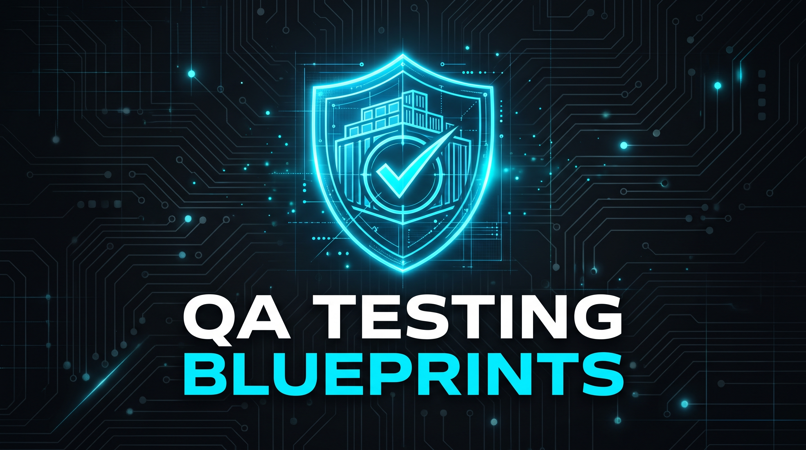
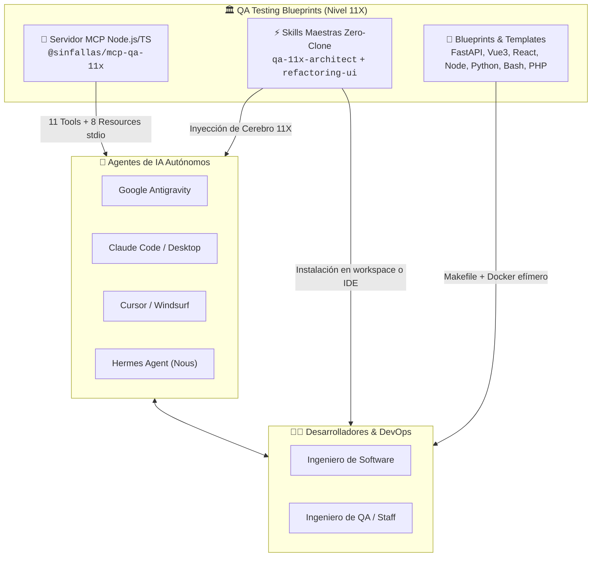

<p align="center">
  
</p>

# QA Testing Blueprints (Estándar Corporativo Nivel 11X)

Bienvenido a **QA Testing Blueprints**, el repositorio central de estándares, arquitecturas de prueba, buenas prácticas de ingeniería y gobernanza para **Agentes de Inteligencia Artificial** (Google Antigravity, Claude Code / Claude Desktop, Hermes Agent de Nous Research, Cursor, Windsurf) y desarrolladores humanos en la creación de software de nivel corporativo.

Este proyecto estandariza la forma en que construimos y validamos software, garantizando que **toda ejecución ocurra estrictamente dentro de contenedores Docker efímeros (`Rule Zero`)**, sin contaminar la máquina local, erradicando la ceguera de mocks mediante motores de base de datos reales y aplicando salvaguardas de seguridad por diseño desde el primer día.

---

## 🚀 Filosofía Principal (Estándar 11X)

1. **Efimeridad Absoluta (Cero Docker Build en Pruebas):** Toda la infraestructura de validación se levanta al vuelo consumiendo nuestra flota de imágenes oficiales en [Docker Hub](https://hub.docker.com/u/sinfallas), junto a motores certificados de base de datos y memoria:
   * [sinfallas/base-python-uv](https://hub.docker.com/r/sinfallas/base-python-uv) (Tags: `3.10` a `3.15`, `latest`).
   * [sinfallas/base-node-ionic](https://hub.docker.com/r/sinfallas/base-node-ionic) (Tags: `22` a `26`, `latest`).
   * [sinfallas/basephpcomposer](https://hub.docker.com/r/sinfallas/basephpcomposer) (Tags: `8.1` a `8.5`, `latest` — Multi-Arch `amd64`/`arm64` con `pcov`, `redis`, `pdo_pgsql`, `intl`, `sodium`).
   * [sinfallas/base-bash-qa](https://hub.docker.com/r/sinfallas/base-bash-qa):latest.
   * [sinfallas/karatelabs](https://hub.docker.com/r/sinfallas/karatelabs):latest para BDD de API y UI en Chrome Headless.
   * [sinfallas/remote-graphify](https://hub.docker.com/r/sinfallas/remote-graphify):latest para Optimización de Contexto IA y Radio de Impacto (Blast Radius).
   * `postgres:17-alpine` y `eqalpha/keydb:alpine` (multi-hilo) con healthchecks nativos.
2. **Dependencias al Vuelo y Aislamiento de Red:** Los paquetes se resuelven en tiempo de ejecución utilizando volúmenes de caché persistentes (`pnpm-store` o `uv-cache`). Las pruebas unitarias tienen prohibido salir a internet; deben aislarse estrictamente.
3. **Validación Transversal Multi-Capa (Métricas Innegociables):**
   * **Cobertura Unitaria:** Ninguna suite pasa con menos del **95.0%**.
   * **Anti-Mock & Anti-Silo Blindness:** Prohibido confiar ciegamente en mocks para persistencia o fronteras entre módulos. Todo cambio de modelo ORM exige migración versionada y validación en base de datos real (`verify_alembic_orm_parity.py`). Toda mutación en un Módulo A debe verificarse consultando sin mocks intermedios los endpoints `GET` de los Módulos B consumidores, probando las **3 fases del reloj** ($t < \text{starts\_at}$, $\text{starts\_at} \le t \le \text{ends\_at}$, $t > \text{ends\_at}$) y prohibiendo mocks ciegos en `write_audit_log` o UUIDs crudos en `actor_username` / `resource_display_name`.
   * **Geometría Visual Anti-JSDOM y Refresco Dual:** Prohibido el uso de footers fijos superpuestos. Verificación de layout in-flow, pruebas interactivas en navegador real (Karate UI / Playwright) e **Invariante de Refresco Dual** (`setInterval` con `clearInterval` en `onUnmounted` + WebSocket + botón manual **`[ 🔄 Refrescar ]`** con `?refresh=true`).
   * **Invariante BDD Karate Labs:** Todo endpoint y vista web DEBE contar con escenarios BDD de aceptación (`api_test.feature` y `ui_business_flow.feature`).
   * **Cero Componentes Huérfanos:** 100% de componentes UI cuentan con pruebas unitarias (`verify_zero_orphan_vue_components.py`).
   * **Deuda Técnica y Mutación:** Complejidad Ciclomática Grado A (`CC <= 5`, `MI >= B`) y pruebas de mutación (Stryker / Mutmut) para eliminar falsos positivos.
   * **Seguridad por Diseño (DISA ASD STIG V6R5 & OWASP):** RLS por tenant en PostgreSQL, anti-SSRF, cifrado AES-256-GCM (FIPS 140-3 + zeroización de memoria), tokens CSRF, cabeceras de idempotencia, gobernanza de sesiones e identidad (timeouts 10m/15m, bloqueo a 3 intentos en tiempo constante, expiración 72h/35d), canonicalización `NFKC`, anti-XXE, validación de archivos por *Magic Bytes*, auditoría forense encadenada con HMAC (alerta al 75% de disco), cabeceras OWASP OSHP, estado *Fail-Secure*, mitigación de OWASP API Security Top 10 (2023), CycloneDX SBOM/CBOM y auditoría preventiva con Trivy.

---

## 🤖 Gobernanza de Agentes de IA (`.agents/`) y Optimización de Tokens

Este repositorio incorpora un sistema completo de directivas y compuertas automáticas para Agentes de IA:

* **Estructura `.agents/`:** Contiene directivas de cumplimiento obligatorio (`rules/`), habilidades especializadas (`skills/`) y scripts deterministas de pre-commit (`scripts/`).
* **Optimización de Tokens ($\approx 35\%$ en Reglas y $65\%–85\%$ en Ejecución):** Las directivas internas para el consumo de los LLMs están redactadas en **inglés técnico de alta densidad**, y todos los scripts operativos (`scripts/*`), validadores (`.agents/scripts/*`), `Makefile` y respuestas JSON del Servidor MCP aplican el patrón **"Pass-Quiet / Fail-Verbose con Telemetría de 1 Línea"** (emitiendo 1 línea con métricas duras en éxito y el detalle completo solo en fallo). Toda la interacción humana y documentación se genera estrictamente en **español** (`OUTPUT LANGUAGE CONSTRAINT`).
* **Compuerta de Certificación Automática:** Los agentes deben ejecutar `./.agents/scripts/certify_task_completion.sh` antes de dar cualquier tarea por terminada.
* **Evolución Continua:** Los agentes tienen mandato de auto-actualizar las directivas ante nuevos descubrimientos (`continuous_agent_evolution.md`).

---

## 📁 Estructura del Repositorio

El repositorio está dividido en ecosistemas tecnológicos listos para ser adoptados:

| Carpeta | Ecosistema | Stack Principal de Validación |
| :--- | :--- | :--- |
| **`python/`** | Scripts Standalone y Librerías | `Ruff` + `Mypy Strict` + `Pytest` + `Pytest-Cov (95%)` + `Bandit` + `Radon` + `Mutmut` |
| **`fastapi/`** | APIs Backend Python | `Ruff` + `Mypy` + `Postgres 17` + `KeyDB` + `Alembic` + `Karate Labs API` + `Locust` + `ZAP` + `Pumba` |
| **`node-backend/`** | Microservicios Node.js | `ESLint` + `Prettier` + `Vitest` + `Stryker` + `SonarJS` + `Karate Labs` + `Artillery` + `ZAP` |
| **`vue3/`** | Frontend Web (Vue 3 / Vite) | `ESLint` + `vue-tsc` + `Vitest (95%)` + `Stryker` + `Playwright` + `@axe-core` + `Lighthouse CI` + `Karate UI` |
| **`react-frontend/`**| Frontend Web (React / Vite) | `ESLint` + `tsc` + `Vitest (95%)` + `RTL` + `Stryker` + `Playwright` + `@axe-core` + `Lighthouse CI` + `Karate UI` |
| **`php/`** | APIs y Backend PHP 8.1–8.5 | `PHP-CS-Fixer` + `PHPStan (Max)` + `Psalm (Taint)` + `Pest/PHPUnit + PCOV (95%)` + `Infection (MSI >= 80%)` + `Karate BDD` |
| **`bash-scripts/`** | Automatización DevOps | `ShellCheck` + `shfmt` + `BATS-core` + `bats-mock` + `kcov` |
| **`mcp-server/`** | Servidor MCP Node.js/TS | Paquete `@sinfallas/mcp-qa-11x`: Servidor MCP (stdio), 8 recursos `blueprint://*`, 11 tools y CLI `install-skill` / `init-agents` |
| **`.agents/`** | Gobernanza de Agentes IA | Reglas (`rules/`), Habilidades (`skills/`) y Scripts de certificación (`scripts/`) |
| **`manifest.json`** | Manifiesto Criptográfico Zero-Clone | Índice criptográfico SHA-256 de verificación remota bajo demanda (DISA STIG `V-222513` / `APSC-DV-001430`) |

---

## 📚 Guías Técnicas y Manuales Operativos

* **[`docs/01_ARQUITECTURA_Y_GOBERNANZA_AGENTES_IA.md`](docs/01_ARQUITECTURA_Y_GOBERNANZA_AGENTES_IA.md):** Manual completo sobre gobernanza de agentes, optimización bimodal de tokens y compatibilidad multi-agente (Antigravity, Claude, Hermes, Cursor).
* **[`docs/02_BUENAS_PRACTICAS_PROGRAMACION_11X.md`](docs/02_BUENAS_PRACTICAS_PROGRAMACION_11X.md):** Guía de arquitectura: Anti-Mock Blindness, Geometría Visual Anti-JSDOM, Seguridad RLS, Bóveda AES-256-GCM, Idempotencia y Motor KeyDB Multi-Hilo.
* **[`docs/03_TIPOS_DE_PRUEBAS_Y_COMO_UTILIZARLOS.md`](docs/03_TIPOS_DE_PRUEBAS_Y_COMO_UTILIZARLOS.md):** La pirámide completa de 13 capas de calidad, con sintaxis de código, comandos Docker y criterios de aprobación.
* **[`docs/04_GUIA_DESARROLLO_SEGURO_Y_MITIGACION_DE_VULNERABILIDADES.md`](docs/04_GUIA_DESARROLLO_SEGURO_Y_MITIGACION_DE_VULNERABILIDADES.md):** Recetario técnico de desarrollo seguro y mitigación de los 22 vectores de ataque y controles normativos (DISA ASD STIG V6R5 + OWASP Developer Guide v4.2) en plataformas híbridas (SPA + API).
* **[`ROADMAP.md`](./ROADMAP.md):** Hoja de ruta maestra por Hitos para la implementación del ecosistema Zero-Clone (`@sinfallas/mcp-qa-11x` en npm + Skill `qa-11x-architect` con hidratación desde GitHub).
* **[`manifest.json`](./manifest.json):** Manifiesto criptográfico indexado con hashes SHA-256 para adopción e hidratación remota Zero-Clone (DISA ASD STIG V6R5 `V-222513` / `APSC-DV-001430`).
* **[`docs/specs/`](docs/specs/):** Especificaciones técnicas detalladas de arquitectura para la Skill, el Servidor MCP en Node.js/TypeScript, el manifiesto criptográfico SHA-256 (`manifest.json`) y la publicación en npm.
* **[`SECURITY.md`](./SECURITY.md):** Política de seguridad corporativa, arquitectura de defensa DevSecOps y reporte responsable.
* **[`TESTING.md`](./TESTING.md):** Cuadro de mando de aseguramiento de calidad, métricas 11X y comandos de validación efímera.
* **[`FAQ.md`](./FAQ.md):** Resolución rápida a dudas frecuentes, discos llenos o fallos de cobertura.
* **[`docs/qa-philosophy.md`](docs/qa-philosophy.md):** La filosofía de calidad y la innegociable regla del 95%.
* **[`docs/ai-integration.md`](docs/ai-integration.md):** Integración autónoma vía Model Context Protocol (MCP).
* **[`docs/ci-cd-pipelines.md`](docs/ci-cd-pipelines.md):** Arquitectura de ejecución y principios de integración continua bajo la Regla Cero.
* **[`docs/docker-troubleshooting.md`](docs/docker-troubleshooting.md):** Diagnóstico de conflictos de red y entornos anidados.

---

## 🔄 Modos de Adopción e Integración (Ecosistema Híbrido Humano + IA)

Este ecosistema está concebido con una arquitectura **Dual-Consumer**: puede ser consumido directamente por **Agentes de Inteligencia Artificial autónomos** mediante el protocolo MCP y Skills Zero-Clone, o adoptado por **desarrolladores humanos e ingenieros de DevOps** de manera tradicional o asistida en cualquier fase del ciclo de vida del software.



---

### 🤖 Modo 1: Agentes de IA vía Servidor MCP (`@sinfallas/mcp-qa-11x`) — Cero Clonación

El servidor canónico MCP en Node.js/TypeScript está publicado en npmjs bajo **`@sinfallas/mcp-qa-11x`** (Node.js 20+). Permite a cualquier agente de IA o IDE conectarse en tiempo real sin clonar el repositorio, accediendo a:

* **8 Recursos Dinámicos (`blueprint://*`):** Manifiesto criptográfico (`blueprint://manifest`), filosofía y prompts (`blueprint://core/philosophy`), síntesis DISA/OWASP (`blueprint://security/disa-owasp-22`), templates por stack (`blueprint://{stack}/readme`), reglas tácticas UI (`blueprint://ui/refactoring-ui/{topic}`) y utilitarios (`blueprint://core/*`).
* **11 Herramientas Autónomas (`Tools`):**
  * `inspect_project_config`: Audita stacks presentes, configuraciones de linters/tipado y disponibilidad de pruebas en navegador real (`BrowserTestingReadiness`).
  * `fetch_blueprint_bundle`: Descarga quirúrgica de plantillas bajo demanda con validación SHA-256.
  * `bootstrap_or_merge_11x`: Aplica fusión no destructiva integrando QA 11X en proyectos vivos.
  * `inspect_ast_blast_radius`: Análisis AST de radio de impacto previo a refactorizaciones.
  * `clean_workspace_11x`: Purga profunda de cachés y artefactos sin requerir `sudo`.
  * `audit_security_stig_owasp`: Auditoría estática de 11 reglas DISA/OWASP (`SEC-01` a `SEC-11`, incluyendo integridad semántica de auditoría anti-UUID y prohibición de mocks ciegos en `write_audit_log`) y ergonomía visual/operativa (`UI-11X-01` y `UI-11X-02`).
  * `run_ephemeral_qa`: Ejecución de pruebas en Docker efímero bajo la Regla Cero con salida JSON.
  * `certify_11x_gate`: Validación de la compuerta universal de certificación de 10 etapas.
  * `audit_test_pyramid_gaps`: Auditoría exhaustiva de las 13 capas de la pirámide 11X (incluyendo Ciclo Temporal de 3 Fases en Capa 13 e Invariante de Refresco Dual en Capa 07), detección de archivos huérfanos, endpoints sin BDD, vistas sin E2E y plan de acción priorizado.
  * `init_or_append_agents_md`: Crea `AGENTS.md` o inyecta de forma aditiva y no destructiva el bloque conector de QA 11X al final de un `AGENTS.md` existente sin modificar reglas previas.
  * `propose_skill_evolution_pr`: Propone mejoras federadas a `qa-testing-blueprints` mediante `gh` CLI local autenticado o generando un archivo de propuesta local y URL prellenada de GitHub (Zero-Trust, 0 tokens empaquetados).
  * `reconcile_agents_governance`: Reconcilia y deduplica reglas en `.agents/` para proyectos adoptantes, podando directivas ya promovidas a `qa-testing-blueprints`, aislando reglas de negocio en `domain_<project>_rules.md` y respaldando en `.agents/backups/<timestamp>/`.

#### Ejecución Directa en 1 Comando:
```bash
# Levantar el servidor MCP canónico (comunicación stdio para Antigravity, Claude, Cursor, Hermes):
npx -y @sinfallas/mcp-qa-11x@latest

# Inyectar o actualizar el conector QA 11X en AGENTS.md de forma aditiva y no destructiva:
npx -y @sinfallas/mcp-qa-11x@latest init-agents [--project-path <ruta>] [--dry-run]

# Reconciliar gobernanza y aislar reglas de dominio de un proyecto consumidor (ej. rosgrid):
npx -y @sinfallas/mcp-qa-11x@latest reconcile-agents [--project-path <ruta>] [--dry-run]
```

#### Configuración en Clientes MCP (Antigravity, Claude Desktop / Code, Cursor, Hermes):
```json
{
  "mcpServers": {
    "qa-11x": {
      "command": "npx",
      "args": ["-y", "@sinfallas/mcp-qa-11x@latest"]
    }
  }
}
```

Consulte la [Guía de Integración con Agentes de IA](docs/ai-integration.md) para detalles completos de configuración y parámetros.

---

### ⚡ Modo 2: Inyección de Skills, Scripts y `AGENTS.md` Zero-Clone en 1 Segundo

Para dotar a cualquier proyecto, agente o desarrollador del catálogo completo de **5 Skills**, los scripts de gobernanza (`.agents/scripts/*`, `scripts/*`) y el conector no destructivo en **`AGENTS.md`** sin clonar el repositorio completo, ejecuta el instalador oficial verificado con SHA-256 (DISA ASD STIG V6R5 `V-222513` / `APSC-DV-001430`):

```bash
# Opción A (Recomendada — instala las 5 skills, descarga los scripts operativos e inicializa/actualiza AGENTS.md):
npx -y @sinfallas/mcp-qa-11x@latest install-skill --init-agents --include-scripts

# Opción B (vía script universal curl con verificación criptográfica SHA-256):
curl -fsSL https://raw.githubusercontent.com/tecno-consultores/qa-testing-blueprints/main/scripts/install-skill.sh | sh
```

El instalador detecta automáticamente el entorno del agente (`auto`: Google Antigravity, Claude, Cursor, Hermes y/o Workspace) e hidrata de forma segura las 5 skills del catálogo:
* **`qa-11x-architect`:** Cerebro metodológico 11X, las 13 capas de la pirámide de calidad, los 22 patrones DISA ASD STIG V6R5 / OWASP v4.2 y directivas especializadas para Python, FastAPI, Node.js, Vue 3, React, PHP 8.1–8.5 y Bash.
* **`refactoring-ui`:** Reglas tácticas de jerarquía visual, WCAG 2.1 AA, contraste OKLCH y `tabular-nums` para `CLS = 0`.
* **`docker-trivy-keydb-hardening`:** Hardening de contenedores Docker (Trivy=0) y motor en memoria KeyDB multi-hilo.
* **`graphify-ast-navigator`:** Navegación del grafo semántico AST, cálculo preventivo de blast radius y cumplimiento de límites de capas.
* **`qa-11x-docker-certifier`:** Certificador corporativo en contenedores Docker efímeros bajo la Regla Cero.

#### Opciones del comando `install-skill`:
| Opción / Flag | Descripción Operativa |
| :--- | :--- |
| `--target, -t <entorno>` | Define el destino de las skills: `auto` (por defecto: autodetecta agentes globales y workspace), `workspace`, `antigravity`, `claude`, `cursor`, `hermes` o `all`. |
| `--init-agents` | Crea `AGENTS.md` en la raíz del proyecto o inyecta de forma aditiva y 100% no destructiva el bloque conector de QA 11X al final de un `AGENTS.md` existente. |
| `--include-scripts` | Descarga e instala en el proyecto actual todos los scripts de certificación y auditoría (`.agents/scripts/*` y `scripts/*`) con permisos de ejecución `0o755`. |

```bash
# Comando completo con todas las opciones explícitas:
npx -y @sinfallas/mcp-qa-11x@latest install-skill --target [auto|workspace|antigravity|claude|cursor|hermes|all] --init-agents --include-scripts
```

---

### 👨‍💻 Modo 3: Adopción Directa en Proyectos (Desarrollador Humano / Uso Asistido)

Si prefieres adoptar o inspeccionar los blueprints directamente en tu propio repositorio:

1. **Copiar Archivos Operativos:** Arrastra a la raíz de tu proyecto el orquestador `docker-compose.qa.yml`, el `Makefile.example` (renómbralo a `Makefile`), los archivos `.example` del ecosistema elegido y la carpeta `.agents/`.
2. **Documentación de Soporte:** Copia la carpeta `docs/` y el archivo `AI_MASTER_PROMPT.md` a tu proyecto (ej. en `docs/qa/` o en la raíz).
3. **Delega la Fusión a tu Agente de IA o Aplícala Manualmente:**
   > *"Lee las directrices en `AI_MASTER_PROMPT.md` y `.agents/README.md`. Necesito integrar el estándar QA 11X en este proyecto. Lee los archivos `.example` y realiza una **fusión quirúrgica no destructiva** con mis archivos de configuración reales. Conserva intactas mis dependencias de negocio y añade todo el stack de linters, tipado estricto y pruebas."*
4. **Verificación Efímera:** Ejecuta `make qa-all` y `./.agents/scripts/certify_task_completion.sh` para certificar el cumplimiento de las 10 compuertas corporativas.
5. **Saneamiento Automático:** Ejecuta `make clean` o `./scripts/limpieza.sh` para purgar artefactos temporales de pruebas y cachés de Docker (con fallback efímero Alpine que elimina archivos `root` sin requerir `sudo` ni dejar bloqueos de permisos).
