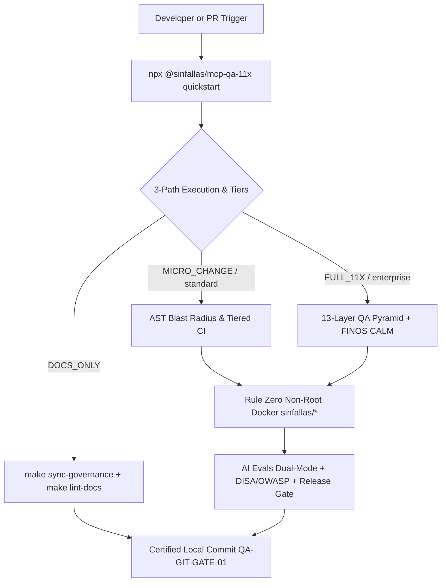

> 🌐 **Language:** **English (Canonical)** · [🇪🇸 Leer en Español](README.es.md)

<p align="center">
  
</p>

# QA Testing Blueprints (`QA-11X v3.10`)

**Zero-Infra Agentic QA, AI Evals & DevSecOps Governance Blueprint**

[](LICENSE)
[](TESTING.md)
[](SECURITY.md)
[-6f42c1)](.agents/skills/qa-11x-architect/SKILL.md)
[](docs/agent-setup.md)
[](architecture/qa-11x.calm.json)

**QA-11X v3.10** turns both **AI Coding Agents** (28 supported agents including Google Antigravity, Claude Code, Cursor, Windsurf, Codex, Copilot, Hermes Agent, and 21 more) and **human engineering teams** into deterministic Staff-level QA & DevSecOps operators. Every check runs inside **ephemeral, non-root Docker containers (`Rule Zero`)** with zero host contamination, enforcing `>= 95%` coverage, real database/contract parity, dual-mode AI evaluations, and **DISA ASD STIG V6R5 + OWASP v4.2** security controls from day one.

---

## ⚡ 30-Second Zero-Friction Quickstart

> [!IMPORTANT]
> **Mandatory Physical Prerequisite — Docker Engine (`Rule Zero` is Non-Negotiable):** Every developer workstation or CI runner **MUST** have an active Docker daemon to run `qa-11x` (`qa-11x doctor` fails hard with `exit 1` if Docker is missing or stopped). Even when delegating SAST/SCA work to external scanners (`Semgrep`, `Trivy`, `CodeQL`) without a live Companion MCP, execution runs **exclusively inside non-root ephemeral containers** (`--rm --restart=no --network none`) serialized under `QA_MAX_CONCURRENT_CONTAINERS=1`.

Bootstrap any repository in 30 seconds without cloning this monorepo:

```bash
# Auto-detect stacks, prompt for tier on TTY (or default to `standard` non-interactively), write .qa-11x.json v3, AGENTS.md & PR workflow:
npx -y @sinfallas/mcp-qa-11x@latest quickstart

# Explicit tier, contextual governance templates, output language policy, agent selection, or dry-run preview:
npx -y @sinfallas/mcp-qa-11x@latest quickstart --tier standard --governance-docs CHANGELOG.md,ROADMAP.md,TESTING.md --lang en --agents auto
npx -y @sinfallas/mcp-qa-11x@latest quickstart --tier enterprise --lang es --dry-run
```

### Add Proportional PR Protection to GitHub Actions

Use the hardened composite action [`.github/actions/qa-11x-pr-check/action.yml`](.github/actions/qa-11x-pr-check/action.yml) in your pull-request workflow:

```yaml
name: QA-11X PR Check
on: [pull_request]
permissions:
  contents: read
jobs:
  qa-11x:
    runs-on: ubuntu-latest
    timeout-minutes: 20
    steps:
      - uses: actions/checkout@fbc6f3992d24b796d5a048ff273f7fcc4a7b6c09 # v5.1.0
        with:
          fetch-depth: 0
      - uses: tecno-consultores/qa-testing-blueprints/.github/actions/qa-11x-pr-check@v3 # sec-ci-action-ref-ok (example tag; pin a 40-char commit SHA in production)
        with:
          tier: standard
          lang: en
```

---

## 🧭 Differential Architecture (`QA-11X v3.10`)



### Progressive Adoption Tiers (`.qa-11x.json` v3)

> **Unified Default & Single-Prompt Onboarding:** Non-interactive runs, CI, and repositories without `.qa-11x.json` default to **`standard`**. Every QA-11X agent session announces `[QA-11X | Tier: <tier> | Path: <DOCS_ONLY|MICRO_CHANGE|FULL_11X>]` and offers one consolidated non-destructive onboarding prompt for unconfirmed tiers or missing/legacy governance templates (`CHANGELOG.md`, `ROADMAP.md`, `TESTING.md`, `SECURITY.md`, `.agents/boundaries.json`, `architecture/calm.json`, ADR-0001, `.github/CODEOWNERS`), persisting `enabled`/`declined`/`legacy_preserved` choices in `.qa-11x.json` v3 so agents never nag twice.

| Tier | Target Adoption | Included Gates & Guarantees |
| :--- | :--- | :--- |
| **`starter`** | Day-1 Adoption (30s) | Zero-plain-text secret scanning, `Rule Zero` container hygiene, `.qa-11x.json` v3, `AGENTS.md` connector across 28 AI coding agents, assisted governance templates, and `DOCS_ONLY` fast-path |
| **`standard`** *(default)* | Daily PR Workflows | Everything in `starter` + `>= 95%` unit coverage, strict types (`mypy --strict`, `tsc`, `PHPStan max`), AST Blast-Radius CI partitioning (`40%–60%` compute savings), and UI anti-pattern linting (`QA-UI-ANTI-001..005`) |
| **`enterprise`** | Regulated Production | Full 13-layer `FULL_11X` pyramid, blocking FINOS CALM architecture validation, PostgreSQL 17 RLS + WORM `seq_num` audit chains, DISA STIG V6R5 / OWASP v4.2, 3-phase clock assertions (`t < starts_at`, `starts_at <= t <= ends_at`, `t > ends_at`), Pact + k6 load, and multi-signal Release Readiness Gate (`GO` / `NO_GO` / `SKIPPED`) |

### Zero-Infra Ephemeral Docker Matrix (`sinfallas/*`)

All runtime, lint, mutation, contract, and BDD suites execute inside non-root containers (`-u "$(id -u):$(id -g)" -e HOME=/tmp`) with **`Trivy HIGH/CRITICAL = 0`**:

| Ephemeral Image | Role in QA-11X v3.10 | Certified Tags & Pre-Baked Tooling |
| :--- | :--- | :--- |
| **[sinfallas/base-python-uv](https://hub.docker.com/r/sinfallas/base-python-uv)** | Python, FastAPI, AI Evals & Vibe-Rescue | `3.11`, `3.12`, `3.13`, `3.14`, `3.15`, `latest` (`uv`, `ruff`, `mypy`, `pytest`, `bandit`, `radon`, `mutmut`, `deepeval`, `pact-python`, `tesseract-ocr`) |
| **[sinfallas/base-node-ionic](https://hub.docker.com/r/sinfallas/base-node-ionic)** | MCP Server, Node, Vue 3, React & CALM | `22`, `24`, `26`, `latest` (`pnpm`, `promptfoo`, `@finos/calm-cli`, `playwright`, `@axe-core/playwright`, `@pact-foundation/pact`) |
| **[sinfallas/base-mobile-appium](https://hub.docker.com/r/sinfallas/base-mobile-appium)** | Native & Hybrid Mobile W3C Bridge (Android/iOS) | `26`, `latest` (`Node.js 26`, `pnpm`, `OpenJDK 21`, `Android SDK/ADB`, `Appium 3`, `uiautomator2`, `xcuitest`, `WebdriverIO v9`) |
| **[sinfallas/basephpcomposer](https://hub.docker.com/r/sinfallas/basephpcomposer)** | PHP 8.2–8.5 APIs & Services | `8.2`, `8.3`, `8.4`, `8.5`, `latest` (`pcov`, `phpstan`, `psalm`, `pest`, `phpunit`, `infection`) |
| **[sinfallas/karatelabs](https://hub.docker.com/r/sinfallas/karatelabs)** | API & HTTP/Edge/OSHP/XML BDD Contracts | `1.5.1` (Java + Maven + Karate JUnit5; proportional to stateful multi-service `FULL_11X` flows) |
| **[sinfallas/base-bash-qa](https://hub.docker.com/r/sinfallas/base-bash-qa)** | DevOps & POSIX Shell Scripts | `latest` (`ShellCheck`, `shfmt`, `BATS-core`, `bats-mock`, `kcov`) |
| **[sinfallas/remote-graphify](https://hub.docker.com/r/sinfallas/remote-graphify)** | AST Context Optimization & Blast Radius | `latest` (`graphify` Tree-sitter AST graph & cluster extraction) |
| **Infra, Security & Load Engines** | Live DB, Cache, DAST, Chaos & Load | `postgres:17-alpine`, `eqalpha/keydb@sha256:6537505c42355ca1f571276bddf83f5b750f760f07b2a185a676481791e388ac` (`v6.3.4` multi-arch), `aquasec/trivy:0.76.2`, `zaproxy/zap-stable:2.15.0`, `gaiaadm/pumba:0.10.1`, `prom/prometheus:v2.55.1`, `grafana/k6:2.4.0` |

---

## 🗂️ Full-Stack, Mobile, AI Evals & Vibe-Rescue Blueprints

The matrix covers **10 hydratable stacks** (`python`, `fastapi`, `node-backend`, `vue3`, `react-frontend`, `bash-scripts`, `php`, `mobile-appium`, `ai-evals`, `vibe-rescue`) plus **`architecture/`** (FINOS CALM topology) and **`mcp-server/`** (`@sinfallas/mcp-qa-11x`), forming the **12 matrix environments**:

| Directory | Domain | Key Capabilities (QA-11X v3.10) |
| :--- | :--- | :--- |
| **[`fastapi/`](fastapi/)** | Python Async APIs | Ruff, Mypy strict, PostgreSQL 17 RLS + Alembic parity, Pact V4 consumer ([`test_pact_consumer.py`](fastapi/tests/contracts/test_pact_consumer.py)), k6 smoke load ([`smoke.k6.js`](fastapi/tests/load/smoke.k6.js)), Karate BDD |
| **[`python/`](python/)** | Python Libraries & CLIs | UV, Ruff (`CC <= 5`), Mypy strict, Pytest `>= 95%`, Hypothesis, Mutmut (`MSI >= 80%`), Bandit |
| **[`node-backend/`](node-backend/)** | Node.js / TS Microservices | ESLint `--max-warnings 0`, Vitest `>= 95%`, Pact V4 provider verifier ([`provider.pact.test.ts`](node-backend/tests/contracts/provider.pact.test.ts)), Stryker, ZAP |
| **[`vue3/`](vue3/)** | Vue 3 + Vite Frontends | Screenplay [`Actor.ts`](vue3/tests/screenplay/Actor.ts), Self-Healing DOM [`semanticLocator.ts`](vue3/tests/utils/semanticLocator.ts), Vitest `>= 95%`, `@axe-core`, Lighthouse CI |
| **[`react-frontend/`](react-frontend/)** | React + Vite Frontends | Screenplay [`Actor.ts`](react-frontend/tests/screenplay/Actor.ts), Self-Healing DOM [`semanticLocator.ts`](react-frontend/tests/utils/semanticLocator.ts), RTL, Playwright, `@axe-core` |
| **[`php/`](php/)** | PHP 8.2–8.5 Services | PHP-CS-Fixer, PHPStan Level Max, Psalm Taint Analysis, Pest/PHPUnit + PCOV `>= 95%`, Infection |
| **[`bash-scripts/`](bash-scripts/)** | POSIX / Bash Automation | ShellCheck, shfmt, BATS-core, `bats-mock`, `kcov >= 95%` |
| **[`mobile-appium/`](mobile-appium/)** | Native & Hybrid Mobile | Appium 3 / W3C + WebdriverIO ([`wdio.conf.ts`](mobile-appium/wdio.conf.ts)), [`MobileActor.ts`](mobile-appium/tests/screenplay/MobileActor.ts) (Android, iOS, Ionic, RN) |
| **[`ai-evals/`](ai-evals/)** | Dual-Mode AI & Multimodal QA | RAG faithfulness, Promptfoo OWASP LLM Top 10, WebRTC voice latency ([`test_voice_websocket_latency.py`](ai-evals/voice-realtime/test_voice_websocket_latency.py)), PDF/OCR `Decimal` ([`test_pdf_table_fidelity.py`](ai-evals/multimodal-ocr/test_pdf_table_fidelity.py)), [`golden_from_traces.py`](ai-evals/golden_from_traces.py) |
| **[`vibe-rescue/`](vibe-rescue/)** | Vibe-to-Enterprise Hardening | [`audit_vibe_prototype.py`](vibe-rescue/audit_vibe_prototype.py) (`VIBE-SEC-001..QA-005`), PostgreSQL 17 RLS/WORM template ([`rls_hardening.sql`](vibe-rescue/templates/rls_hardening.sql)) |
| **[`architecture/`](architecture/README.md)** | Architecture-as-Code | Blocking FINOS CALM topology ([`qa-11x.calm.json`](architecture/qa-11x.calm.json)) & 7 mandatory 11X controls (`make validate-calm`) |
| **[`mcp-server/`](mcp-server/)** | `@sinfallas/mcp-qa-11x` | Node.js MCP server (`stdio`), 12 CLI subcommands (`quickstart`, `install-skill`, `init-agents`, `reconcile-agents`, `tms-sync`, `doctor`, `upgrade`, `certify`, `audit`, `blast-radius`, `mcp-config`, `completion`) & A2A `v1.0` agent card |

---

## 🛠 Testing Tools Matrix

Below is the corporate validation stack summarized across all **12 matrix environments** (**10 hydratable stacks** + `architecture/` + `mcp-server/`) and test type. `N/A` indicates test categories that do not apply due to the intrinsic nature of the environment (e.g. a standalone Python CLI, Bash script, or declarative architecture topology does not expose an HTTP server, so DAST and Chaos Engineering do not apply).

| Environment | Linting / Formatting | Unit Tests / Mocking | Coverage | Dependency Audit | Static Security (SAST) | Mutation | BDD / Black-Box | Concurrency / Stress | Profiling / Complexity | DAST (Dynamic) | Chaos Engineering | Observability (Metrics) | IaC / Docker Audit | Local Git Hooks |
| :--- | :--- | :--- | :--- | :--- | :--- | :--- | :--- | :--- | :--- | :--- | :--- | :--- | :--- | :--- |
| **Python** (`python/`) | `Ruff` + `Mypy (Strict)` | `Pytest` + `pytest-mock` | `Pytest-Cov (>= 95%)` | `pip-audit` + `CycloneDX SBOM` | `Bandit` | `Mutmut (>= 80%)` | `pytest-bdd` + `pact-python` | `k6` (`make qa-load`) | `py-spy` + `Radon (CC <= A)` | `N/A` | `N/A` | `Pushgateway` + `Prometheus` | `Trivy` + `verificar-secretos.sh` | `Lefthook` |
| **FastAPI** (`fastapi/`) | `Ruff` + `Mypy (Strict)` | `Pytest` + `pytest-asyncio` + `respx` + `PostgreSQL 17` + `KeyDB` + `Alembic` | `Pytest-Cov (>= 95%)` | `pip-audit` + `CycloneDX SBOM` | `Bandit` | `Mutmut (>= 80%)` | `Karate Labs` + `Schemathesis` + `Pact V4` | `Locust (Headless)` + `k6` | `py-spy` / `memray` + `Radon (CC <= A)` | `OWASP ZAP Baseline` | `Pumba` | `prometheus-fastapi-instrumentator` + `Prometheus` | `Trivy` + `verificar-secretos.sh` | `Lefthook` |
| **Node Backend** (`node-backend/`) | `ESLint (--max-warnings 0)` + `Prettier` + `tsc` | `Vitest` + `Supertest` + `Nock` | `@vitest/coverage-v8 (>= 95%)` | `pnpm audit` + `@cyclonedx/cyclonedx-npm` + `.npmrc` | `eslint-plugin-security` | `Stryker (>= 80%)` | `Karate Labs` + `Pact V4` | `Artillery` | `Clinic.js` + `SonarJS (<= 15)` | `OWASP ZAP Baseline` | `Pumba` | `express-prom-bundle` + `Prometheus` | `Trivy` + `verificar-secretos.sh` | `Lefthook` |
| **Vue 3** (`vue3/`) | `ESLint (--max-warnings 0)` + `Prettier` + `vue-tsc` | `Vitest` + `Vue Test Utils` + `Screenplay` + `Playwright` + `@axe-core` | `@vitest/coverage-v8 (>= 95%)` | `pnpm audit` + `.npmrc (ignore-scripts=true)` | `eslint-plugin-security` | `Stryker (>= 80%)` | `Karate Labs (HTTP/OSHP)` + `Playwright UI` | `N/A` | `Lighthouse CI` + `SonarJS (<= 15)` | `N/A` | `N/A` | `nginx-prometheus-exporter` + `Prometheus` | `Trivy` + `verificar-secretos.sh` | `Lefthook` |
| **React** (`react-frontend/`) | `ESLint (--max-warnings 0)` + `Prettier` + `tsc` | `Vitest` + `React Testing Library` + `Screenplay` + `Playwright` + `@axe-core` | `@vitest/coverage-v8 (>= 95%)` | `pnpm audit` + `.npmrc (ignore-scripts=true)` | `eslint-plugin-security` + `react-hooks` | `Stryker (>= 80%)` | `Karate Labs (HTTP/OSHP)` + `Playwright UI` | `N/A` | `Lighthouse CI` + `SonarJS (<= 15)` | `N/A` | `N/A` | `nginx-prometheus-exporter` + `Prometheus` | `Trivy` + `verificar-secretos.sh` | `Lefthook` |
| **PHP 8.2–8.5** (`php/`) | `PHP-CS-Fixer (@PER-CS2.0)` + `PHPStan (Level Max)` | `Pest` / `PHPUnit 11.5+` + `MockHandler` + `PostgreSQL 17` + `KeyDB` | `PCOV (>= 95%)` | `composer audit` + `roave/security-advisories` + `CycloneDX SBOM` | `Psalm (--taint-analysis)` | `Infection (MSI >= 80%)` | `Karate Labs` + `OpenAPI` | `k6` (`make qa-load`) | `tomasvotruba/cognitive-complexity (<= 9)` | `OWASP ZAP Baseline` | `Pumba` | `promphp/prometheus_client_php` + `Prometheus` | `Trivy` + `verificar-secretos.sh` | `Lefthook` |
| **Bash** (`bash-scripts/`) | `ShellCheck` + `shfmt` | `BATS-core` + `bats-support` + `bats-assert` + `bats-file` + `bats-mock` | `kcov (>= 95%)` | `N/A` | `ShellCheck` | `N/A` | `N/A` | `N/A` | `hyperfine` + `time -v` | `N/A` | `N/A` | `Pushgateway` + `Prometheus` | `Trivy` + `verificar-secretos.sh` | `Lefthook` |
| **Mobile Appium** (`mobile-appium/`) | `tsc --strict` (offline) + `ESLint` / `Prettier` | `WebdriverIO v9` + `MobileActor` Screenplay (W3C Bridge, Android/iOS/Ionic/RN) | `node:test` (`--experimental-test-coverage` / `lcov >= 95%`) | `pnpm audit` + `.npmrc` + `CycloneDX SBOM` | `eslint-plugin-security` + Deep-Link / Biometry guards | `N/A` | `Appium 3 (uiautomator2/xcuitest)` + `Karate BFF` | `N/A` | `CC <= 5` + Fail-Verbose `/tmp` Traces | `N/A` (delegated to BFF `OWASP ZAP`) | `N/A` (Offline Sync & Biometry toggle) | `Allure JSON Fail-Verbose` (`/tmp`) | `Trivy` + `verificar-secretos.sh` (`sinfallas/base-mobile-appium:26`) | `Lefthook` |
| **AI Evals** (`ai-evals/`) | `Ruff (CC <= 5)` + `Mypy (Strict)` | `Pytest asyncio` + `DeepEval` + WebRTC Voice + PDF/OCR `Decimal` | `Pytest-Cov (>= 95%)` | `pip-audit` + `CycloneDX SBOM` | `Bandit` + `Promptfoo OWASP LLM Top 10` | `N/A` | `DeepEval` + `Promptfoo` (Offline + Live) | `WebRTC TTFB <= 500ms` | `Radon (CC <= A)` + `golden_from_traces.py` | `Promptfoo LLM Red-Team` | `N/A` | `JSON Eval Trajectory Trace` | `Trivy` + `verificar-secretos.sh` | `Lefthook` |
| **Vibe Rescue** (`vibe-rescue/`) | `Ruff (CC <= 5)` + `Mypy (Strict)` | `Pytest` + `audit_vibe_prototype.py` (`VIBE-SEC-001..QA-005`) | `Pytest-Cov (>= 95%)` | `pip-audit` + `rls_hardening.sql` | `Bandit` + `RLS / AES-256-GCM / WORM` | `N/A` | `QA-11X 10/10 Rescue Gate` | `N/A` | `Radon (CC <= 5)` | `OWASP ZAP (post-rescue)` | `N/A` | `Finding State Tracker JSON` | `Trivy` + `verificar-secretos.sh` | `Lefthook` |
| **Architecture** (`architecture/`) | `AJV CLI / CALM` (`validate_calm_architecture.sh`) | `CALM Schema & 7-Control Verification (qa-11x.calm.json)` | `N/A` | `CALM Control Integrity` | `7 Blocking Architecture Controls (RLS/WORM/mTLS)` | `N/A` | `FINOS CALM Architecture Gate` | `N/A` | `Graphify AST Coupling / Layer Check` | `N/A` | `N/A` | `CALM Validation Report` | `Trivy` + `verificar-secretos.sh` | `Lefthook` |
| **MCP Server** (`mcp-server/`) | `ESLint 9 (--max-warnings 0)` + `tsc` | `Vitest` + `run-example-e2e.mjs` (Clean-Room `stdio`) | `@vitest/coverage-v8 (>= 95%)` | `pnpm audit` + `.npmrc (ignore-scripts=true)` | `eslint-plugin-security` + `promptGuard` + `audit_security_stig_owasp` | `N/A` | `Karate Labs (mcp_cli_test.feature)` | `N/A` | `SonarJS (<= 15)` | `N/A` | `N/A` | `Pass-Quiet Telemetry & PR_VERDICT SHA-256` | `Trivy` + `verificar-secretos.sh` | `Lefthook` |

---

## 🛡️ Dual-Mode AI Evals, Local LLMs & Security Shield

1. **Mode 1 — Zero-Cost Deterministic Offline Contracts (`make test-ai-offline`):**
   - Runs hermetic RAG, agent-trajectory, WebRTC voice (`TTFB p95 <= 500ms`), and OCR `Decimal` table checks with stubbed judges (`>= 95%` coverage, `CC <= 5`, `mypy --strict`) at `$0` API cost.
   - Protects MCP tool execution fail-closed via [`promptGuard.ts`](mcp-server/src/security/promptGuard.ts) (`NFKC` canonicalization, zero-width/Trojan Source sanitization, prompt-injection & `QA-GIT-GATE-01` bypass prevention, PII/secret redaction using `<EXAMPLE_REDACTED>` placeholders).
   - Compresses long transcripts deterministically with [`.agents/scripts/compact_context_11x.py`](.agents/scripts/compact_context_11x.py) and supports air-gapped **Ollama / vLLM** profiles plus **A2A Agent Card** discovery ([`agentCard.ts`](mcp-server/src/a2a/agentCard.ts), [`docs/specs/14_LOCAL_LLM_AND_A2A_PROFILES.md`](docs/specs/14_LOCAL_LLM_AND_A2A_PROFILES.md)).
2. **Mode 2 — On-Demand Probabilistic & Red-Team Audits (`make audit-llm`):**
   - Executes **DeepEval** (`GEval`, `TaskCompletionMetric`, faithfulness) and **Promptfoo** OWASP LLM Top 10 red-teaming against configured cloud providers or local Ollama/vLLM endpoints (`SKIPPED_MISSING_CREDENTIALS` when credentials are absent in CI).

---

## 🤖 11 Modular Skills (`< 20 KB`), MCP Server & 28 AI Agents

* **Progressive Skill Routing (`< 20 KB` budget):** Led by [`.agents/skills/qa-11x-architect/SKILL.md`](.agents/skills/qa-11x-architect/SKILL.md) (`<= 12 KB`, `10` on-demand references incl. SDD/EARS), loading 10 specialized sub-skills on demand (`qa-11x-devsecops-hardener`, `qa-11x-systematic-debugging`, `qa-11x-screenplay-builder`, `qa-11x-llm-evaluator`, `qa-11x-vibe-rescue`, `qa-11x-docker-certifier`, `docker-trivy-keydb-hardening`, `graphify-ast-navigator`, `refactoring-ui`, and JIT [`tactical-patterns-11x`](.agents/skills/tactical-patterns-11x/SKILL.md) `<= 2.5 KB` injected via `[DIRECTIVE-11X]`) and installable natively via [`.claude-plugin/plugin.json`](.claude-plugin/plugin.json) + [`.claude-plugin/marketplace.json`](.claude-plugin/marketplace.json).
* **Public MCP Surface (`@sinfallas/mcp-qa-11x` v3.10.0):** Exposes **19 Tools** and **13 Resources** (`blueprint://*`, including `blueprint://{stack}/readme` across all **10 hydratable stacks**: `python`, `fastapi`, `node-backend`, `vue3`, `react-frontend`, `bash-scripts`, `php`, `mobile-appium`, `ai-evals`, `vibe-rescue`) over `stdio` — combining 12 core v1 tools + 6 v2.0 evaluators + **v3.1** atomic Flight Recorder `session_flight_recorder` (`session_checkpoint.json` `0600` -> `.agents/ACTIVE_TASK.md`) and **v3.1** `blueprint://skills/tactical-patterns-11x` (`11` modular skills total), protected end-to-end by `promptGuard`, `TaskStateGuard`, and **v3.7** Docker anti-saturation guardrails (`QA_MAX_CONCURRENT_CONTAINERS=1`, `COMPOSE_PARALLEL_LIMIT=1`, passive Linux thermal/RAM guard `exit_code=75`, CrashLoop pre-flight remediation, static rule #37 `QA-DOCKER-LOOP-01`, and `qa-11x doctor` `docker_health` telemetry).
* **Human-Confirmed Git Closure (`QA-GIT-GATE-01`):** Enforced by [`.agents/rules/git_closure_gate.md`](.agents/rules/git_closure_gate.md) — agents certify locally via `make certify` and stop at a local `git commit`; automatic `git push` or `npm publish` is strictly forbidden.
* **Setup & Catalog Guides:** See [`docs/agent-setup.md`](docs/agent-setup.md) (English), [`docs/agent-setup.es.md`](docs/agent-setup.es.md) (Spanish), [`server.json`](server.json) (Official MCP Registry: `io.github.tecno-consultores/mcp-qa-11x`), [`RESOURCES.md`](RESOURCES.md), [`llms.txt`](llms.txt) (GEO index), [`catalogs/`](catalogs/agenticskills-submission.md) ([QASkills](catalogs/qaskills-pack.json), [SkillsLLM](catalogs/skillsllm-manifest.json)), [`docs/01_ARQUITECTURA_PIRAMIDE_11X.md`](docs/01_ARQUITECTURA_PIRAMIDE_11X.md), [`TESTING.md`](TESTING.md), [`SECURITY.md`](SECURITY.md), and [`ROADMAP.md`](ROADMAP.md).

```bash
# Install global skills, operational scripts, and thin AGENTS.md connector across detected IDEs:
npx -y @sinfallas/mcp-qa-11x@latest install-skill --init-agents --include-scripts --reconcile
```

---

## 📄 Author, Copyright & License

* **Author:** Jesus Palencia (`<sinfallas@gmail.com>`)
* **Copyright:** `Copyright (C) 2026 Jesus Palencia <sinfallas@gmail.com> (Creado en Tecno Consultores)`
* **License:** Distributed under the [MIT License](LICENSE).
