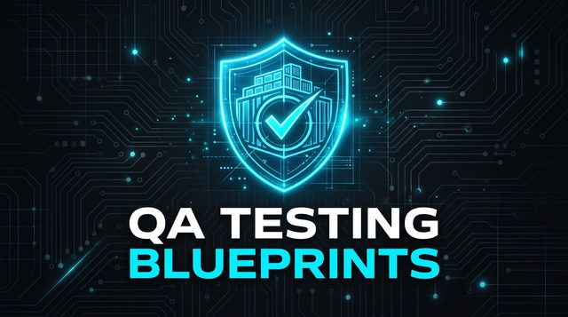
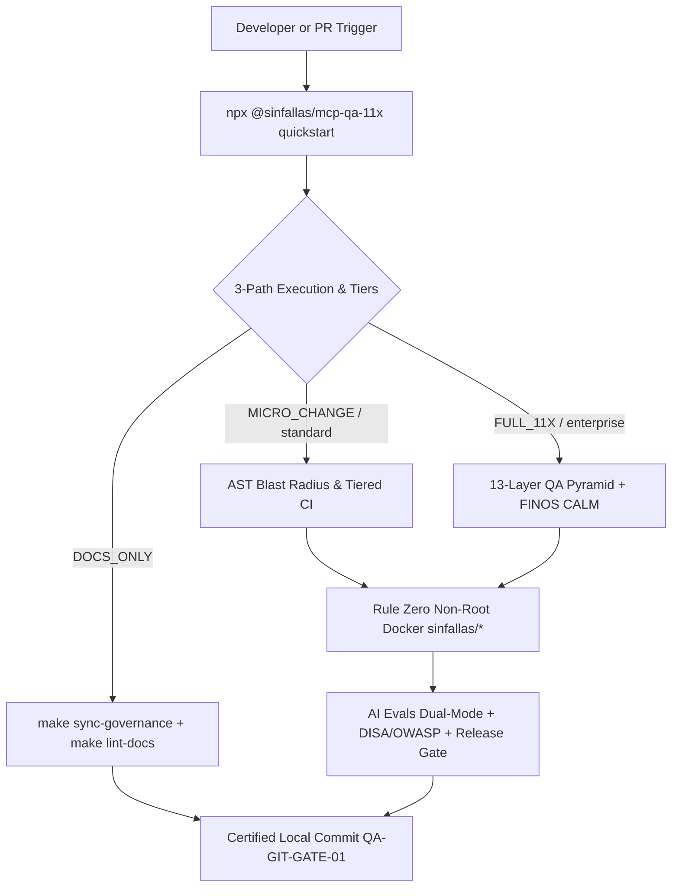

> 🌐 Language: **English** | [Español](README.es.md)

<p align="center">
  
</p>

# QA Testing Blueprints (`QA-11X v2.0`)

**Zero-Infra Agentic QA, AI Evals & DevSecOps Governance Blueprint**

[](LICENSE)
[](TESTING.md)
[](SECURITY.md)
[-6f42c1)](.agents/skills/qa-11x-architect/SKILL.md)
[](docs/agent-setup.en.md)
[](architecture/qa-11x.calm.json)

**QA-11X v2.0** turns both **AI Coding Agents** (Google Antigravity, Claude Code, Cursor, Windsurf, Codex, Copilot, Hermes Agent, and 20+ more) and **human engineering teams** into deterministic Staff-level QA & DevSecOps operators. Every check runs inside **ephemeral, non-root Docker containers (`Rule Zero`)** with zero host contamination, enforcing `>= 95%` coverage, real database/contract parity, dual-mode AI evaluations, and **DISA ASD STIG V6R5 + OWASP v4.2** security controls from day one.

---

## ⚡ 30-Second Zero-Friction Quickstart

Bootstrap any repository in 30 seconds without cloning this monorepo:

```bash
# Auto-detect stacks & vibe-coded markers, configure .qa-11x.json, AGENTS.md, ACTIVE_TASK.md & PR workflow:
npx -y @sinfallas/mcp-qa-11x@latest quickstart

# Explicit tier, output language policy, agent selection, or dry-run preview:
npx -y @sinfallas/mcp-qa-11x@latest quickstart --tier standard --lang en --agents auto
npx -y @sinfallas/mcp-qa-11x@latest quickstart --tier enterprise --lang es --dry-run
```

### Add Proportional PR Protection to GitHub Actions

Use the hardened composite action [`.github/actions/qa-11x-pr-check/action.yml`](.github/actions/qa-11x-pr-check/action.yml) in your pull-request workflow:

```yaml
name: QA-11X PR Check
on: [pull_request]
permissions:
  contents: read
jobs:
  qa-11x:
    runs-on: ubuntu-latest
    timeout-minutes: 20
    steps:
      - uses: actions/checkout@11bd71901bbe5b1630ceea73d27597364c9af683
        with:
          fetch-depth: 0
      - uses: tecno-consultores/qa-testing-blueprints/.github/actions/qa-11x-pr-check@v2
        with:
          tier: standard
          lang: en
```

---

## 🧭 Differential Architecture (`QA-11X v2.0`)



### Progressive Adoption Tiers

| Tier | Target Adoption | Included Gates & Guarantees |
| :--- | :--- | :--- |
| **`starter`** | Day-1 Adoption (30s) | Zero-plain-text secret scanning, `Rule Zero` container hygiene, `.qa-11x.json`, `AGENTS.md` connector across 27+ AI coding agents, and `DOCS_ONLY` fast-path |
| **`standard`** | Daily PR Workflows | Everything in `starter` + `>= 95%` unit coverage, strict types (`mypy --strict`, `tsc`, `PHPStan max`), AST Blast-Radius CI partitioning (`40%–60%` compute savings), and UI anti-pattern linting (`QA-UI-ANTI-001..005`) |
| **`enterprise`** | Regulated Production | Full 13-layer `FULL_11X` pyramid, blocking FINOS CALM architecture validation, PostgreSQL 17 RLS + WORM `seq_num` audit chains, DISA STIG V6R5 / OWASP v4.2, 3-phase clock assertions (`t < starts_at`, `starts_at <= t <= ends_at`, `t > ends_at`), Pact + k6 load, and multi-signal Release Readiness Gate (`GO` / `NO_GO` / `SKIPPED`) |

### Zero-Infra Ephemeral Docker Matrix (`sinfallas/*`)

All runtime, lint, mutation, contract, and BDD suites execute inside non-root containers (`-u "$(id -u):$(id -g)" -e HOME=/tmp`) with **`Trivy HIGH/CRITICAL = 0`**:

| Ephemeral Image | Role in QA-11X v2.0 | Certified Tags & Pre-Baked Tooling |
| :--- | :--- | :--- |
| **[sinfallas/base-python-uv](https://hub.docker.com/r/sinfallas/base-python-uv)** | Python, FastAPI, AI Evals & Vibe-Rescue | `3.11`, `3.12`, `3.13`, `3.14`, `3.15`, `latest` (`uv`, `ruff`, `mypy`, `pytest`, `bandit`, `radon`, `mutmut`, `deepeval`, `pact-python`, `tesseract-ocr`) |
| **[sinfallas/base-node-ionic](https://hub.docker.com/r/sinfallas/base-node-ionic)** | MCP Server, Node, Vue 3, React, Mobile & CALM | `22`, `24`, `26`, `latest` (`pnpm`, `promptfoo`, `@finos/calm-cli`, `appium`, `playwright`, `@axe-core/playwright`, `@pact-foundation/pact`) |
| **[sinfallas/basephpcomposer](https://hub.docker.com/r/sinfallas/basephpcomposer)** | PHP 8.2–8.5 APIs & Services | `8.2`, `8.3`, `8.4`, `8.5`, `latest` (`pcov`, `phpstan`, `psalm`, `pest`, `phpunit`, `infection`) |
| **[sinfallas/karatelabs](https://hub.docker.com/r/sinfallas/karatelabs)** | API & Chrome Headless UI BDD Contracts | `1.5.1` / `11x-v2-local` (Java + Maven + Karate JUnit5; proportional to stateful multi-service `FULL_11X` flows) |
| **[sinfallas/base-bash-qa](https://hub.docker.com/r/sinfallas/base-bash-qa)** | DevOps & POSIX Shell Scripts | `latest` (`ShellCheck`, `shfmt`, `BATS-core`, `bats-mock`, `kcov`) |
| **[sinfallas/remote-graphify](https://hub.docker.com/r/sinfallas/remote-graphify)** | AST Context Optimization & Blast Radius | `latest` (`graphify` Tree-sitter AST graph & cluster extraction) |
| **Infra & Load Engines** | Live DB, Cache & Smoke Load | `postgres:17-alpine`, `eqalpha/keydb:alpine`, `grafana/k6:2.4.0` |

---

## 🗂️ Full-Stack, Mobile, AI Evals & Vibe-Rescue Blueprints

| Directory | Domain | Key v2.0 Capabilities |
| :--- | :--- | :--- |
| **[`fastapi/`](fastapi/)** | Python Async APIs | Ruff, Mypy strict, PostgreSQL 17 RLS + Alembic parity, Pact V4 consumer ([`test_pact_consumer.py`](fastapi/tests/contracts/test_pact_consumer.py)), k6 smoke load ([`smoke.k6.js`](fastapi/tests/load/smoke.k6.js)), Karate BDD |
| **[`python/`](python/)** | Python Libraries & CLIs | UV, Ruff (`CC <= 5`), Mypy strict, Pytest `>= 95%`, Hypothesis, Mutmut (`MSI >= 80%`), Bandit |
| **[`node-backend/`](node-backend/)** | Node.js / TS Microservices | ESLint `--max-warnings 0`, Vitest `>= 95%`, Pact V4 provider verifier ([`provider.pact.test.ts`](node-backend/tests/contracts/provider.pact.test.ts)), Stryker, ZAP |
| **[`vue3/`](vue3/)** | Vue 3 + Vite Frontends | Screenplay [`Actor.ts`](vue3/tests/screenplay/Actor.ts), Self-Healing DOM [`semanticLocator.ts`](vue3/tests/utils/semanticLocator.ts), Vitest `>= 95%`, `@axe-core`, Lighthouse CI |
| **[`react-frontend/`](react-frontend/)** | React + Vite Frontends | Screenplay [`Actor.ts`](react-frontend/tests/screenplay/Actor.ts), Self-Healing DOM [`semanticLocator.ts`](react-frontend/tests/utils/semanticLocator.ts), RTL, Playwright, `@axe-core` |
| **[`php/`](php/)** | PHP 8.2–8.5 Services | PHP-CS-Fixer, PHPStan Level Max, Psalm Taint Analysis, Pest/PHPUnit + PCOV `>= 95%`, Infection |
| **[`bash-scripts/`](bash-scripts/)** | POSIX / Bash Automation | ShellCheck, shfmt, BATS-core, `bats-mock`, `kcov >= 95%` |
| **[`mobile-appium/`](mobile-appium/)** | Native & Hybrid Mobile | Appium 2 + WebdriverIO ([`wdio.conf.ts`](mobile-appium/wdio.conf.ts)), [`MobileActor.ts`](mobile-appium/tests/screenplay/MobileActor.ts) (Android, iOS, Ionic, RN) |
| **[`ai-evals/`](ai-evals/)** | Dual-Mode AI & Multimodal QA | RAG faithfulness, Promptfoo OWASP LLM Top 10, WebRTC voice latency ([`test_voice_websocket_latency.py`](ai-evals/voice-realtime/test_voice_websocket_latency.py)), PDF/OCR `Decimal` ([`test_pdf_table_fidelity.py`](ai-evals/multimodal-ocr/test_pdf_table_fidelity.py)), [`golden_from_traces.py`](ai-evals/golden_from_traces.py) |
| **[`vibe-rescue/`](vibe-rescue/)** | Vibe-to-Enterprise Hardening | [`audit_vibe_prototype.py`](vibe-rescue/audit_vibe_prototype.py) (`VIBE-SEC-001..QA-005`), PostgreSQL 17 RLS/WORM template ([`rls_hardening.sql`](vibe-rescue/templates/rls_hardening.sql)) |
| **[`architecture/`](architecture/qa-11x.calm.json)** | Architecture-as-Code | Blocking FINOS CALM topology & 7 mandatory 11X controls (`make validate-calm`) |
| **[`mcp-server/`](mcp-server/)** | `@sinfallas/mcp-qa-11x` | Node.js MCP server (`stdio`), `quickstart`, `install-skill`, `init-agents`, `reconcile-agents`, TMS sync & A2A agent card |

---

## 🛡️ Dual-Mode AI Evals, Local LLMs & Security Shield

1. **Mode 1 — Zero-Cost Deterministic Offline Contracts (`make test-ai-offline`):**
   - Runs hermetic RAG, agent-trajectory, WebRTC voice (`TTFB p95 <= 500ms`), and OCR `Decimal` table checks with stubbed judges (`>= 95%` coverage, `CC <= 5`, `mypy --strict`) at `$0` API cost.
   - Protects MCP tool execution fail-closed via [`promptGuard.ts`](mcp-server/src/security/promptGuard.ts) (`NFKC` canonicalization, zero-width/Trojan Source sanitization, prompt-injection & `QA-GIT-GATE-01` bypass prevention, PII/secret redaction using `<EXAMPLE_REDACTED>` placeholders).
   - Compresses long transcripts deterministically with [`.agents/scripts/compact_context_11x.py`](.agents/scripts/compact_context_11x.py) and supports air-gapped **Ollama / vLLM** profiles plus **A2A Agent Card** discovery ([`agentCard.ts`](mcp-server/src/a2a/agentCard.ts), [`docs/specs/14_LOCAL_LLM_AND_A2A_PROFILES.md`](docs/specs/14_LOCAL_LLM_AND_A2A_PROFILES.md)).
2. **Mode 2 — On-Demand Probabilistic & Red-Team Audits (`make audit-llm`):**
   - Executes **DeepEval** (`GEval`, `TaskCompletionMetric`, faithfulness) and **Promptfoo** OWASP LLM Top 10 red-teaming against configured cloud providers or local Ollama/vLLM endpoints (`SKIPPED_NO_LLM_SECRETS_CONFIGURED` when credentials are absent in CI).

---

## 🤖 10 Modular Skills (`< 20 KB`), MCP Server & 27+ AI Agents

* **Progressive Skill Routing (`< 20 KB` budget):** Led by [`.agents/skills/qa-11x-architect/SKILL.md`](.agents/skills/qa-11x-architect/SKILL.md) (`< 12 KB`), loading 9 specialized sub-skills on demand (`qa-11x-devsecops-hardener`, `qa-11x-systematic-debugging`, `qa-11x-screenplay-builder`, `qa-11x-llm-evaluator`, `qa-11x-vibe-rescue`, `qa-11x-docker-certifier`, `docker-trivy-keydb-hardening`, `graphify-ast-navigator`, `refactoring-ui`).
* **Public MCP Surface (`@sinfallas/mcp-qa-11x`):** Exposes **12 Tools** and **9 Resources** (`blueprint://*`) over `stdio` today (additional v2.0 evaluators, CALM, release-gate, vibe-rescue, and TMS modules live in `mcp-server/src/` ahead of public catalog consolidation in `T5.3`).
* **Human-Confirmed Git Closure (`QA-GIT-GATE-01`):** Enforced by [`.agents/rules/git_closure_gate.md`](.agents/rules/git_closure_gate.md) — agents certify locally via `make certify` and stop at a local `git commit`; automatic `git push` or `npm publish` is strictly forbidden.
* **Setup & Catalog Guides:** See [`docs/agent-setup.en.md`](docs/agent-setup.en.md) (English), [`docs/agent-setup.md`](docs/agent-setup.md) (Spanish), [`RESOURCES.md`](RESOURCES.md), [`docs/01_ARQUITECTURA_PIRAMIDE_11X.md`](docs/01_ARQUITECTURA_PIRAMIDE_11X.md), [`TESTING.md`](TESTING.md), [`SECURITY.md`](SECURITY.md), and [`ROADMAP.md`](ROADMAP.md).

```bash
# Install global skills, operational scripts, and thin AGENTS.md connector across detected IDEs:
npx -y @sinfallas/mcp-qa-11x@latest install-skill --init-agents --include-scripts --reconcile
```

---

## 📄 Author, Copyright & License

* **Author:** Jesus Palencia (`<sinfallas@gmail.com>`)
* **Copyright:** `Copyright (C) 2026 Jesus Palencia <sinfallas@gmail.com> (Creado en Tecno Consultores)`
* **License:** Distributed under the [MIT License](LICENSE).

<!-- QA-11X-BDD-COMPATIBILITY-ANCHORS
## 🛠 Matriz de Herramientas de Pruebas
| Entorno | Linting / Formateo | Pruebas Unitarias / Mocking |
* `3.11`, `3.12`, `3.13`, `3.14`, `3.15` y `latest`
* `22`, `24`, `26` y `latest`
* `8.2`, `8.3`, `8.4`, `8.5` y `latest`
* 9 recursos `blueprint://*`
-->
