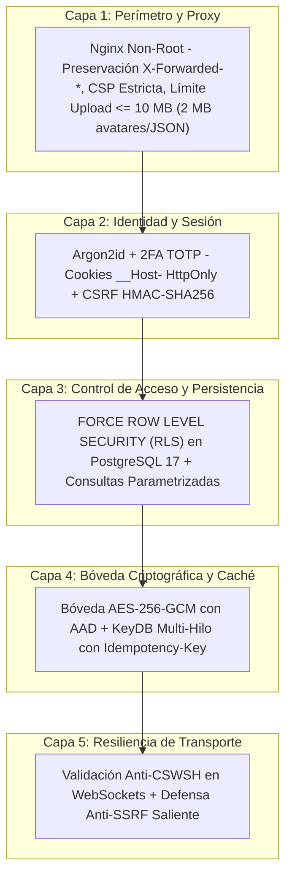
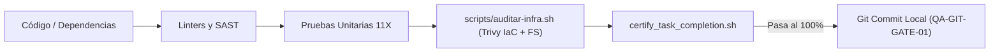

# 🛡️ Política de Seguridad y Arquitectura de Defensa (QA Testing Blueprints)

> 🌐 **Idioma:** [🇬🇧 Read in English](SECURITY.md) · **Español (Espejo 1:1)**

**Proyecto:** QA Testing Blueprints — Estándar Corporativo Nivel 11X  
**Licencia:** MIT  
**Estándar de Certificación:** QA 11X DevSecOps

En **Tecno Consultores**, la seguridad de nuestra infraestructura y del software que producimos es la máxima prioridad. Este documento establece los estándares de **Seguridad por Diseño (Security-by-Design)**, la mitigación de vectores de ataque en arquitecturas híbridas (SPA + API Asíncrona) y la política de auditoría preventiva **Shift-Left**.

---

## 1. Versiones Soportadas

Dado que este repositorio actúa como la plantilla arquitectónica y base de conocimientos corporativa, las actualizaciones de seguridad se aplican continuamente a la rama principal (`main`):

| Versión | Estado de Soporte | Requisitos de Infraestructura |
| :--- | :--- | :--- |
| **`3.2.x` (`main` / Activa)** | ✅ Soporte Activo | Docker 26+, PostgreSQL 17, KeyDB Multi-Hilo |
| **`3.1.x`** | ⚠️ Solo Parches de Seguridad | Reemplazada por `3.2.x` (`actualización recomendada`) |
| **`3.0.x`** | ⚠️ Solo Parches de Seguridad | Reemplazada por `3.2.x` (`actualización recomendada`) |
| **`<= 2.x`** | ❌ No Soportado | Versiones descontinuadas |

---

## 2. Reporte Responsable de Vulnerabilidades

Si descubres una vulnerabilidad en nuestras imágenes base, en los scripts de limpieza o en la configuración de los orquestadores efímeros:

1. **NO abras un Issue ni Pull Request público en GitHub/GitLab** con el exploit o vector de ataque.
2. Envía un reporte detallado por correo a: **`soporte@tecnoconsultores.net`** con el asunto `[SECURITY-BLUEPRINT] Descripción breve del hallazgo`.
3. Incluye los pasos de reproducción, componentes afectados y el impacto potencial.
4. Recibirás acuse de recibo en un máximo de **48 horas laborables** y coordinaremos la mitigación antes de la divulgación pública.

---

## 3. Pilares de Seguridad por Diseño y Mitigación de Vulnerabilidades

Cualquier proyecto corporativo que implemente el estándar 11X debe aplicar las siguientes **capas de defensa en profundidad**:



---

## 4. Mitigación Integral de Vectores de Ataque en Plataforma Híbrida (SPA + API)

La integración entre aplicaciones SPA (Vue 3, React) y APIs REST/WebSockets (FastAPI, Node.js) introduce una superficie de ataque específica que debe neutralizarse mediante código defensivo obligatorio:

### 4.1. Prevención de Asignación Masiva (*Mass Assignment / Over-posting*)
- **Riesgo:** Un atacante inyecta campos no autorizados en el payload JSON (ej. `role: "admin"`, `is_superuser: true`).
- **Mitigación:**
  - Configurar en todos los esquemas Pydantic v2: `model_config = ConfigDict(extra="forbid")`.
  - Desacoplar estrictamente los DTOs de entrada (`UserCreate`) de los modelos ORM de base de datos (`UserInDB`) y de los esquemas de respuesta pública (`UserPublic`).

### 4.2. Protección Anti-CSWSH (*Cross-Site WebSocket Hijacking*)
- **Riesgo:** Los WebSockets no aplican la política SOP (Same-Origin Policy) del navegador. Si un usuario tiene una cookie de sesión activa, un sitio malicioso puede abrir un canal WebSocket no autorizado.
- **Mitigación:**
  - Inspeccionar la cabecera `Origin` **antes** de invocar `await ws.accept()`.
  - Si el origen no coincide con la lista blanca (`ALLOWED_ORIGINS`), abortar inmediatamente con código de cierre de aplicación `4403` ("Forbidden Origin").

### 4.3. Sanitización de Errores de Validación 422 (`RequestValidationError`)
- **Riesgo:** En desarrollo, los frameworks exponen nombres internos de campos, regex y rutas de código en respuestas 422, facilitando el reconocimiento y fingerprinting del backend.
- **Mitigación:**
  - En producción (`APP_ENV=production`), capturar globalmente `RequestValidationError`, registrar el traceback detallado en `stdout` del contenedor y devolver al cliente un mensaje genérico: `{"detail": "Los datos proporcionados no cumplen con los requisitos de validación."}`.

### 4.4. Defensa Anti-SSRF en Webhooks, Clientes HTTP y Workers Salientes
- **Riesgo:** La aplicación es forzada a consultar direcciones internas para escanear la red privada o extraer metadatos de proveedores cloud (`169.254.169.254`).
- **Mitigación:**
  - Resolver el hostname vía DNS **antes** de enviar la petición.
  - Bloquear incondicionalmente: rangos privados RFC 1918 (`10.0.0.0/8`, `172.16.0.0/12`, `192.168.0.0/16`), loopback (`127.0.0.0/8`, `::1`), link-local (`169.254.0.0/16`), multicast y nombres de contenedores Docker internos (`localhost`, `*-db`, `*-redis`, `*-api`, `*-worker`).

### 4.5. Sentencias Parametrizadas Seguras en Contextos Dinámicos
- **Riesgo:** Inyección SQL al interpolar cadenas (`f-strings`) para configurar variables de sesión o tenant (`SET LOCAL app.current_tenant_id = f'{tenant_id}'`).
- **Mitigación:**
  - Utilizar siempre sentencias parametrizadas seguras mediante `bindparam` de SQLAlchemy o consultas preparadas.

### 4.6. Límites Estrictos de Carga de Archivos (Anti-DoS / OOM)
- **Riesgo:** Agotamiento de memoria RAM en el backend mediante subida de archivos gigantescos no autenticados o payloads masivos.
- **Mitigación:**
  - Imponer un límite estricto de cuota en streaming (`<= 10 MB` general y `2 MB` estricto para avatares/JSON), rechazando solicitudes que excedan el umbral con HTTP `413 Payload Too Large`.

### 4.7. Preservación de Cabeceras de Proxy Inverso en Nginx
- **Riesgo:** Pérdida de la IP real del cliente ante proxies reversos, impidiendo auditorías forenses, rate limiting y detección de ataques de fuerza bruta.
- **Mitigación:**
  - Configurar explícitamente en Nginx para `/api/` y `/ws/`:
    ```nginx
    proxy_set_header X-Forwarded-For $proxy_add_x_forwarded_for;
    proxy_set_header X-Forwarded-Proto $scheme;
    ```

### 4.8. Desacoplamiento de Middleware Anti-CSRF y Protección Escopada
- **Riesgo:** Ataques CSRF en peticiones disparadas desde navegadores con cookies activas, o bloqueo indebido a llamadas automatizadas de agentes de IA.
- **Mitigación:**
  - El middleware CSRF extrae el JWT directamente de cookies seguras `__Host-` y exige `X-CSRF-Token` (HMAC-SHA256).
  - Alinear con OWASP CSRF Prevention eximiendo de validación CSRF a las peticiones basadas en cabecera `Authorization: Bearer` (usadas por agentes de IA, automatizaciones y servidores MCP).

### 4.9. Sanitización Estricta Anti-XSS y Anti-Prototype Pollution en Frontend
- **Riesgo:** Inyección de scripts maliciosos en `innerHTML` (ej. popups de mapas cartográficos, tooltips dinámicos) y contaminación de prototipos en JavaScript.
- **Mitigación:**
  - Usar siempre una función de escape HTML (`escapeHtml`) antes de inyectar contenido dinámico en el DOM.
  - Sanitizar objetos recursivamente eliminando claves peligrosas (`__proto__`, `constructor`, `prototype`) y crear diccionarios puros con `Object.create(null)`.

### 4.10. Seguridad en el Ecosistema MCP y Agentes de IA Autónomos
- **Aislamiento de Ejecución y Regla Cero (`Rule Zero`):** Las herramientas MCP ejecutadas por agentes de IA (`run_ephemeral_qa`, `certify_11x_gate`) operan estrictamente dentro de contenedores efímeros aislados (`sinfallas/*`), impidiendo el escape al sistema anfitrión.
- **Validación Criptográfica de Descargas Zero-Clone (DISA ASD STIG V6R5 `V-222513` / `APSC-DV-001430`):** Toda plantilla o skill descargada dinámicamente por la herramienta `fetch_blueprint_bundle` o el instalador `install-skill` es contrastada contra su hash SHA-256 precalculado en `manifest.json`, bloqueando cualquier manipulación o envenenamiento en tránsito.
- **Publicación Soberana de Artefactos y Compuerta Humana (`QA-GIT-GATE-01`):** Se prohíbe alojar secretos de publicación de paquetes (`NPM_TOKEN`) en corredores de CI/CD de terceros. Toda publicación se realiza desde entornos controlados en memoria volátil mediante `scripts/publicar-mcp.sh` (`.env` con permisos `0600`) con autodestrucción del token tras la ejecución, y **exige confirmación humana explícita** (`QA-GIT-GATE-01` — queda prohibido que agentes de IA ejecuten `git push` o `npm publish` automáticamente).

### 4.11. Tolerancia a Carreras Concurrentes (*Grace Period Leeway* de 5s) en Refresh Tokens
- **Riesgo:** Cuando un usuario abre múltiples pestañas en el navegador, todas intentan refrescar el JWT casi simultáneamente. Un sistema estricto de rotación detecta la segunda petición como "reúso malicioso" y cierra la sesión de forma abrupta.
- **Mitigación:**
  - Implementar un margen de cortesía (*grace period*) de 5 segundos en la rotación de Refresh Tokens en KeyDB/Redis, permitiendo que las pestañas paralelas reciban el nuevo par de tokens sin provocar falsos positivos de `REUSE_DETECTED`.

### 4.12. Aislamiento Multi-Tenant y por Operador en Llaves de Idempotencia
- **Riesgo:** Colisión cruzada de claves de idempotencia UUID si dos operadores o inquilinos distintos envían el mismo identificador.
- **Mitigación:**
  - Estructurar las llaves en KeyDB bajo espacios de nombres compuestos: `idemp:{tenant_id}:{user_id}:{idempotency_key}`.

### 4.13. Desactivación de Swagger / ReDoc / OpenAPI en Producción
- **Riesgo:** Exposición pública del mapa completo de endpoints, esquemas de entrada y rutas administrativas, facilitando ataques dirigidos.
- **Mitigación:**
  - En entorno de producción (`APP_ENV=production`), configurar FastAPI con `docs_url=None`, `redoc_url=None` y `openapi_url=None` (sincronizando también el singleton `settings` en smoke tests post-importación, `QA-SMOKE-01`).

### 4.14. Gobernanza de Sesiones, Timeouts por Rol y Purga en Logout (`DISA STIG V-222387..V-222392, V-222578..V-222583` & `OWASP 4.3.7`)
- **Riesgo:** Secuestro o fijación de sesiones (*Session Fixation*), sesiones huérfanas indefinidas y persistencia de datos sensibles en el almacenamiento del navegador tras cerrar sesión.
- **Mitigación:**
  - Limitar el número de sesiones simultáneas por usuario (`APSC-DV-000010`) y auditar inicios de sesión concurrentes desde distintas estaciones/IPs (`APSC-DV-003360`).
  - Aplicar *idle timeouts* diferenciados por rol: **10 minutos** para sesiones administrativas/privilegiadas (`APSC-DV-000080`) y **15 minutos** para sesiones operativas estándar (`APSC-DV-000070`), además de expiración absoluta (`OWASP SM-8`).
  - Rotar el ID de sesión con un CSPRNG validado (FIPS 140-3) al autenticar o cambiar nivel de privilegio (`APSC-DV-002250..002290`), revocar todas las sesiones activas al deshabilitar cuentas o rotar credenciales (`APSC-DV-001800`) y purgar `localStorage`, `sessionStorage` y `CacheStorage` al cerrar sesión mostrando confirmación explícita (`APSC-DV-000060, 000100, 002240`).

### 4.15. Bloqueo de Cuentas, Anti-Enumeración en Tiempo Constante y Ciclo de Vida (`DISA STIG V-222409..V-222411, V-222432, V-222536..V-222547` & `OWASP 4.3.7`)
- **Riesgo:** Enumeración de cuentas válidas por diferencias de tiempo de respuesta (*Timing Side-Channel*), ataques de fuerza bruta y abuso de cuentas temporales o inactivas no revocadas.
- **Mitigación:**
  - Bloquear la cuenta tras **3 intentos fallidos consecutivos en 15 minutos** (`APSC-DV-000530`) y verificar siempre contra un hash señuelo precalculado (`DUMMY_ARGON2_HASH`) cuando el usuario no exista (`OWASP A-19, A-20`).
  - Exigir contraseñas locales de al menos **15 caracteres** (`APSC-DV-001680`), complejidad multi-clase, cambio mínimo de 8 caracteres (`APSC-DV-001730`), historial de **5 generaciones** (`APSC-DV-001780`) y prohibir preguntas de seguridad (`OWASP P-6`).
  - Deshabilitar automáticamente cuentas temporales a las **72 horas** (`APSC-DV-000300`) y cuentas inactivas a los **35 días** (`APSC-DV-000320`), notificando al usuario la fecha/hora de su último inicio de sesión (`APSC-DV-000580`). Exigir *Step-Up Re-Authentication* para acciones críticas (`APSC-DV-001470`) y validación mTLS/PKI con caché local CRL/OCSP para integraciones máquina a máquina (`APSC-DV-001640, 001850`).

### 4.16. Canonicalización Unicode (`NFKC`), Anti-XXE, Deserialización Segura y Magic Bytes (`DISA STIG V-222593, V-222601..V-222608, V-222626` & `OWASP 4.3.5, 4.3.6`)
- **Riesgo:** Evasión de filtros mediante caracteres homógrafos Unicode, lectura de archivos locales por entidades externas XML (XXE), ejecución remota de código por deserialización insegura (`pickle`/`yaml.load`) o `shell=True`, y carga de binarios maliciosos con extensión falsificada.
- **Mitigación:**
  - Normalizar toda entrada de texto a **Unicode `NFKC`** antes de validar (`APSC-DV-002520`) y rechazar caracteres de control ASCII.
  - Deshabilitar DTDs y entidades externas en analizadores XML (`resolve_entities=False`, `no_network=True`) (`APSC-DV-002390, 002550`) y validar firmas/timestamps/`OneTimeUse` en aserciones SAML (`APSC-DV-000160..000270`).
  - Prohibir `shell=True` (`APSC-DV-002510`) y deserializadores inseguros (`OWASP VSD 1-6`), validar archivos subidos mediante firmas binarias (*Magic Bytes*), almacenarlos fuera del web root con permisos `noexec` y referenciarlos mediante mapas de índices en lista blanca (`APSC-DV-002485, 002960`).

### 4.17. Auditoría Forense Inmutable, Anti-Log Injection y Alerta al 75% de Capacidad (`DISA STIG V-222444, V-222446..V-222509` & `OWASP 4.3.10`)
- **Riesgo:** Falsificación de registros de auditoría mediante inyección CR/LF (`\r\n`), exposición de credenciales/tokens en logs, manipulación de trazas forenses o pérdida de auditoría por disco lleno.
- **Mitigación:**
  - Sanitizar caracteres CR/LF y etiquetas HTML en todos los campos registrables (`OWASP SL-4, SLD-2`) y prohibir terminantemente el registro de contraseñas, tokens o IDs de sesión en logs (`APSC-DV-000650`).
  - Estructurar cada evento con marca de tiempo UTC (granularidad de milisegundos, `APSC-DV-001250`), IPs de origen y destino, identidad de usuario/proceso, resultado y `trace_id`, protegiendo la integridad mediante cadenas **HMAC-SHA256** (`APSC-DV-001350`) serializadas con secuencia `seq_num BIGINT` + `pg_advisory_xact_lock` (`SEC-14`), y alertando cuando el almacenamiento de auditoría alcance el **75% de capacidad** (`APSC-DV-001090`).

### 4.18. Criptografía FIPS 140-3, Zeroización de Memoria y Sanitización de Exportaciones (`DISA STIG V-222393..V-222395, V-222570..V-222577, V-222612, V-222666` & `OWASP 4.3.9`)
- **Riesgo:** Exposición de llaves criptográficas en volcados de memoria RAM o filtración de hashes/credenciales administrativas en volcados de base de datos exportados.
- **Mitigación:**
  - Utilizar módulos criptográficos validados bajo **FIPS 140-2 / 140-3** con diseño de agilidad criptográfica (`APSC-DV-002010..002040`, `OWASP CP-5`), deshabilitar compresión TLS/HTTP (anti-CRIME/BREACH), sobrescribir con ceros (`zeroize`) los búferes de memoria que contengan secretos al salir de cada función (`APSC-DV-002590`, `OWASP MM 1-9`) y purgar credenciales/PII de cualquier exportación de base de datos adjuntando etiquetas de clasificación de seguridad (`APSC-DV-000110, 003120, 003310`).

### 4.19. Cabeceras OSHP, Estado Fail-Secure, API Top 10 (2023), CycloneDX SBOM y Threat Modeling (`DISA STIG V-222424, V-222513, V-222585, V-222616, V-222655` & `OWASP 4.2, 5.3.4, 5.4.4, 7.8`)
- **Riesgo:** Fallos en modo abierto (*Fail-Open*) durante el arranque o caídas de configuración, extracción masiva de datos (*Data Mining*), vulnerabilidades BOLA/BOPLA/BFLA en APIs y compromisos en la cadena de suministro de software.
- **Mitigación:**
  - Aplicar cabeceras del **OWASP Secure Headers Project (OSHP)** (`Strict-Transport-Security`, `Content-Security-Policy`, `X-Content-Type-Options: nosniff`, `X-Frame-Options: DENY`, `Referrer-Policy`, `Cache-Control: no-store`, `X-Robots-Tag: noindex`) y suprimir cabeceras `Server` / `X-Powered-By`.
  - Garantizar transición a **estado seguro (Fail-Closed)** ante fallos de inicialización o aborto (`APSC-DV-002310`) y ejecutar auto-verificación de funciones de seguridad al arranque (`APSC-DV-002770`).
  - Imponer cuotas anti-data-mining en consultas paginadas (`APSC-DV-000450`), validar respuestas de APIs externas con esquemas estrictos y timeouts (`OWASP API10:2023`), mantener modelos de amenazas como código (`OWASP pytm` / `Threat Dragon`, `APSC-DV-003230`) y generar inventarios **CycloneDX SBOM/CBOM (ECMA-424)** verificados criptográficamente (`APSC-DV-001430, 003140`).

### 4.20. Continuidad e Inmunidad Atómica en Flujos Pre-Auth Multi-Etapa (`SEC-16` — `APSC-DV-000530`, `APSC-DV-002270`, `APSC-DV-002560` & `OWASP ASVS V2.8`)
- **Riesgo:** En ceremonias no autenticadas de múltiples pasos (`POST /auth/login` devolviendo `mfa_enrollment_required`, `mfa_challenge` o `password_change_required`, seguido de `POST /auth/mfa/enroll`, `POST /auth/mfa/verify` o WebAuthn), la reutilización no atómica del `challenge_id` permite ataques de carrera (*replay*), mientras que la asimetría entre middlewares globales (`CSRF`/`Idempotency`) y el interceptor HTTP `401 -> /auth/refresh` del frontend rompe el flujo en producción.
- **Mitigación:**
  - Emitir `challenge_id` opaco CSPRNG de al menos **128 bits** (`secrets.token_urlsafe(32)`) exclusivamente en cuerpo JSON o cabecera (nunca en query string) validando `Origin` / `Sec-Fetch-Site`.
  - Consumir el desafío de forma **atómica y de un solo uso** en KeyDB/Redis (`GETDEL` o script Lua) o bajo espacio de nombres `idemp:preauth:{challenge_id}:{key}`, con `TTL <= 300s` y purga inmediata al superar `3–5` intentos fallidos (`APSC-DV-000530`).
  - Compartir simétricamente la lista blanca explícita `PREAUTH_PUBLIC_ROUTES` entre los middlewares backend y el interceptor HTTP `401` del frontend, validando la cadena completa en un único test continuo sin mocks intermedios.

### 4.21. Integridad de Auditoría de Catálogo RLS en PostgreSQL 15–17+ (`QA-PG17-RLS` — `DISA STIG V-222543` y `Ley 7 Estándar 11X`)
- **Riesgo:** Consultas de prueba o validación que verifican `FORCE ROW LEVEL SECURITY` leyendo `pg_tables.forcerowsecurity` fallan en motores reales PostgreSQL 15–17+ (donde dicha columna no existe en la vista `pg_tables`), enmascarando errores en entornos con mocks o rompiendo pipelines CI.
- **Mitigación:**
  - Auditar siempre el estado de RLS consultando `pg_catalog.pg_class` (`relrowsecurity` y `relforcerowsecurity`) mediante `JOIN pg_catalog.pg_namespace` (`nspname = 'public' AND relkind = 'r'`), bloqueando estáticamente cualquier referencia a `pg_tables.forcerowsecurity` mediante `QA-PG17-RLS`.

### 4.22. Contrato de Salud Real en Contenedores y Semántica de Salida en Supervisores Asíncronos (`QA-HEALTH-01` — `DISA APSC-DV-002310`, `APSC-DV-002770` y `Regla UAT #9 Estándar 11X`)
- **Riesgo:** Orquestadores y runners de workers en segundo plano superan `>= 95%` de cobertura con sub-workers mockeados (`AsyncMock`), pero al desplegarse en contenedores reales caen en bucle `unhealthy` porque los supervisores `asyncio` tratan el retorno limpio (`return None`) de workers opt-in deshabilitados como un fallo fatal (`task.done() and not task.cancelled()`) o jamás verifican la escritura real de la sonda física exigida por `HEALTHCHECK` (`/tmp/worker_heartbeat`).
- **Mitigación:**
  - Inspeccionar explícitamente `task.exception() is not None` en bucles supervisores y declarar un conjunto inmutable `OPTIONAL_WORKERS` para distinguir salidas limpias por feature-flag deshabilitado de caídas reales de bucles infinitos obligatorios (`APSC-DV-002310`).
  - Exigir al menos un test de contrato que arranque el orquestador real bajo `Settings()` de producción por defecto sin mockear los loops opcionales y haga `assert` explícito sobre el artefacto observable de `healthcheck` (`APSC-DV-002770`, auditado estáticamente mediante `QA-HEALTH-01`).

### 4.23. Guardia Anti-Bloqueo en Terminal Interactiva (`TTY`) para Binarios Duales CLI + Servidor MCP `stdio` (`QA-CLI-TTY-01` — `DISA APSC-DV-002310` y `Regla UAT #10 Estándar 11X`)
- **Riesgo:** Los paquetes híbridos que combinan subcomandos CLI (`npx ... install-skill`, `argparse`) con un servidor MCP sobre `stdio` (`StdioServerTransport` / `stdio_server()`) superan al 100% las pruebas unitarias (que inyectan callbacks falsos `startStdio`) y las pruebas E2E en CI (donde `stdin` siempre es un *pipe* con `isTTY === false`), pero al ser ejecutados sin argumentos por un desarrollador humano en una terminal interactiva (`TTY`) bloquean indefinidamente la consola esperando tramas JSON-RPC en `stdin`.
- **Mitigación:**
  - Verificar explícitamente `process.stdin.isTTY` (Node/TS) o `sys.stdin.isatty()` (Python) cuando el binario se invoca sin subcomandos: en una sesión `TTY` interactiva (salvo que se fuerce `--stdio` o `QA_FORCE_STDIO=1`), ejecutar cualquier auto-sincronización segura, imprimir la guía de uso rápido y finalizar con código `0` sin abrir el transporte bloqueante (`APSC-DV-002310`, auditado estáticamente mediante `QA-CLI-TTY-01`).
  - Incluir obligatoriamente en la suite E2E una sonda en subproceso con `TTY` simulado y `timeout <= 5s` que certifique la salida limpia e inmediata.

### 4.24. Fijación Inmutable por Commit SHA-40 en GitHub Actions (`SEC-CI-ACTION-REF` — `DISA STIG V-222513`, `APSC-DV-001430` y `Endurecimiento Cadena de Suministro`)
- **Riesgo:** Referenciar acciones de terceros mediante ramas mutables (`@main`, `@master`) o etiquetas heredadas sin prefijo `v` (como `aquasecurity/trivy-action@0.28.0`, eliminada aguas arriba provocando el fallo `Unable to resolve action` en GitHub Actions aunque el escaneo local de Trivy pase) expone el pipeline CI/CD a roturas inesperadas y ataques de reescritura de etiquetas en la cadena de suministro.
- **Mitigación:**
  - Fijar todas las acciones externas en `.github/workflows/*.yml` y `.github/actions/*/action.yml` mediante el hash SHA-1 completo de 40 caracteres del commit anotado (`uses: aquasecurity/trivy-action@ed142fd0673e97e23eac54620cfb913e5ce36c25 # v0.36.0`) y validar que las etiquetas semánticas existan en remoto (`git ls-remote --tags`), prohibiendo explícitamente etiquetas legacy sin prefijo `v` en `aquasecurity/trivy-action@0.x.y` y ramas mutables (`SEC-CI-ACTION-REF`, auditado estáticamente mediante `audit_security_stig_owasp` y `make lint-workflows`).
  - Las acciones locales (`uses: ./...`, `../...`), referencias `docker://` o excepciones documentadas con `# sec-ci-action-ref-ok` quedan exentas de forma explícita.

### 4.25. Ejecución No Interactiva en Pipelines (`docker compose run -T`) y Caché `tmpfs` (`noexec`) sobre Contenedores `read_only: true` (`QA-DOCKER-TTY-01` — `DISA APSC-DV-002310` & `Rule Zero Hardening`)
- **Riesgo:** Invocar `docker compose run --rm` sin `-T` en pipelines CI/CD o scripts de despliegue (`CI=true`) asigna un pseudo-TTY (`process.stdin.isTTY === true`) que empuja a CLIs modernas (como Wrangler v4) hacia ramas interactivas y aborta con `NoDefaultValueProvided`; adicionalmente, contenedores endurecidos con `read_only: true` fallan con `ENOENT`/`EROFS` si una herramienta intenta escribir fuera de `/tmp` (ej. `/app/.wrangler/cache` en `saveToConfigCache()`), o sufren delegación silenciosa Pages-to-Workers (`maybeDelegatePagesToWorkers()`) cuando se ejecutan desde sesiones de agentes IA sin `--force`.
- **Mitigación:**
  - Usar siempre `docker compose run --rm -T` (`--no-TTY`) en workflows de GitHub Actions y scripts `deploy*`/`ci*`/`probar-*`/`release*` o con `CI=true`, precrear puntos de montaje requeridos (como `/app/.wrangler`) en el `Dockerfile` con `chown` no-root y montarlos como `tmpfs` endurecido (`mode=1777,noexec,nosuid,nodev`), verificar idempotencia previa de proyectos Pages validando variables obligatorias en modo Fail-Secure, y pasar `--force` en `wrangler pages project create` y `wrangler pages deploy` (auditado estáticamente mediante `QA-DOCKER-TTY-01` en `audit_security_stig_owasp`, sujeto a confirmación humana bajo `QA-GIT-GATE-01`).

### 4.26. Higiene de Cabeceras Edge (`_headers` / `_routes.json`), Política `CORP` y Activos Multi-Formato (`UI-11X-03` — `OWASP OSHP` & `Cloudflare Pages Hardening`)
- **Riesgo:** En Cloudflare Pages, las reglas de subruta en `public/_headers` heredan y concatenan de forma aditiva las cabeceras de `/*` salvo desacoplamiento explícito (`! Nombre-Cabecera`), generando respuestas contradictorias (`Cross-Origin-Resource-Policy: same-origin, cross-origin` o `X-Robots-Tag: noindex` mezclado con `index`) que bloquean favicons e imágenes OpenGraph en orígenes externos; adicionalmente, comodines de sufijo inválidos en `_routes.json` (`/*.ico`), `apple-touch-icon` apuntando a `.webp`/`.svg`, iconos combinados `"any maskable"` o la falta de `public/favicon.ico` (`>= 48x48`) provocan fallos silenciosos en Safari/iOS y buscadores.
- **Mitigación:**
  - Desacoplar explícitamente con `! <Cabecera>` antes de redefinir `Cache-Control`, `X-Robots-Tag`, `Cross-Origin-Resource-Policy`, `Content-Security-Policy`, `X-Frame-Options` o `Referrer-Policy` en `public/_headers`, habilitando `Cross-Origin-Resource-Policy: cross-origin` sobre `/favicon.ico`, `/favicons/*`, `/brand/*` y `/og/*` (y manteniendo `X-Robots-Tag: noindex, nofollow` en SPAs internas).
  - Replicar `Cross-Origin-Resource-Policy "same-origin"` en `server`/`/index.html` y `"cross-origin"` en `location ~* \.(?:ico|svg|png|webmanifest)$` dentro de `nginx/default.conf`, excluir `"/favicon.ico"` de forma literal en `_routes.json` (sin `/*.ico`), y distribuir `favicon.ico` multi-resolución (`16x16`/`32x32`/`48x48`), `apple-touch-icon.png` opaco `180x180` y `site.webmanifest` con PNGs `192x192` y `512x512` (auditado estáticamente mediante `UI-11X-03` en `audit_security_stig_owasp`).

### 4.27. Expansión de Shell en GitHub Actions vs. `Makefile`/Compose y Frontera de Volumen `$(CURDIR)` en Sub-Makefiles (`QA-CI-ESCAPE-01` & `QA-MAKE-CURDIR-01` — `DISA APSC-DV-002510` / `APSC-DV-002310`)
- **Riesgo:** Copiar escapes de doble dólar propios de GNU Make o `docker-compose.yml` (`$$(pwd)`, `$$(id -u)`, `$${VAR}`) dentro de bloques `run:` de GitHub Actions hace que `bash` expanda `$$` al PID numérico del proceso (`<PID>(pwd)`), provocando errores fatales de montaje Docker (`exit code 125`) recién en CI; en paralelo, usar `$(PWD)` o `${PWD}` en sub-Makefiles (`*/Makefile`) invocados con `$(MAKE) -C <subdir>` conserva el `PWD` del directorio padre y expone rutas fuera del perímetro del subproyecto.
- **Mitigación:**
  - Usar exclusivamente sustitución simple (`$(pwd)`, `$(id -u)`, `${VAR}`) en `.github/workflows/*.{yml,yaml}` y `.github/actions/*/action.{yml,yaml}` (`QA-CI-ESCAPE-01`, eximible solo en generadores literales mediante `# qa-ci-escape-ok`).
  - Usar siempre `$(CURDIR)` (ej. `HOST_PWD ?= $(CURDIR)`) en lugar de `$(PWD)` / `${PWD}` dentro de sub-Makefiles (`QA-MAKE-CURDIR-01`, eximible mediante `# qa-make-curdir-ok`), auditado estáticamente en `audit_security_stig_owasp`, `scripts/auditar-infra.sh` y `make lint-workflows`.

### 4.28. Contrato sobre Transporte Real del SDK (`QA-CONTRACT-SDK-01`) y Paridad de Lockfile + Smoke Test en Imágenes Docker (`QA-DOCKER-LOCK-01` — `DISA APSC-DV-001430` & `APSC-DV-002310`)
- **Riesgo:** Superar `>= 95%` de cobertura unitaria invocando handlers MCP/JSON-RPC/ACP con `MagicMock` deja pasar cambios incompatibles en la firma del SDK (`mcp 1.x -> 2.x`), provocando errores internos en ejecución real; adicionalmente, mantener listas manuales de dependencias en `Dockerfile` en lugar de instalar desde el lockfile provoca ausencias silenciosas de paquetes (`ModuleNotFoundError`) en la imagen final aunque el entorno de pruebas pase.
- **Mitigación:**
  - Incluir al menos una prueba in-process conectada mediante el cliente/transporte real del SDK (`InMemoryTransport` + `Client` en Node/TS o `ClientSession` / `create_connected_server_and_client_session` en Python) ejercitando `list_tools` y `call_tool` (`QA-CONTRACT-SDK-01`, eximible con `# qa-contract-sdk-ok` si se valida mediante arnés externo).
  - Instalar dependencias en `Dockerfile` estrictamente desde el lockfile (`uv sync --frozen --no-dev`, `uv export --frozen --no-dev | uv pip install --system -r -`, `pnpm install --frozen-lockfile`, `npm ci`) y ejecutar un smoke test sobre la imagen construida (`import <app>`, `id -u != 0` y sonda `401` en rutas protegidas; auditado mediante `QA-DOCKER-LOCK-01` en `audit_security_stig_owasp`, eximible con `# qa-docker-lock-ok`).

### 4.29. Paridad Exacta Playwright NPM ↔ Imagen Docker (`QA-PLAYWRIGHT-PIN-01`) y Protección Anti-SSRF en PageSpeed Insights (`SEC-03` — `DISA APSC-DV-001430` / `APSC-DV-002520`)
- **Riesgo:** Usar rangos SemVer (`^1.52.0`) o etiquetas flotantes `:latest` entre `@playwright/test`/`playwright` en `package.json` y la imagen `mcr.microsoft.com/playwright:vX.Y.Z-*` en `docker-compose.qa.yml` introduce fallos `Executable doesn't exist` al desalinearse el navegador preinstalado; adicionalmente, pasar URLs no validadas a herramientas automatizadas de auditoría externa (`PageSpeed Insights`) sin resolver DNS previo expone vectores SSRF hacia la intranet y puede filtrar llaves `?key=...` en trazas de error.
- **Mitigación:**
  - Fijar versión exacta sin prefijos (`"1.52.0"`) en `@playwright/test` / `playwright` sincronizada 1:1 con el tag `mcr.microsoft.com/playwright:v1.52.0-*` (`QA-PLAYWRIGHT-PIN-01` en `audit_security_stig_owasp`, alineación automática en `SurgicalMerger.mergePackageJson` y ejecución no-root `QA_UID:QA_GID` prioritizando `./node_modules/.bin/{playwright,lhci}`).
  - Validar todas las URLs objetivo de `.agents/scripts/audit_pagespeed_insights.py` (`make audit-psi` / `make qa-psi`) con esquema `https://` exclusivo, bloqueo pre-DNS contra rangos privados/loopback/link-local/`.internal` (`SEC-03`) y redacción obligatoria de parámetros `key=`/`PAGESPEED_API_KEY` (`SEC-06`).

### 4.30. Paridad de Hidratación SSR/SSG bajo Doble Esquema de Color en Playwright (`QA-SSR-HYDRATION-01` — `Capa 9 Estándar 11X (L09 Playwright/SSR)` y `APSC-DV-002310`)
- **Riesgo:** En aplicaciones SSR/SSG con selector de tema claro/oscuro, un script inline en `<head>` que muta `dataset.theme` o `.dark` antes de la hidratación provoca divergencias DOM silenciosas (*Hydration completed but contains mismatches*) cuando los componentes usan `v-if` dependiente del cliente o cuando `playwright.config.ts` fija únicamente un `colorScheme` (p. ej. `'dark'`), ocultando degradaciones en producción bajo `prefers-color-scheme: light`.
- **Mitigación:**
  - Evitar ramificar la estructura HTML inicial (`v-if`) según `localStorage` o `dataset.theme` antes del montaje; renderizar ambas variantes por CSS (`display: none` / `hidden dark:block`) y sincronizar el estado reactivo en `onMounted`.
  - En proyectos SSR/SSG con tematización dual, añadir en Playwright cobertura explícita para ambos esquemas (`'light'` y `'dark'` vía `browser.newContext({ colorScheme })` o `page.emulateMedia({ colorScheme })`) junto con listeners `console` y `pageerror` que fallen ante cualquier mensaje `/hydration/i` (auditado por `QA-SSR-HYDRATION-01` en `audit_security_stig_owasp`, eximible con `# qa-ssr-hydration-ok`).

---

## 5. Auditoría Preventiva de Vulnerabilidades y Seguridad Shift-Left

En los proyectos regidos por el estándar 11X, toda vulnerabilidad debe ser detectada y corregida en la estación local antes de hacer commit o push:



### 5.1. Gobernanza de Archivos de Bloqueo (`uv.lock` y `pnpm-lock.yaml`)
- **Compilaciones Herméticas y Reproducibles:** Las versiones de dependencias directas y transitivas deben estar estrictamente congeladas con sus hashes SHA-256 en los archivos de bloqueo para neutralizar ataques a la cadena de suministro (*Supply Chain Attacks*).
- **Protocolo de Parcheo Selectivo:**
  - Para Python: ejecutar en Docker `uv lock --upgrade-package <paquete>`.
  - Para Frontend: ejecutar en Docker `pnpm update <paquete>`.
  - Re-ejecutar suites unitarias y escaneo con `./scripts/auditar-infra.sh` certificando `0` vulnerabilidades CRITICAL y HIGH.

### 5.2. Auditoría Diaria Automatizada de Imágenes Base (`audit-base-images.yml`)
- **Cadencia y Alcance:** El workflow [`.github/workflows/audit-base-images.yml`](.github/workflows/audit-base-images.yml) se ejecuta diariamente (`cron: '0 6 * * *'`), bajo demanda (`workflow_dispatch`) y en `pull_request` sobre manifiestos de contenedores/seguridad, aplicando mínimo privilegio (`permissions: contents: read`), `timeout-minutes` explícitos y Actions fijadas por SHA inmutable (`SEC-CI-ACTION-REF`).
- **Escaneo de Imágenes Oficiales (`Trivy HIGH/CRITICAL = 0`):** Matriz `fail-fast: false` sobre `sinfallas/base-python-uv:{latest,3.15}`, `sinfallas/base-node-ionic:{latest,26}`, `sinfallas/base-mobile-appium:{latest,26}`, `sinfallas/basephpcomposer:latest`, `sinfallas/karatelabs:1.5.1`, `sinfallas/base-bash-qa:latest` y `sinfallas/remote-graphify:latest` con `--severity HIGH,CRITICAL --ignore-unfixed --exit-code 1`, además de verificación no-root `smoke-mobile-appium` (`java`, `adb`, `appium`).
- **Auditoría de Paquetes Python v2 (`pip-audit`) y SAST (`CodeQL`):** Ejecución efímera no-root (`--user 10001:10001 -e HOME=/tmp`) de `pip-audit --strict --desc` sobre `sinfallas/base-python-uv:3.15`, análisis `CodeQL` en `javascript-typescript`, `python` y `actions`, y validación determinista local mediante `make lint-workflows`.

---

## 6. Barreras Automatizadas DevSecOps

Antes de cada commit, el código supera de forma automatizada:
1. **Detección de Secretos:** `./scripts/verificar-secretos.sh` (0 credenciales hardcodeadas).
2. **SAST Estático:** `Bandit` (Python) y `eslint-plugin-security` (vía **ESLint 9 Flat Config (`eslint.config.mjs`)** + `sonarjs` v3 + reglas *type-aware*, o `plugin:security/recommended-legacy` en repos heredados ESLint 8), con `.npmrc` configurado con `ignore-scripts=true` y excepciones nativas declaradas mediante el mapa booleano `allowBuilds` en `pnpm-workspace.yaml` (`SEC-09`).
3. **Auditoría IaC y Contenedores:** `Trivy` (`./scripts/auditar-infra.sh`) exigiendo `0` vulnerabilidades `HIGH` o `CRITICAL` y ejecución no-root.
4. **Compuerta de Certificación:** `./.agents/scripts/certify_task_completion.sh` con salida en exit code 0.
5. **Validación de Workflows y Auditoría Continua:** `make lint-workflows` en local y `.github/workflows/audit-base-images.yml` (`Trivy`, `pip-audit` y `CodeQL`) en CI.
