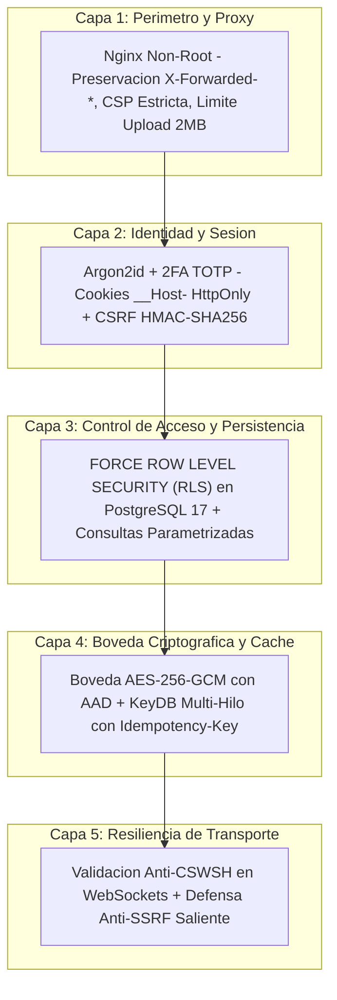
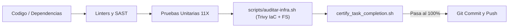

# 🛡️ Política de Seguridad y Arquitectura de Defensa (QA Testing Blueprints)

**Proyecto:** QA Testing Blueprints — Estándar Corporativo Nivel 11X  
**Licencia:** MIT  
**Estándar de Certificación:** QA 11X DevSecOps

En **Tecno Consultores**, la seguridad de nuestra infraestructura y del software que producimos es la máxima prioridad. Este documento establece los estándares de **Seguridad por Diseño (Security-by-Design)**, la mitigación de vectores de ataque en arquitecturas híbridas (SPA + API Asíncrona) y la política de auditoría preventiva **Shift-Left**.

---

## 1. Versiones Soportadas

Dado que este repositorio actúa como la plantilla arquitectónica y base de conocimientos corporativa, las actualizaciones de seguridad se aplican continuamente a la rama principal (`main`):

| Versión | Estado de Soporte | Requisitos de Infraestructura |
| :--- | :--- | :--- |
| **`main` (`latest`)** | ✅ Soporte Activo | Docker 26+, PostgreSQL 17, KeyDB Multi-Hilo |
| **`< 2.0`** | ❌ No Soportado | Versiones descontinuadas |

---

## 2. Reporte Responsable de Vulnerabilidades

Si descubres una vulnerabilidad en nuestras imágenes base, en los scripts de limpieza o en la configuración de los orquestadores efímeros:

1. **NO abras un Issue ni Pull Request público en GitHub/GitLab** con el exploit o vector de ataque.
2. Envía un reporte detallado por correo a: **`soporte@tecnoconsultores.net`** con el asunto `[SECURITY-BLUEPRINT] Descripción breve del hallazgo`.
3. Incluye los pasos de reproducción, componentes afectados y el impacto potencial.
4. Recibirás acuse de recibo en un máximo de **48 horas laborables** y coordinaremos la mitigación antes de la divulgación pública.

---

## 3. Pilares de Seguridad por Diseño y Mitigación de Vulnerabilidades

Cualquier proyecto corporativo que implemente el estándar 11X debe aplicar las siguientes **capas de defensa en profundidad**:



---

## 4. Mitigación Integral de Vectores de Ataque en Plataforma Híbrida (SPA + API)

La integración entre aplicaciones SPA (Vue 3, React) y APIs REST/WebSockets (FastAPI, Node.js) introduce una superficie de ataque específica que debe neutralizarse mediante código defensivo obligatorio:

### 4.1. Prevención de Asignación Masiva (*Mass Assignment / Over-posting*)
- **Riesgo:** Un atacante inyecta campos no autorizados en el payload JSON (ej. `role: "admin"`, `is_superuser: true`).
- **Mitigación:** 
  - Configurar en todos los esquemas Pydantic v2: `model_config = ConfigDict(extra="forbid")`.
  - Desacoplar estrictamente los DTOs de entrada (`UserCreate`) de los modelos ORM de base de datos (`UserInDB`) y de los esquemas de respuesta pública (`UserPublic`).

### 4.2. Protección Anti-CSWSH (*Cross-Site WebSocket Hijacking*)
- **Riesgo:** Los WebSockets no aplican la política SOP (Same-Origin Policy) del navegador. Si un usuario tiene una cookie de sesión activa, un sitio malicioso puede abrir un canal WebSocket no autorizado.
- **Mitigación:** 
  - Inspeccionar la cabecera `Origin` **antes** de invocar `await ws.accept()`.
  - Si el origen no coincide con la lista blanca (`ALLOWED_ORIGINS`), abortar inmediatamente con código de cierre de aplicación `4403` ("Forbidden Origin").

### 4.3. Sanitización de Errores de Validación 422 (`RequestValidationError`)
- **Riesgo:** En desarrollo, los frameworks exponen nombres internos de campos, regex y rutas de código en respuestas 422, facilitando el reconocimiento y fingerprinting del backend.
- **Mitigación:** 
  - En producción (`APP_ENV=production`), capturar globalmente `RequestValidationError`, registrar el traceback detallado en `stdout` del contenedor y devolver al cliente un mensaje genérico: `{"detail": "Los datos proporcionados no cumplen con los requisitos de validación."}`.

### 4.4. Defensa Anti-SSRF en Webhooks, Clientes HTTP y Workers Salientes
- **Riesgo:** La aplicación es forzada a consultar direcciones internas para escanear la red privada o extraer metadatos de proveedores cloud (`169.254.169.254`).
- **Mitigación:** 
  - Resolver el hostname vía DNS **antes** de enviar la petición.
  - Bloquear incondicionalmente: rangos privados RFC 1918 (`10.0.0.0/8`, `172.16.0.0/12`, `192.168.0.0/16`), loopback (`127.0.0.0/8`, `::1`), link-local (`169.254.0.0/16`), multicast y nombres de contenedores Docker internos (`localhost`, `*-db`, `*-redis`, `*-api`, `*-worker`).

### 4.5. Sentencias Parametrizadas Seguras en Contextos Dinámicos
- **Riesgo:** Inyección SQL al interpolar cadenas (`f-strings`) para configurar variables de sesión o tenant (`SET LOCAL app.current_tenant_id = f'{tenant_id}'`).
- **Mitigación:** 
  - Utilizar siempre sentencias parametrizadas seguras mediante `bindparam` de SQLAlchemy o consultas preparadas.

### 4.6. Límites Estrictos de Carga de Archivos (Anti-DoS / OOM)
- **Riesgo:** Agotamiento de memoria RAM en el backend mediante subida de archivos gigantescos no autenticados o payloads masivos.
- **Mitigación:** 
  - Imponer un límite estricto de cuota (ej. 2 MB o 5 MB) en streaming, rechazando solicitudes que excedan el umbral con HTTP `413 Payload Too Large`.

### 4.7. Preservación de Cabeceras de Proxy Inverso en Nginx
- **Riesgo:** Pérdida de la IP real del cliente ante proxies reversos, impidiendo auditorías forenses, rate limiting y detección de ataques de fuerza bruta.
- **Mitigación:** 
  - Configurar explícitamente en Nginx para `/api/` y `/ws/`:
    ```nginx
    proxy_set_header X-Forwarded-For $proxy_add_x_forwarded_for;
    proxy_set_header X-Forwarded-Proto $scheme;
    ```

### 4.8. Desacoplamiento de Middleware Anti-CSRF y Protección Escopada
- **Riesgo:** Ataques CSRF en peticiones disparadas desde navegadores con cookies activas, o bloqueo indebido a llamadas automatizadas de agentes de IA.
- **Mitigación:** 
  - El middleware CSRF extrae el JWT directamente de cookies seguras `__Host-` y exige `X-CSRF-Token` (HMAC-SHA256).
  - Alinear con OWASP CSRF Prevention eximiendo de validación CSRF a las peticiones basadas en cabecera `Authorization: Bearer` (usadas por agentes de IA, automatizaciones y servidores MCP).

### 4.9. Sanitización Estricta Anti-XSS y Anti-Prototype Pollution en Frontend
- **Riesgo:** Inyección de scripts maliciosos en `innerHTML` (ej. popups de mapas cartográficos, tooltips dinámicos) y contaminación de prototipos en JavaScript.
- **Mitigación:** 
  - Usar siempre una función de escape HTML (`escapeHtml`) antes de inyectar contenido dinámico en el DOM.
  - Sanitizar objetos recursivamente eliminando claves peligrosas (`__proto__`, `constructor`, `prototype`) y crear diccionarios puros con `Object.create(null)`.

### 4.10. Seguridad en el Ecosistema MCP y Agentes de IA Autónomos
- **Aislamiento de Ejecución y Regla Cero (`Rule Zero`):** Las herramientas MCP ejecutadas por agentes de IA (`run_ephemeral_qa`, `certify_11x_gate`) operan estrictamente dentro de contenedores efímeros aislados (`sinfallas/*`), impidiendo el escape al sistema anfitrión.
- **Validación Criptográfica de Descargas Zero-Clone (DISA ASD STIG V6R5 `V-222513` / `APSC-DV-001430`):** Toda plantilla o skill descargada dinámicamente por la herramienta `fetch_blueprint_bundle` o el instalador `install-skill` es contrastada contra su hash SHA-256 precalculado en `manifest.json`, bloqueando cualquier manipulación o envenenamiento en tránsito.
- **Publicación Soberana de Artefactos (Modelo RoSGrid):** Se prohíbe alojar secretos de publicación de paquetes (`NPM_TOKEN`) en corredores de CI/CD de terceros. Toda publicación se realiza desde entornos controlados en memoria volátil mediante `scripts/publicar-mcp.sh` (`.env` con permisos `0600`) con autodestrucción del token tras la ejecución.

### 4.11. Tolerancia a Carreras Concurrentes (*Grace Period Leeway* de 5s) en Refresh Tokens
- **Riesgo:** Cuando un usuario abre múltiples pestañas en el navegador, todas intentan refrescar el JWT casi simultáneamente. Un sistema estricto de rotación detecta la segunda petición como "reúso malicioso" y cierra la sesión de forma abrupta.
- **Mitigación:** 
  - Implementar un margen de cortesía (*grace period*) de 5 segundos en la rotación de Refresh Tokens en KeyDB/Redis, permitiendo que las pestañas paralelas reciban el nuevo par de tokens sin provocar falsos positivos de `REUSE_DETECTED`.

### 4.12. Aislamiento Multi-Tenant y por Operador en Llaves de Idempotencia
- **Riesgo:** Colisión cruzada de claves de idempotencia UUID si dos operadores o inquilinos distintos envían el mismo identificador.
- **Mitigación:** 
  - Estructurar las llaves en KeyDB bajo espacios de nombres compuestos: `idemp:{tenant_id}:{user_id}:{idempotency_key}`.

### 4.13. Desactivación de Swagger / ReDoc / OpenAPI en Producción
- **Riesgo:** Exposición pública del mapa completo de endpoints, esquemas de entrada y rutas administrativas, facilitando ataques dirigidos.
- **Mitigación:** 
  - En entorno de producción (`APP_ENV=production`), configurar FastAPI con `docs_url=None`, `redoc_url=None` y `openapi_url=None` (sincronizando también el singleton `settings` en smoke tests post-importación, `QA-SMOKE-01`).

### 4.14. Gobernanza de Sesiones, Timeouts por Rol y Purga en Logout (`DISA STIG V-222387..V-222392, V-222578..V-222583` & `OWASP 4.3.7`)
- **Riesgo:** Secuestro o fijación de sesiones (*Session Fixation*), sesiones huérfanas indefinidas y persistencia de datos sensibles en el almacenamiento del navegador tras cerrar sesión.
- **Mitigación:**
  - Limitar el número de sesiones simultáneas por usuario (`APSC-DV-000010`) y auditar inicios de sesión concurrentes desde distintas estaciones/IPs (`APSC-DV-003360`).
  - Aplicar *idle timeouts* diferenciados por rol: **10 minutos** para sesiones administrativas/privilegiadas (`APSC-DV-000080`) y **15 minutos** para sesiones operativas estándar (`APSC-DV-000070`), además de expiración absoluta (`OWASP SM-8`).
  - Rotar el ID de sesión con un CSPRNG validado (FIPS 140-3) al autenticar o cambiar nivel de privilegio (`APSC-DV-002250..002290`), revocar todas las sesiones activas al deshabilitar cuentas o rotar credenciales (`APSC-DV-001800`) y purgar `localStorage`, `sessionStorage` y `CacheStorage` al cerrar sesión mostrando confirmación explícita (`APSC-DV-000060, 000100, 002240`).

### 4.15. Bloqueo de Cuentas, Anti-Enumeración en Tiempo Constante y Ciclo de Vida (`DISA STIG V-222409..V-222411, V-222432, V-222536..V-222547` & `OWASP 4.3.7`)
- **Riesgo:** Enumeración de cuentas válidas por diferencias de tiempo de respuesta (*Timing Side-Channel*), ataques de fuerza bruta y abuso de cuentas temporales o inactivas no revocadas.
- **Mitigación:**
  - Bloquear la cuenta tras **3 intentos fallidos consecutivos en 15 minutos** (`APSC-DV-000530`) y verificar siempre contra un hash señuelo precalculado (`DUMMY_ARGON2_HASH`) cuando el usuario no exista (`OWASP A-19, A-20`).
  - Exigir contraseñas locales de al menos **15 caracteres** (`APSC-DV-001680`), complejidad multi-clase, cambio mínimo de 8 caracteres (`APSC-DV-001730`), historial de **5 generaciones** (`APSC-DV-001780`) y prohibir preguntas de seguridad (`OWASP P-6`).
  - Deshabilitar automáticamente cuentas temporales a las **72 horas** (`APSC-DV-000300`) y cuentas inactivas a los **35 días** (`APSC-DV-000320`), notificando al usuario la fecha/hora de su último inicio de sesión (`APSC-DV-000580`). Exigir *Step-Up Re-Authentication* para acciones críticas (`APSC-DV-001470`) y validación mTLS/PKI con caché local CRL/OCSP para integraciones máquina a máquina (`APSC-DV-001640, 001850`).

### 4.16. Canonicalización Unicode (`NFKC`), Anti-XXE, Deserialización Segura y Magic Bytes (`DISA STIG V-222593, V-222601..V-222608, V-222626` & `OWASP 4.3.5, 4.3.6`)
- **Riesgo:** Evasión de filtros mediante caracteres homógrafos Unicode, lectura de archivos locales por entidades externas XML (XXE), ejecución remota de código por deserialización insegura (`pickle`/`yaml.load`) o `shell=True`, y carga de binarios maliciosos con extensión falsificada.
- **Mitigación:**
  - Normalizar toda entrada de texto a **Unicode `NFKC`** antes de validar (`APSC-DV-002520`) y rechazar caracteres de control ASCII.
  - Deshabilitar DTDs y entidades externas en analizadores XML (`resolve_entities=False`, `no_network=True`) (`APSC-DV-002390, 002550`) y validar firmas/timestamps/`OneTimeUse` en aserciones SAML (`APSC-DV-000160..000270`).
  - Prohibir `shell=True` (`APSC-DV-002510`) y deserializadores inseguros (`OWASP VSD 1-6`), validar archivos subidos mediante firmas binarias (*Magic Bytes*), almacenarlos fuera del web root con permisos `noexec` y referenciarlos mediante mapas de índices en lista blanca (`APSC-DV-002485, 002960`).

### 4.17. Auditoría Forense Inmutable, Anti-Log Injection y Alerta al 75% de Capacidad (`DISA STIG V-222444, V-222446..V-222509` & `OWASP 4.3.10`)
- **Riesgo:** Falsificación de registros de auditoría mediante inyección CR/LF (`\r\n`), exposición de credenciales/tokens en logs, manipulación de trazas forenses o pérdida de auditoría por disco lleno.
- **Mitigación:**
  - Sanitizar caracteres CR/LF y etiquetas HTML en todos los campos registrables (`OWASP SL-4, SLD-2`) y prohibir terminantemente el registro de contraseñas, tokens o IDs de sesión en logs (`APSC-DV-000650`).
  - Estructurar cada evento con marca de tiempo UTC (granularidad de milisegundos, `APSC-DV-001250`), IPs de origen y destino, identidad de usuario/proceso, resultado y `trace_id`, protegiendo la integridad mediante cadenas **HMAC-SHA256** (`APSC-DV-001350`) serializadas con secuencia `seq_num BIGINT` + `pg_advisory_xact_lock` (`SEC-14`), y alertando cuando el almacenamiento de auditoría alcance el **75% de capacidad** (`APSC-DV-001090`).

### 4.18. Criptografía FIPS 140-3, Zeroización de Memoria y Sanitización de Exportaciones (`DISA STIG V-222393..V-222395, V-222570..V-222577, V-222612, V-222666` & `OWASP 4.3.9`)
- **Riesgo:** Exposición de llaves criptográficas en volcados de memoria RAM o filtración de hashes/credenciales administrativas en volcados de base de datos exportados.
- **Mitigación:**
  - Utilizar módulos criptográficos validados bajo **FIPS 140-2 / 140-3** con diseño de agilidad criptográfica (`APSC-DV-002010..002040`, `OWASP CP-5`), deshabilitar compresión TLS/HTTP (anti-CRIME/BREACH), sobrescribir con ceros (`zeroize`) los búferes de memoria que contengan secretos al salir de cada función (`APSC-DV-002590`, `OWASP MM 1-9`) y purgar credenciales/PII de cualquier exportación de base de datos adjuntando etiquetas de clasificación de seguridad (`APSC-DV-000110, 003120, 003310`).

### 4.19. Cabeceras OSHP, Estado Fail-Secure, API Top 10 (2023), CycloneDX SBOM y Threat Modeling (`DISA STIG V-222424, V-222513, V-222585, V-222616, V-222655` & `OWASP 4.2, 5.3.4, 5.4.4, 7.8`)
- **Riesgo:** Fallos en modo abierto (*Fail-Open*) durante el arranque o caídas de configuración, extracción masiva de datos (*Data Mining*), vulnerabilidades BOLA/BOPLA/BFLA en APIs y compromisos en la cadena de suministro de software.
- **Mitigación:**
  - Aplicar cabeceras del **OWASP Secure Headers Project (OSHP)** (`Strict-Transport-Security`, `Content-Security-Policy`, `X-Content-Type-Options: nosniff`, `X-Frame-Options: DENY`, `Referrer-Policy`, `Cache-Control: no-store`, `X-Robots-Tag: noindex`) y suprimir cabeceras `Server` / `X-Powered-By`.
  - Garantizar transición a **estado seguro (Fail-Closed)** ante fallos de inicialización o aborto (`APSC-DV-002310`) y ejecutar auto-verificación de funciones de seguridad al arranque (`APSC-DV-002770`).
  - Imponer cuotas anti-data-mining en consultas paginadas (`APSC-DV-000450`), validar respuestas de APIs externas con esquemas estrictos y timeouts (`OWASP API10:2023`), mantener modelos de amenazas como código (`OWASP pytm` / `Threat Dragon`, `APSC-DV-003230`) y generar inventarios **CycloneDX SBOM/CBOM (ECMA-424)** verificados criptográficamente (`APSC-DV-001430, 003140`).

### 4.20. Continuidad e Inmunidad Atómica en Flujos Pre-Auth Multi-Etapa (`SEC-16` — `APSC-DV-000530`, `APSC-DV-002270`, `APSC-DV-002560` & `OWASP ASVS V2.8`)
- **Riesgo:** En ceremonias no autenticadas de múltiples pasos (`POST /auth/login` devolviendo `mfa_enrollment_required`, `mfa_challenge` o `password_change_required`, seguido de `POST /auth/mfa/enroll`, `POST /auth/mfa/verify` o WebAuthn), la reutilización no atómica del `challenge_id` permite ataques de carrera (*replay*), mientras que la asimetría entre middlewares globales (`CSRF`/`Idempotency`) y el interceptor HTTP `401 -> /auth/refresh` del frontend rompe el flujo en producción.
- **Mitigación:**
  - Emitir `challenge_id` opaco CSPRNG de al menos **128 bits** (`secrets.token_urlsafe(32)`) exclusivamente en cuerpo JSON o cabecera (nunca en query string) validando `Origin` / `Sec-Fetch-Site`.
  - Consumir el desafío de forma **atómica y de un solo uso** en KeyDB/Redis (`GETDEL` o script Lua) o bajo espacio de nombres `idemp:preauth:{challenge_id}:{key}`, con `TTL <= 300s` y purga inmediata al superar `3–5` intentos fallidos (`APSC-DV-000530`).
  - Compartir simétricamente la lista blanca explícita `PREAUTH_PUBLIC_ROUTES` entre los middlewares backend y el interceptor HTTP `401` del frontend, validando la cadena completa en un único test continuo sin mocks intermedios.

### 4.21. Integridad de Auditoría de Catálogo RLS en PostgreSQL 15–17+ (`QA-PG17-RLS` — `DISA STIG V-222543` & `Standard 11X Law 7`)
- **Riesgo:** Consultas de prueba o validación que verifican `FORCE ROW LEVEL SECURITY` leyendo `pg_tables.forcerowsecurity` fallan en motores reales PostgreSQL 15–17+ (donde dicha columna no existe en la vista `pg_tables`), enmascarando errores en entornos con mocks o rompiendo pipelines CI.
- **Mitigación:**
  - Auditar siempre el estado de RLS consultando `pg_catalog.pg_class` (`relrowsecurity` y `relforcerowsecurity`) mediante `JOIN pg_catalog.pg_namespace` (`nspname = 'public' AND relkind = 'r'`), bloqueando estáticamente cualquier referencia a `pg_tables.forcerowsecurity` mediante `QA-PG17-RLS`.

### 4.22. Contrato de Salud Real en Contenedores y Semántica de Salida en Supervisores Asíncronos (`QA-HEALTH-01` — `DISA APSC-DV-002310`, `APSC-DV-002770` & `Standard 11X UAT Rule #9`)
- **Riesgo:** Orquestadores y runners de workers en segundo plano superan `>= 95%` de cobertura con sub-workers mockeados (`AsyncMock`), pero al desplegarse en contenedores reales caen en bucle `unhealthy` porque los supervisores `asyncio` tratan el retorno limpio (`return None`) de workers opt-in deshabilitados como un fallo fatal (`task.done() and not task.cancelled()`) o jamás verifican la escritura real de la sonda física exigida por `HEALTHCHECK` (`/tmp/worker_heartbeat`).
- **Mitigación:**
  - Inspeccionar explícitamente `task.exception() is not None` en bucles supervisores y declarar un conjunto inmutable `OPTIONAL_WORKERS` para distinguir salidas limpias por feature-flag deshabilitado de caídas reales de bucles infinitos obligatorios (`APSC-DV-002310`).
  - Exigir al menos un test de contrato que arranque el orquestador real bajo `Settings()` de producción por defecto sin mockear los loops opcionales y haga `assert` explícito sobre el artefacto observable de `healthcheck` (`APSC-DV-002770`, auditado estáticamente mediante `QA-HEALTH-01`).

---

## 5. Auditoría Preventiva de Vulnerabilidades y Seguridad Shift-Left

En los proyectos regidos por el estándar 11X, toda vulnerabilidad debe ser detectada y corregida en la estación local antes de hacer commit o push:



### 5.1. Gobernanza de Archivos de Bloqueo (`uv.lock` y `pnpm-lock.yaml`)
- **Compilaciones Herméticas y Reproducibles:** Las versiones de dependencias directas y transitivas deben estar estrictamente congeladas con sus hashes SHA-256 en los archivos de bloqueo para neutralizar ataques a la cadena de suministro (*Supply Chain Attacks*).
- **Protocolo de Parcheo Selectivo:**
  - Para Python: ejecutar en Docker `uv lock --upgrade-package <paquete>`.
  - Para Frontend: ejecutar en Docker `pnpm update <paquete>`.
  - Re-ejecutar suites unitarias y escaneo con `./scripts/auditar-infra.sh` certificando `0` vulnerabilidades CRITICAL y HIGH.

---

## 6. Barreras Automatizadas DevSecOps

Antes de cada commit, el código supera de forma automatizada:
1. **Detección de Secretos:** `./scripts/verificar-secretos.sh` (0 credenciales hardcodeadas).
2. **SAST Estático:** `Bandit` (Python) y `eslint-plugin-security` (Node/Vue/React), con `.npmrc` configurado con `ignore-scripts=true`.
3. **Auditoría IaC y Contenedores:** `Trivy` (`./scripts/auditar-infra.sh`) exigiendo `0` vulnerabilidades `HIGH` o `CRITICAL` y ejecución no-root.
4. **Compuerta de Certificación:** `./.agents/scripts/certify_task_completion.sh` con salida en exit code 0.
