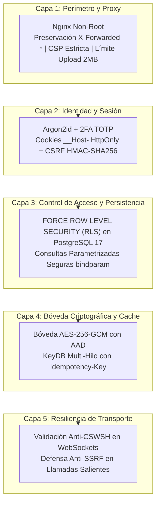
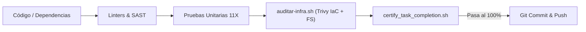

# 🛡️ Política de Seguridad y Arquitectura de Defensa (QA Testing Blueprints)

**Proyecto:** QA Testing Blueprints — Estándar Corporativo Nivel 11X  
**Licencia:** MIT  
**Estándar de Certificación:** QA 11X DevSecOps

En **Tecno Consultores**, la seguridad de nuestra infraestructura y del software que producimos es la máxima prioridad. Este documento establece los estándares de **Seguridad por Diseño (Security-by-Design)**, la mitigación de vectores de ataque en arquitecturas híbridas (SPA + API Asíncrona) y la política de auditoría preventiva **Shift-Left**.

---

## 1. Versiones Soportadas

Dado que este repositorio actúa como la plantilla arquitectónica y base de conocimientos corporativa, las actualizaciones de seguridad se aplican continuamente a la rama principal (`main`):

| Versión | Estado de Soporte | Requisitos de Infraestructura |
| :--- | :--- | :--- |
| **`main` (`latest`)** | ✅ Soporte Activo | Docker 26+, PostgreSQL 17, KeyDB Multi-Hilo |
| **`< 2.0`** | ❌ No Soportado | Versiones descontinuadas |

---

## 2. Reporte Responsable de Vulnerabilidades

Si descubres una vulnerabilidad en nuestras imágenes base, en los scripts de limpieza o en la configuración de los orquestadores efímeros:

1. **NO abras un Issue ni Pull Request público en GitHub/GitLab** con el exploit o vector de ataque.
2. Envía un reporte detallado por correo a: **`soporte@tecnoconsultores.net`** con el asunto `[SECURITY-BLUEPRINT] Descripción breve del hallazgo`.
3. Incluye los pasos de reproducción, componentes afectados y el impacto potencial.
4. Recibirás acuse de recibo en un máximo de **48 horas laborables** y coordinaremos la mitigación antes de la divulgación pública.

---

## 3. Pilares de Seguridad por Diseño y Mitigación de Vulnerabilidades

Cualquier proyecto corporativo que implemente el estándar 11X debe aplicar las siguientes **capas de defensa en profundidad**:



---

## 4. Mitigación Integral de Vectores de Ataque en Plataforma Híbrida (SPA + API)

La integración entre aplicaciones SPA (Vue 3, React) y APIs REST/WebSockets (FastAPI, Node.js) introduce una superficie de ataque específica que debe neutralizarse mediante código defensivo obligatorio:

### 4.1. Prevención de Asignación Masiva (*Mass Assignment / Over-posting*)
- **Riesgo:** Un atacante inyecta campos no autorizados en el payload JSON (ej. `role: "admin"`, `is_superuser: true`).
- **Mitigación:** 
  - Configurar en todos los esquemas Pydantic v2: `model_config = ConfigDict(extra="forbid")`.
  - Desacoplar estrictamente los DTOs de entrada (`UserCreate`) de los modelos ORM de base de datos (`UserInDB`) y de los esquemas de respuesta pública (`UserPublic`).

### 4.2. Protección Anti-CSWSH (*Cross-Site WebSocket Hijacking*)
- **Riesgo:** Los WebSockets no aplican la política SOP (Same-Origin Policy) del navegador. Si un usuario tiene una cookie de sesión activa, un sitio malicioso puede abrir un canal WebSocket no autorizado.
- **Mitigación:** 
  - Inspeccionar la cabecera `Origin` **antes** de invocar `await ws.accept()`.
  - Si el origen no coincide con la lista blanca (`ALLOWED_ORIGINS`), abortar inmediatamente con código de cierre de aplicación `4403` ("Forbidden Origin").

### 4.3. Sanitización de Errores de Validación 422 (`RequestValidationError`)
- **Riesgo:** En desarrollo, los frameworks exponen nombres internos de campos, regex y rutas de código en respuestas 422, facilitando el reconocimiento y fingerprinting del backend.
- **Mitigación:** 
  - En producción (`APP_ENV=production`), capturar globalmente `RequestValidationError`, registrar el traceback detallado en `stdout` del contenedor y devolver al cliente un mensaje genérico: `{"detail": "Los datos proporcionados no cumplen con los requisitos de validación."}`.

### 4.4. Defensa Anti-SSRF en Webhooks, Clientes HTTP y Workers Salientes
- **Riesgo:** La aplicación es forzada a consultar direcciones internas para escanear la red privada o extraer metadatos de proveedores cloud (`169.254.169.254`).
- **Mitigación:** 
  - Resolver el hostname vía DNS **antes** de enviar la petición.
  - Bloquear incondicionalmente: rangos privados RFC 1918 (`10.0.0.0/8`, `172.16.0.0/12`, `192.168.0.0/16`), loopback (`127.0.0.0/8`, `::1`), link-local (`169.254.0.0/16`), multicast y nombres de contenedores Docker internos (`localhost`, `*-db`, `*-redis`, `*-api`, `*-worker`).

### 4.5. Sentencias Parametrizadas Seguras en Contextos Dinámicos
- **Riesgo:** Inyección SQL al interpolar cadenas (`f-strings`) para configurar variables de sesión o tenant (`SET LOCAL app.current_tenant_id = f'{tenant_id}'`).
- **Mitigación:** 
  - Utilizar siempre sentencias parametrizadas seguras mediante `bindparam` de SQLAlchemy o consultas preparadas.

### 4.6. Límites Estrictos de Carga de Archivos (Anti-DoS / OOM)
- **Riesgo:** Agotamiento de memoria RAM en el backend mediante subida de archivos gigantescos no autenticados o payloads masivos.
- **Mitigación:** 
  - Imponer un límite estricto de cuota (ej. 2 MB o 5 MB) en streaming, rechazando solicitudes que excedan el umbral con HTTP `413 Payload Too Large`.

### 4.7. Preservación de Cabeceras de Proxy Inverso en Nginx
- **Riesgo:** Pérdida de la IP real del cliente ante proxies reversos, impidiendo auditorías forenses, rate limiting y detección de ataques de fuerza bruta.
- **Mitigación:** 
  - Configurar explícitamente en Nginx para `/api/` y `/ws/`:
    ```nginx
    proxy_set_header X-Forwarded-For $proxy_add_x_forwarded_for;
    proxy_set_header X-Forwarded-Proto $scheme;
    ```

### 4.8. Desacoplamiento de Middleware Anti-CSRF y Protección Escopada
- **Riesgo:** Ataques CSRF en peticiones disparadas desde navegadores con cookies activas, o bloqueo indebido a llamadas automatizadas de agentes de IA.
- **Mitigación:** 
  - El middleware CSRF extrae el JWT directamente de cookies seguras `__Host-` y exige `X-CSRF-Token` (HMAC-SHA256).
  - Alinear con OWASP CSRF Prevention eximiendo de validación CSRF a las peticiones basadas en cabecera `Authorization: Bearer` (usadas por agentes de IA, automatizaciones y servidores MCP).

### 4.9. Sanitización Estricta Anti-XSS y Anti-Prototype Pollution en Frontend
- **Riesgo:** Inyección de scripts maliciosos en `innerHTML` (ej. popups de mapas cartográficos, tooltips dinámicos) y contaminación de prototipos en JavaScript.
- **Mitigación:** 
  - Usar siempre una función de escape HTML (`escapeHtml`) antes de inyectar contenido dinámico en el DOM.
  - Sanitizar objetos recursivamente eliminando claves peligrosas (`__proto__`, `constructor`, `prototype`) y crear diccionarios puros con `Object.create(null)`.

### 4.10. Tolerancia a Carreras Concurrentes (*Grace Period Leeway* de 5s) en Refresh Tokens
- **Riesgo:** Cuando un usuario abre múltiples pestañas en el navegador, todas intentan refrescar el JWT casi simultáneamente. Un sistema estricto de rotación detecta la segunda petición como "reúso malicioso" y cierra la sesión de forma abrupta.
- **Mitigación:** 
  - Implementar un margen de cortesía (*grace period*) de 5 segundos en la rotación de Refresh Tokens en KeyDB/Redis, permitiendo que las pestañas paralelas reciban el nuevo par de tokens sin provocar falsos positivos de `REUSE_DETECTED`.

### 4.11. Aislamiento Multi-Tenant y por Operador en Llaves de Idempotencia
- **Riesgo:** Colisión cruzada de claves de idempotencia UUID si dos operadores o inquilinos distintos envían el mismo identificador.
- **Mitigación:** 
  - Estructurar las llaves en KeyDB bajo espacios de nombres compuestos: `idemp:{tenant_id}:{user_id}:{idempotency_key}`.

### 4.12. Desactivación de Swagger / ReDoc / OpenAPI en Producción
- **Riesgo:** Exposición pública del mapa completo de endpoints, esquemas de entrada y rutas administrativas, facilitando ataques dirigidos.
- **Mitigación:** 
  - En entorno de producción (`APP_ENV=production`), configurar FastAPI con `docs_url=None`, `redoc_url=None` y `openapi_url=None`.

---

## 5. Auditoría Preventiva de Vulnerabilidades y Seguridad Shift-Left

En los proyectos regidos por el estándar 11X, toda vulnerabilidad debe ser detectada y corregida en la estación local antes de hacer commit o push:



### 5.1. Gobernanza de Archivos de Bloqueo (`uv.lock` y `pnpm-lock.yaml`)
- **Compilaciones Herméticas y Reproducibles:** Las versiones de dependencias directas y transitivas deben estar estrictamente congeladas con sus hashes SHA-256 en los archivos de bloqueo para neutralizar ataques a la cadena de suministro (*Supply Chain Attacks*).
- **Protocolo de Parcheo Selectivo:**
  - Para Python: ejecutar en Docker `uv lock --upgrade-package <paquete>`.
  - Para Frontend: ejecutar en Docker `pnpm update <paquete>`.
  - Re-ejecutar suites unitarias y escaneo con `./auditar-infra.sh` certificando `0` vulnerabilidades CRITICAL y HIGH.

---

## 6. Barreras Automatizadas DevSecOps

Antes de cada commit, el código supera de forma automatizada:
1. **Detección de Secretos:** `./scripts/verificar-secretos.sh` (0 credenciales hardcodeadas).
2. **SAST Estático:** `Bandit` (Python) y `eslint-plugin-security` (Node/Vue/React), con `.npmrc` configurado con `ignore-scripts=true`.
3. **Auditoría IaC y Contenedores:** `Trivy` (`./auditar-infra.sh`) exigiendo `0` vulnerabilidades `HIGH` o `CRITICAL` y ejecución no-root.
4. **Compuerta de Certificación:** `./.agents/scripts/certify_task_completion.sh` con salida en exit code 0.
