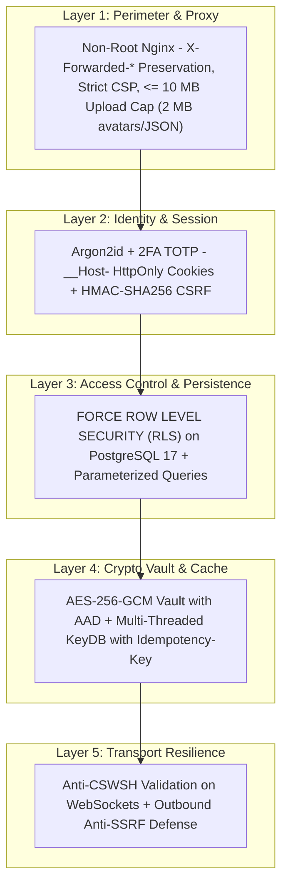
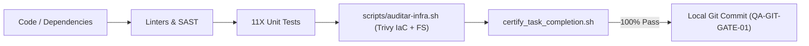

# 🛡️ Security Policy & Defense Architecture (QA Testing Blueprints)

> 🌐 **Language:** **English (Canonical)** · [🇪🇸 Leer en Español](SECURITY.es.md)

**Project:** QA Testing Blueprints — Corporate Standard Level 11X  
**License:** MIT  
**Certification Standard:** QA 11X DevSecOps

At **Tecno Consultores**, the security of our infrastructure and the software we produce is our highest priority. This document defines our **Security-by-Design** standards, attack vector mitigations in hybrid architectures (SPA + Async API), and **Shift-Left** preventive auditing policy.

---

## 1. Supported Versions

Because this repository acts as the corporate architectural blueprint and knowledge base, security updates are applied continuously to the main branch (`main`):

| Version | Support Status | Infrastructure Requirements |
| :--- | :--- | :--- |
| **`3.3.x` (`main` / Active)** | ✅ Active Support | Docker 26+, PostgreSQL 17, Multi-Threaded KeyDB |
| **`3.2.x`** | ⚠️ Security Fixes Only | Superseded by `3.3.x` (`upgrade recommended`) |
| **`3.1.x`** | ⚠️ Security Fixes Only | Superseded by `3.3.x` (`upgrade recommended`) |
| **`3.0.x`** | ⚠️ Security Fixes Only | Superseded by `3.3.x` (`upgrade recommended`) |
| **`<= 2.x`** | ❌ Unsupported | Discontinued versions |

---

## 2. Responsible Vulnerability Disclosure

If you discover a vulnerability in our base images, cleanup scripts, or ephemeral orchestrator configurations:

1. **DO NOT open a public Issue or Pull Request on GitHub/GitLab** disclosing the exploit or attack vector.
2. Send a detailed email report to: **`soporte@tecnoconsultores.net`** with subject `[SECURITY-BLUEPRINT] Brief finding description`.
3. Include reproduction steps, affected components, and potential impact.
4. You will receive an acknowledgment within **48 business hours** and we will coordinate mitigation prior to public disclosure.

---

## 3. Security-by-Design Pillars and Vulnerability Mitigation

Every corporate project implementing Standard 11X must enforce the following **defense-in-depth layers**:



---

## 4. Comprehensive Attack Vector Mitigation in Hybrid Platforms (SPA + API)

Integrating SPAs (Vue 3, React) with REST/WebSocket APIs (FastAPI, Node.js) creates a specific attack surface that must be neutralized via mandatory defensive code:

### 4.1. Mass Assignment / Over-posting Prevention
- **Risk:** An attacker injects unauthorized fields into the JSON payload (e.g., `role: "admin"`, `is_superuser: true`).
- **Mitigation:**
  - Configure all Pydantic v2 schemas with `model_config = ConfigDict(extra="forbid")`.
  - Strictly decouple input DTOs (`UserCreate`) from database ORM models (`UserInDB`) and public response schemas (`UserPublic`).

### 4.2. Anti-CSWSH (*Cross-Site WebSocket Hijacking*) Protection
- **Risk:** WebSockets do not enforce browser Same-Origin Policy (SOP). If a user holds an active session cookie, a malicious site can open an unauthorized WebSocket channel.
- **Mitigation:**
  - Inspect the `Origin` header **before** invoking `await ws.accept()`.
  - If the origin is not in the allowlist (`ALLOWED_ORIGINS`), abort immediately with application close code `4403` ("Forbidden Origin").

### 4.3. Sanitization of 422 Validation Errors (`RequestValidationError`)
- **Risk:** In development mode, frameworks expose internal field names, regex patterns, and code paths in 422 responses, aiding backend reconnaissance and fingerprinting.
- **Mitigation:**
  - In production (`APP_ENV=production`), globally catch `RequestValidationError`, log the detailed traceback to container `stdout`, and return a generic client error: `{"detail": "The provided data does not meet validation requirements."}`.

### 4.4. Anti-SSRF Defense on Outbound Webhooks, HTTP Clients, and Workers
- **Risk:** The application is tricked into querying internal addresses to scan private networks or exfiltrate cloud metadata (`169.254.169.254`).
- **Mitigation:**
  - Resolve the hostname via DNS **before** sending the request.
  - Unconditionally block: RFC 1918 private ranges (`10.0.0.0/8`, `172.16.0.0/12`, `192.168.0.0/16`), loopback (`127.0.0.0/8`, `::1`), link-local (`169.254.0.0/16`), multicast, and internal Docker container names (`localhost`, `*-db`, `*-redis`, `*-api`, `*-worker`).

### 4.5. Safe Parameterized Statements in Dynamic Contexts
- **Risk:** SQL injection via string interpolation (`f-strings`) when setting session or tenant variables (`SET LOCAL app.current_tenant_id = f'{tenant_id}'`).
- **Mitigation:**
  - Always use safe parameterized statements via SQLAlchemy `bindparam` or prepared statements.

### 4.6. Strict File Upload Limits (Anti-DoS / OOM)
- **Risk:** Backend RAM exhaustion via massive unauthenticated uploads or oversized payloads.
- **Mitigation:**
  - Enforce a strict streaming quota limit (`<= 10 MB` general upload cap, with a strict `2 MB` cap for avatars/JSON payloads), rejecting requests above the threshold with HTTP `413 Payload Too Large`.

### 4.7. Reverse Proxy Header Preservation in Nginx
- **Risk:** Loss of true client IP behind reverse proxies, obstructing forensic audits, rate limiting, and brute-force detection.
- **Mitigation:**
  - Configure explicitly in Nginx for `/api/` and `/ws/`:
    ```nginx
    proxy_set_header X-Forwarded-For $proxy_add_x_forwarded_for;
    proxy_set_header X-Forwarded-Proto $scheme;
    ```

### 4.8. Decoupled Anti-CSRF Middleware & Scoped Protection
- **Risk:** CSRF attacks on requests fired from browsers with active cookies, or unwarranted blocking of automated AI agent calls.
- **Mitigation:**
  - The CSRF middleware extracts JWTs directly from secure `__Host-` cookies and requires `X-CSRF-Token` (HMAC-SHA256).
  - Align with OWASP CSRF Prevention by exempting `Authorization: Bearer` header-based requests (used by AI agents, automations, and MCP servers) from CSRF validation.

### 4.9. Strict Anti-XSS and Anti-Prototype Pollution on Frontend
- **Risk:** Malicious script injection into `innerHTML` (e.g., map popups, dynamic tooltips) and JavaScript prototype pollution.
- **Mitigation:**
  - Always pass dynamic content through an HTML escape helper (`escapeHtml`) before DOM injection.
  - Recursively sanitize objects by stripping dangerous keys (`__proto__`, `constructor`, `prototype`) and construct pure dictionaries via `Object.create(null)`.

### 4.10. Security in the MCP Ecosystem and Autonomous AI Agents
- **Execution Isolation & `Rule Zero`:** MCP tools executed by AI agents (`run_ephemeral_qa`, `certify_11x_gate`) operate strictly inside isolated ephemeral containers (`sinfallas/*`), preventing host escape.
- **Cryptographic Zero-Clone Download Verification (DISA ASD STIG V6R5 `V-222513` / `APSC-DV-001430`):** Every blueprint or skill dynamically fetched via `fetch_blueprint_bundle` or `install-skill` is verified against its precomputed SHA-256 hash in `manifest.json`, blocking in-transit tampering or poisoning.
- **Sovereign Artifact Publishing & Human Gate (`QA-GIT-GATE-01`):** Storing package publishing credentials (`NPM_TOKEN`) in third-party CI/CD runners is prohibited. All publishing runs from controlled volatile in-memory sessions via `scripts/publicar-mcp.sh` (`.env` with `0600` permissions) destroying the token immediately after execution, and **strictly requires explicit human authorization** (`QA-GIT-GATE-01` — automated `git push` or `npm publish` by AI agents is forbidden).

### 4.11. Concurrent Race Tolerance (*5s Grace Period Leeway*) on Refresh Tokens
- **Risk:** When a user opens multiple browser tabs, all tabs attempt to refresh the JWT nearly simultaneously. Strict token rotation treats the second request as "malicious reuse" and abruptly terminates the session.
- **Mitigation:**
  - Implement a 5-second *grace period* leeway on Refresh Token rotation in KeyDB/Redis, allowing parallel tabs to receive the rotated token pair without triggering `REUSE_DETECTED` false positives.

### 4.12. Multi-Tenant & Operator Isolation in Idempotency Keys
- **Risk:** Cross-collision of UUID idempotency keys if two operators or distinct tenants send the same identifier.
- **Mitigation:**
  - Namespace keys in KeyDB under composite identifiers: `idemp:{tenant_id}:{user_id}:{idempotency_key}`.

### 4.13. Disabling Swagger / ReDoc / OpenAPI in Production
- **Risk:** Public exposure of the full endpoint map, input schemas, and administrative routes, facilitating targeted attacks.
- **Mitigation:**
  - In production (`APP_ENV=production`), configure FastAPI with `docs_url=None`, `redoc_url=None`, and `openapi_url=None` (also syncing the `settings` singleton in post-import smoke tests, `QA-SMOKE-01`).

### 4.14. Session Governance, Role-Tiered Timeouts, and Logout Purge (`DISA STIG V-222387..V-222392, V-222578..V-222583` & `OWASP 4.3.7`)
- **Risk:** Session hijacking or fixation, indefinite orphan sessions, and sensitive data lingering in browser storage after logout.
- **Mitigation:**
  - Cap concurrent active sessions per user (`APSC-DV-000010`) and audit concurrent logins across distinct hosts/IPs (`APSC-DV-003360`).
  - Enforce role-tiered *idle timeouts*: **10 minutes** for privileged/admin sessions (`APSC-DV-000080`) and **15 minutes** for standard operational sessions (`APSC-DV-000070`), alongside absolute expiration (`OWASP SM-8`).
  - Rotate session IDs with a validated CSPRNG (FIPS 140-3) upon authentication or privilege escalation (`APSC-DV-002250..002290`), revoke all active sessions on account disablement or credential rotation (`APSC-DV-001800`), and purge `localStorage`, `sessionStorage`, and `CacheStorage` on logout with explicit user confirmation (`APSC-DV-000060, 000100, 002240`).

### 4.15. Account Lockout, Constant-Time Anti-Enumeration, and Lifecycle (`DISA STIG V-222409..V-222411, V-222432, V-222536..V-222547` & `OWASP 4.3.7`)
- **Risk:** Account enumeration via response timing discrepancies (*Timing Side-Channel*), brute-force attacks, and abuse of unrevoked temporary or inactive accounts.
- **Mitigation:**
  - Lock accounts after **3 consecutive failed attempts within 15 minutes** (`APSC-DV-000530`) and always verify against a precomputed dummy hash (`DUMMY_ARGON2_HASH`) when the username does not exist (`OWASP A-19, A-20`).
  - Enforce local passwords of at least **15 characters** (`APSC-DV-001680`), multi-class complexity, 8-character minimum change diff (`APSC-DV-001730`), **5-generation** history (`APSC-DV-001780`), and prohibit security questions (`OWASP P-6`).
  - Automatically disable temporary accounts after **72 hours** (`APSC-DV-000300`) and inactive accounts after **35 days** (`APSC-DV-000320`), notifying users of their last login timestamp (`APSC-DV-000580`). Require *Step-Up Re-Authentication* for critical actions (`APSC-DV-001470`) and mTLS/PKI validation with local CRL/OCSP caching for machine-to-machine integrations (`APSC-DV-001640, 001850`).

### 4.16. Unicode Canonicalization (`NFKC`), Anti-XXE, Safe Deserialization, and Magic Bytes (`DISA STIG V-222593, V-222601..V-222608, V-222626` & `OWASP 4.3.5, 4.3.6`)
- **Risk:** Filter bypass via Unicode homographs, local file disclosure via XML external entities (XXE), remote code execution via unsafe deserialization (`pickle`/`yaml.load`) or `shell=True`, and malicious binary uploads with spoofed extensions.
- **Mitigation:**
  - Normalize all text inputs to **Unicode `NFKC`** prior to validation (`APSC-DV-002520`) and reject ASCII control characters.
  - Disable DTDs and external entities in XML parsers (`resolve_entities=False`, `no_network=True`) (`APSC-DV-002390, 002550`) and validate signatures, timestamps, and `OneTimeUse` on SAML assertions (`APSC-DV-000160..000270`).
  - Prohibit `shell=True` (`APSC-DV-002510`) and unsafe deserializers (`OWASP VSD 1-6`), verify uploaded files by binary signatures (*Magic Bytes*), store them outside the web root with `noexec` permissions, and reference them via allowlisted index maps (`APSC-DV-002485, 002960`).

### 4.17. Immutable Forensic Auditing, Anti-Log Injection, and 75% Capacity Alerting (`DISA STIG V-222444, V-222446..V-222509` & `OWASP 4.3.10`)
- **Risk:** Audit record forgery via CR/LF injection (`\r\n`), credential/token exposure in logs, forensic trace tampering, or audit loss due to disk exhaustion.
- **Mitigation:**
  - Sanitize CR/LF characters and HTML tags across all logged fields (`OWASP SL-4, SLD-2`) and strictly forbid logging passwords, tokens, or session IDs (`APSC-DV-000650`).
  - Structure every event with millisecond-granularity UTC timestamps (`APSC-DV-001250`), source/destination IPs, user/process identity, outcome, and `trace_id`, protecting integrity via **HMAC-SHA256** hash chains (`APSC-DV-001350`) serialized with monotonic `seq_num BIGINT` + `pg_advisory_xact_lock` (`SEC-14`), and alerting when audit storage reaches **75% capacity** (`APSC-DV-001090`).

### 4.18. FIPS 140-3 Cryptography, Memory Zeroization, and Export Sanitization (`DISA STIG V-222393..V-222395, V-222570..V-222577, V-222612, V-222666` & `OWASP 4.3.9`)
- **Risk:** Cryptographic key exposure in RAM dumps or administrative credential/hash leakage in exported database dumps.
- **Mitigation:**
  - Use **FIPS 140-2 / 140-3** validated cryptographic modules designed for crypto-agility (`APSC-DV-002010..002040`, `OWASP CP-5`), disable TLS/HTTP compression (anti-CRIME/BREACH), zeroize secret-bearing memory buffers upon function exit (`APSC-DV-002590`, `OWASP MM 1-9`), and scrub credentials/PII from all database exports while attaching security classification labels (`APSC-DV-000110, 003120, 003310`).

### 4.19. OSHP Headers, Fail-Secure State, API Top 10 (2023), CycloneDX SBOM, and Threat Modeling (`DISA STIG V-222424, V-222513, V-222585, V-222616, V-222655` & `OWASP 4.2, 5.3.4, 5.4.4, 7.8`)
- **Risk:** *Fail-Open* failures during startup or config crashes, bulk extraction (*Data Mining*), API BOLA/BOPLA/BFLA flaws, and software supply-chain compromises.
- **Mitigation:**
  - Enforce **OWASP Secure Headers Project (OSHP)** headers (`Strict-Transport-Security`, `Content-Security-Policy`, `X-Content-Type-Options: nosniff`, `X-Frame-Options: DENY`, `Referrer-Policy`, `Cache-Control: no-store`, `X-Robots-Tag: noindex`) and strip `Server` / `X-Powered-By`.
  - Guarantee transition to a **Fail-Closed** state upon initialization failure or abort (`APSC-DV-002310`) and run startup security self-tests (`APSC-DV-002770`).
  - Enforce anti-data-mining quotas on paginated queries (`APSC-DV-000450`), validate external API responses with strict schemas and timeouts (`OWASP API10:2023`), maintain threat models as code (`OWASP pytm` / `Threat Dragon`, `APSC-DV-003230`), and generate cryptographically verified **CycloneDX SBOM/CBOM (ECMA-424)** inventories (`APSC-DV-001430, 003140`).

### 4.20. Continuity & Atomic Immunity in Multi-Stage Pre-Auth Flows (`SEC-16` — `APSC-DV-000530`, `APSC-DV-002270`, `APSC-DV-002560` & `OWASP ASVS V2.8`)
- **Risk:** In multi-step unauthenticated ceremonies (`POST /auth/login` returning `mfa_enrollment_required`, `mfa_challenge`, or `password_change_required`, followed by `POST /auth/mfa/enroll`, `POST /auth/mfa/verify`, or WebAuthn), non-atomic reuse of `challenge_id` enables replay races, while mismatch between global middlewares (`CSRF`/`Idempotency`) and the frontend `401 -> /auth/refresh` HTTP interceptor breaks production flows.
- **Mitigation:**
  - Issue an opaque CSPRNG `challenge_id` of at least **128 bits** (`secrets.token_urlsafe(32)`) exclusively in JSON body or header (never in query string) while validating `Origin` / `Sec-Fetch-Site`.
  - Consume the challenge **atomically and single-use** in KeyDB/Redis (`GETDEL` or Lua script) or under namespace `idemp:preauth:{challenge_id}:{key}`, with `TTL <= 300s` and immediate purge after exceeding `3–5` failed attempts (`APSC-DV-000530`).
  - Symmetrically share the explicit allowlist `PREAUTH_PUBLIC_ROUTES` across backend middlewares and the frontend `401` HTTP interceptor, validating the full chain in a single continuous mock-free test.

### 4.21. PostgreSQL 15–17+ RLS Catalog Audit Integrity (`QA-PG17-RLS` — `DISA STIG V-222543` & `Standard 11X Law 7`)
- **Risk:** Test or validation queries verifying `FORCE ROW LEVEL SECURITY` via `pg_tables.forcerowsecurity` fail on real PostgreSQL 15–17+ engines (where that column does not exist on `pg_tables`), masking errors in mocked suites or breaking CI pipelines.
- **Mitigation:**
  - Always audit RLS state by querying `pg_catalog.pg_class` (`relrowsecurity` and `relforcerowsecurity`) joined with `pg_catalog.pg_namespace` (`nspname = 'public' AND relkind = 'r'`), statically blocking any reference to `pg_tables.forcerowsecurity` via `QA-PG17-RLS`.

### 4.22. Real Container Health Contract & Exit Semantics in Async Supervisors (`QA-HEALTH-01` — `DISA APSC-DV-002310`, `APSC-DV-002770` & `Standard 11X UAT Rule #9`)
- **Risk:** Background orchestrators and worker runners pass `>= 95%` coverage using mocked sub-workers (`AsyncMock`), yet enter an `unhealthy` crash loop in real containers because `asyncio` supervisors treat clean returns (`return None`) of disabled opt-in workers as fatal failures (`task.done() and not task.cancelled()`) or never verify physical writes of the `HEALTHCHECK` probe (`/tmp/worker_heartbeat`).
- **Mitigation:**
  - Explicitly inspect `task.exception() is not None` in supervisor loops and declare an immutable `OPTIONAL_WORKERS` set distinguishing clean feature-flag exits from real crashes of mandatory infinite loops (`APSC-DV-002310`).
  - Require at least one contract test booting the real orchestrator under default production `Settings()` without mocking optional loops and explicitly asserting the observable `healthcheck` artifact (`APSC-DV-002770`, statically audited via `QA-HEALTH-01`).

### 4.23. Interactive Terminal (`TTY`) Anti-Lock Guard for Dual CLI + MCP `stdio` Binaries (`QA-CLI-TTY-01` — `DISA APSC-DV-002310` & `Standard 11X UAT Rule #10`)
- **Risk:** Hybrid packages combining CLI subcommands (`npx ... install-skill`, `argparse`) with an MCP `stdio` server (`StdioServerTransport` / `stdio_server()`) pass 100% of unit tests (which inject fake `startStdio` callbacks) and CI E2E tests (where `stdin` is always a pipe with `isTTY === false`), yet freeze indefinitely awaiting JSON-RPC frames on `stdin` when run with no args by a human in an interactive terminal (`TTY`).
- **Mitigation:**
  - Explicitly inspect `process.stdin.isTTY` (Node/TS) or `sys.stdin.isatty()` (Python) when invoked without subcommands: on an interactive `TTY` (unless `--stdio` or `QA_FORCE_STDIO=1` is forced), execute safe auto-sync, print quick-usage help, and exit with code `0` without opening the blocking transport (`APSC-DV-002310`, statically audited via `QA-CLI-TTY-01`).
  - Require a simulated-`TTY` subprocess probe in E2E with `timeout <= 5s` certifying clean, immediate exit.

### 4.24. Immutable Commit SHA-40 Pinning in GitHub Actions (`SEC-CI-ACTION-REF` — `DISA STIG V-222513`, `APSC-DV-001430` & `Supply Chain Hardening`)
- **Risk:** Referencing third-party Actions by mutable branches (`@main`, `@master`) or unprefixed legacy tags (such as `aquasecurity/trivy-action@0.28.0`, deleted upstream and causing `Unable to resolve action` in GitHub Actions even when local Trivy scans pass) exposes CI/CD pipelines to unexpected breakage and supply-chain tag rewrites.
- **Mitigation:**
  - Pin all external Actions in `.github/workflows/*.yml` and `.github/actions/*/action.yml` to the full 40-character commit SHA-1 hash (`uses: aquasecurity/trivy-action@ed142fd0673e97e23eac54620cfb913e5ce36c25 # v0.36.0`), verify semantic tags exist upstream (`git ls-remote --tags`), and explicitly forbid unprefixed legacy tags on `aquasecurity/trivy-action@0.x.y` and mutable branches (`SEC-CI-ACTION-REF`, statically audited via `audit_security_stig_owasp` and `make lint-workflows`).
  - Local actions (`uses: ./...`, `../...`), `docker://` refs, or exemptions marked `# sec-ci-action-ref-ok` are explicitly exempted.

### 4.25. Non-Interactive Pipeline Execution (`docker compose run -T`) & `noexec` `tmpfs` Cache on `read_only: true` Containers (`QA-DOCKER-TTY-01` — `DISA APSC-DV-002310` & `Rule Zero Hardening`)
- **Risk:** Invoking `docker compose run --rm` without `-T` in CI/CD pipelines or deploy scripts (`CI=true`) allocates a pseudo-TTY (`process.stdin.isTTY === true`) pushing modern CLIs (such as Wrangler v4) into interactive branches and aborting with `NoDefaultValueProvided`; additionally, `read_only: true` containers fail with `ENOENT`/`EROFS` if a tool writes outside `/tmp` (e.g. `/app/.wrangler/cache` in `saveToConfigCache()`), or silently trigger Pages-to-Workers delegation (`maybeDelegatePagesToWorkers()`) when invoked from AI agent sessions without `--force`.
- **Mitigation:**
  - Always use `docker compose run --rm -T` (`--no-TTY`) in GitHub Actions workflows and `deploy*`/`ci*`/`probar-*`/`release*` scripts or when `CI=true`, pre-create required mountpoints (such as `/app/.wrangler`) in `Dockerfile` with non-root `chown` and mount hardened `tmpfs` (`mode=1777,noexec,nosuid,nodev`), verify idempotent Pages project existence under Fail-Secure variable checks, and pass `--force` to `wrangler pages project create` and `wrangler pages deploy` (statically audited via `QA-DOCKER-TTY-01` in `audit_security_stig_owasp`, subject to human confirmation under `QA-GIT-GATE-01`).

### 4.26. Edge Header Hygiene (`_headers` / `_routes.json`), `CORP` Policy, and Multi-Format Assets (`UI-11X-03` — `OWASP OSHP` & `Cloudflare Pages Hardening`)
- **Risk:** On Cloudflare Pages, subpath rules in `public/_headers` additively inherit and concatenate headers from `/*` unless explicitly detached (`! Header-Name`), producing conflicting responses (`Cross-Origin-Resource-Policy: same-origin, cross-origin` or mixed `X-Robots-Tag`) that block favicons and OpenGraph images on external origins; additionally, invalid suffix wildcards in `_routes.json` (`/*.ico`), `apple-touch-icon` pointing to `.webp`/`.svg`, combined `"any maskable"` icons, or missing `public/favicon.ico` (`>= 48x48`) cause silent Safari/iOS and crawler failures.
- **Mitigation:**
  - Explicitly detach with `! <Header>` before redefining `Cache-Control`, `X-Robots-Tag`, `Cross-Origin-Resource-Policy`, `Content-Security-Policy`, `X-Frame-Options`, or `Referrer-Policy` in `public/_headers`, enabling `Cross-Origin-Resource-Policy: cross-origin` on `/favicon.ico`, `/favicons/*`, `/brand/*`, and `/og/*` (while keeping `X-Robots-Tag: noindex, nofollow` on internal SPAs).
  - Mirror `Cross-Origin-Resource-Policy "same-origin"` on `server`/`/index.html` and `"cross-origin"` in `location ~* \.(?:ico|svg|png|webmanifest)$` inside `nginx/default.conf`, exclude `"/favicon.ico"` literally in `_routes.json` (never `/*.ico`), and serve multi-resolution `favicon.ico` (`16x16`/`32x32`/`48x48`), opaque `180x180` `apple-touch-icon.png`, and `site.webmanifest` with `192x192` and `512x512` PNGs (statically audited via `UI-11X-03` in `audit_security_stig_owasp`).

### 4.27. Shell Expansion in GitHub Actions vs. `Makefile`/Compose & `$(CURDIR)` Volume Boundary in Sub-Makefiles (`QA-CI-ESCAPE-01` & `QA-MAKE-CURDIR-01` — `DISA APSC-DV-002510` / `APSC-DV-002310`)
- **Risk:** Copying GNU Make or `docker-compose.yml` double-dollar escapes (`$$(pwd)`, `$$(id -u)`, `$${VAR}`) into GitHub Actions `run:` blocks causes `bash` to expand `$$` to the process numeric PID (`<PID>(pwd)`), triggering fatal Docker volume mount errors (`exit code 125`) only in CI; concurrently, using `$(PWD)` or `${PWD}` in sub-Makefiles (`*/Makefile`) invoked via `$(MAKE) -C <subdir>` retains the parent directory's `PWD` and exposes paths outside the subproject boundary.
- **Mitigation:**
  - Use exclusively single-dollar substitution (`$(pwd)`, `$(id -u)`, `${VAR}`) in `.github/workflows/*.{yml,yaml}` and `.github/actions/*/action.{yml,yaml}` (`QA-CI-ESCAPE-01`, exemptable only in literal generators via `# qa-ci-escape-ok`).
  - Always use `$(CURDIR)` (e.g., `HOST_PWD ?= $(CURDIR)`) instead of `$(PWD)` / `${PWD}` in sub-Makefiles (`QA-MAKE-CURDIR-01`, exemptable via `# qa-make-curdir-ok`), statically audited by `audit_security_stig_owasp`, `scripts/auditar-infra.sh`, and `make lint-workflows`.

### 4.28. Live SDK Transport Contract (`QA-CONTRACT-SDK-01`) & Lockfile Parity + Docker Image Smoke Test (`QA-DOCKER-LOCK-01` — `DISA APSC-DV-001430` & `APSC-DV-002310`)
- **Risk:** Reaching `>= 95%` unit coverage by calling MCP/JSON-RPC/ACP handlers with `MagicMock` misses breaking SDK signature changes (`mcp 1.x -> 2.x`), causing runtime internal errors; additionally, maintaining manual dependency lists in `Dockerfile` rather than installing from lockfiles leads to silent missing packages (`ModuleNotFoundError`) in the final image even when the test harness passes.
- **Mitigation:**
  - Include at least one in-process test wired through the real SDK client/transport (`InMemoryTransport` + `Client` in Node/TS or `ClientSession` / `create_connected_server_and_client_session` in Python) exercising `list_tools` and `call_tool` (`QA-CONTRACT-SDK-01`, exemptable with `# qa-contract-sdk-ok` when covered by an external harness).
  - Install dependencies in `Dockerfile` strictly from the lockfile (`uv sync --frozen --no-dev`, `uv export --frozen --no-dev | uv pip install --system -r -`, `pnpm install --frozen-lockfile`, `npm ci`) and execute a smoke test on the built image (`import <app>`, `id -u != 0`, and `401` probe on protected routes; audited via `QA-DOCKER-LOCK-01` in `audit_security_stig_owasp`, exemptable with `# qa-docker-lock-ok`).

### 4.29. Exact Playwright NPM ↔ Docker Image Parity (`QA-PLAYWRIGHT-PIN-01`) & Anti-SSRF Protection in PageSpeed Insights (`SEC-03` — `DISA APSC-DV-001430` / `APSC-DV-002520`)
- **Risk:** Using SemVer ranges (`^1.52.0`) or floating `:latest` tags between `@playwright/test`/`playwright` in `package.json` and `mcr.microsoft.com/playwright:vX.Y.Z-*` in `docker-compose.qa.yml` triggers `Executable doesn't exist` failures when the preinstalled browser mismatches; additionally, passing unvalidated URLs to external audit tools (`PageSpeed Insights`) without pre-DNS resolution exposes intranet SSRF vectors and risks leaking `?key=...` parameters in error traces.
- **Mitigation:**
  - Pin exact unprefixed versions (`"1.52.0"`) in `@playwright/test` / `playwright` matched 1:1 with `mcr.microsoft.com/playwright:v1.52.0-*` (`QA-PLAYWRIGHT-PIN-01` in `audit_security_stig_owasp`, auto-aligned in `SurgicalMerger.mergePackageJson`, executed non-root as `QA_UID:QA_GID` prioritizing `./node_modules/.bin/{playwright,lhci}`).
  - Validate all target URLs in `.agents/scripts/audit_pagespeed_insights.py` (`make audit-psi` / `make qa-psi`) enforcing exclusive `https://` scheme, pre-DNS blocking of private/loopback/link-local/`.internal` ranges (`SEC-03`), and mandatory redaction of `key=`/`PAGESPEED_API_KEY` parameters (`SEC-06`).

### 4.30. SSR/SSG Hydration Parity under Dual Color Schemes in Playwright (`QA-SSR-HYDRATION-01` — `Standard 11X Layer 9 (L09 Playwright/SSR)` & `APSC-DV-002310`)
- **Risk:** In SSR/SSG apps with light/dark theme switching, an inline `<head>` script mutating `dataset.theme` or `.dark` before hydration causes silent DOM mismatches (*Hydration completed but contains mismatches*) when components use client-dependent `v-if` or when `playwright.config.ts` hardcodes only one `colorScheme` (e.g., `'dark'`), hiding production regressions under `prefers-color-scheme: light`.
- **Mitigation:**
  - Avoid branching initial HTML structure (`v-if` in Vue or conditional JSX/TSX outside `useEffect`) on `localStorage` or `dataset.theme` before mount; render both variants via CSS (`display: none` / `hidden dark:block`) and sync reactive state in `onMounted` / `useEffect`.
  - On SSR/SSG projects with dual theming, add explicit Playwright coverage for both schemes (`'light'` and `'dark'` via `browser.newContext({ colorScheme })` or `page.emulateMedia({ colorScheme })`) plus `console` and `pageerror` listeners failing on any `/hydration/i` message (audited by `QA-SSR-HYDRATION-01` in `audit_security_stig_owasp`, exemptable with `# qa-ssr-hydration-ok`).

### 4.31. Non-Root Bounded Stryker Mutation Execution (`QA-STRYKER-CFG-01` — `Standard 11X Layer 6 (L06 Mutation)` & `APSC-DV-003210`)
- **Risk:** Configuring Stryker Mutator without `"ignoreStatic": true`, without `!src/**/*.{unit,spec,test}.*` test exclusions in `mutate`, or with `"concurrency" > 4` exhausts ephemeral CI container RAM/PIDs and causes OOM kills, while invoking Stryker under non-root UID containers where host/procps `ps` differs triggers child-process discovery failures unless a deterministic `/tmp/qa-bin/ps` shim is wired in `qa-mutation`.
- **Mitigation:**
  - Pin `"ignoreStatic": true`, `"concurrency" <= 4`, and explicit `!src/**/*.{unit,spec,test}.*` exclusions in `mutate` across `stryker.conf.json(.example)` (`node-backend`, `vue3`, `react-frontend`) alongside `coverageAnalysis: "perTest"`, failing fast on static check regressions (`QA-STRYKER-CFG-01`, exemptable with `# qa-stryker-cfg-ok`).
  - Provide a non-root `/tmp/qa-bin/ps` shim (`PATH="/tmp/qa-bin:$$PATH"`) in container `qa-mutation` targets and enforce deterministic Python `mutmut_gates.py` (`>= 80%` killed ratio) and `qa-profile` (`py-spy`) flamegraph gates.

### 4.32. Multi-Tenant WebSocket & Redis/KeyDB PubSub Isolation and Pool Cleanup (`SEC-WS-PUBSUB-01` — `DISA STIG V-222536 / APSC-DV-001880` & `OWASP A01:2025`)
- **Risk:** Subscribing WebSocket gateways to global/unvalidated Redis/KeyDB PubSub channels (e.g., `SUBSCRIBE events` or `*`) without `tenant_id` scoping leaks cross-tenant events, while omitting guaranteed `pubsub.aclose()`/`close()` inside `try/finally:` under abrupt client disconnects exhausts the broker connection pool across sequential E2E runs.
- **Mitigation:**
  - Namespace all broker channels with the authenticated tenant (`ws:${tenant_id}:events` / `f"ws:{tenant_id}:events"`), validate tenant membership server-side, run a decoupled `ws.receive()` disconnect watcher, and guarantee `await pubsub.aclose()` inside `finally:` (`SEC-WS-PUBSUB-01`, exemptable with `# sec-ws-pubsub-ok`).

---

## 5. Preventive Vulnerability Auditing and Shift-Left Security

In projects governed by Standard 11X, every vulnerability must be detected and fixed locally before committing or pushing:



### 5.1. Lockfile Governance (`uv.lock` and `pnpm-lock.yaml`)
- **Hermetic Reproducible Builds:** Direct and transitive dependency versions must be strictly pinned with their SHA-256 hashes in lockfiles to neutralize *Supply Chain Attacks*.
- **Selective Patching Protocol:**
  - For Python: run `uv lock --upgrade-package <package>` in Docker.
  - For Frontend: run `pnpm update <package>` in Docker.
  - Re-run unit suites and scan with `./scripts/auditar-infra.sh` certifying `0` CRITICAL and HIGH vulnerabilities.

### 5.2. Automated Daily Base Image Audit (`audit-base-images.yml`)
- **Cadence & Scope:** The workflow [`.github/workflows/audit-base-images.yml`](.github/workflows/audit-base-images.yml) runs daily (`cron: '0 6 * * *'`), on demand (`workflow_dispatch`), and on `pull_request` changes to container/security manifests, enforcing least privilege (`permissions: contents: read`), explicit `timeout-minutes`, and immutable SHA-pinned Actions (`SEC-CI-ACTION-REF`).
- **Official Image Scanning (`Trivy HIGH/CRITICAL = 0`):** `fail-fast: false` matrix across `sinfallas/base-python-uv:{latest,3.15}`, `sinfallas/base-node-ionic:{latest,26}`, `sinfallas/basephpcomposer:{latest,8.5}`, `sinfallas/karatelabs:{1.5.1,latest}`, `sinfallas/base-bash-qa:latest`, `sinfallas/remote-graphify:latest`, and `sinfallas/base-mobile-appium:{latest,26}` (`12` targets) with `--severity HIGH,CRITICAL --ignore-unfixed --exit-code 1`, plus non-root `smoke-mobile-appium` toolchain verification (`java`, `adb`, `appium`).
- **Python v2 Package Audit (`pip-audit`) & SAST (`CodeQL`):** Ephemeral non-root execution (`--user 10001:10001 -e HOME=/tmp`) of `pip-audit --strict --desc` on `sinfallas/base-python-uv:3.15`, `CodeQL` analysis across `javascript-typescript`, `python`, and `actions`, and deterministic local workflow validation via `make lint-workflows`.

---

## 6. Automated DevSecOps Barriers

Before every commit, code automatically passes:
1. **Secret Detection:** `./scripts/verificar-secretos.sh` (0 hardcoded credentials).
2. **Static SAST:** `Bandit` (Python) and `eslint-plugin-security` (via **ESLint 9 Flat Config (`eslint.config.mjs`)** + `sonarjs` v3 + type-aware rules, or `plugin:security/recommended-legacy` on legacy ESLint 8 repos), with `.npmrc` configured with `ignore-scripts=true` and native exemptions declared via the `allowBuilds` boolean map in `pnpm-workspace.yaml` (`SEC-09`).
3. **IaC & Container Audit:** `Trivy` (`./scripts/auditar-infra.sh`) requiring `0` `HIGH` or `CRITICAL` vulnerabilities and non-root execution.
4. **Certification Gate:** `./.agents/scripts/certify_task_completion.sh` returning exit code 0.
5. **Workflow Validation & Continuous Audit:** `make lint-workflows` locally and `.github/workflows/audit-base-images.yml` (`Trivy`, `pip-audit`, and `CodeQL`) in CI.
