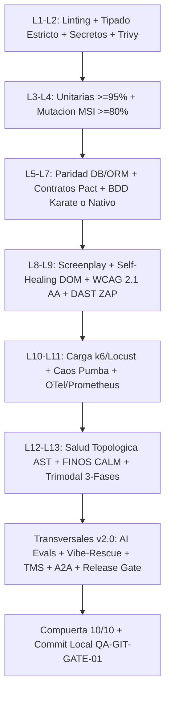

> 🌐 **Idioma / Language:** [🇬🇧 English (01_ARQUITECTURA_PIRAMIDE_11X.md)](01_ARQUITECTURA_PIRAMIDE_11X.md) | **Español (Espejo 1:1)**

# 🏛️ Arquitectura de la Pirámide de Calidad QA-11X v3.0 (13 Capas + Transversales Agénticos)

> **PROPÓSITO:** Documento arquitectónico maestro en español corporativo que define las **13 capas de calidad**, los **planos transversales agénticos y de seguridad** de **QA-11X v3.0**, los **3 niveles progresivos de adopción** (`starter`, `standard`, `enterprise`) y las **3 vías proporcionales de ejecución** (`DOCS_ONLY`, `MICRO_CHANGE`, `FULL_11X`).

---

## 1. Adopción Proporcional en 3 Vías y 3 Perfiles

Para evitar sobreingeniería en tareas pequeñas sin relajar los controles en sistemas críticos, QA-11X v3.0 separa el **nivel de adopción del repositorio** de la **vía de ejecución por cambio**:

| Dimensión | Clasificación | Criterio de Activación | Alcance de Validación |
| :--- | :--- | :--- | :--- |
| **Perfil** | **`starter`** | Inicio rápido en 30s (`quickstart`) | Secretos = 0, contenedores no-root (`Rule Zero`), `.qa-11x.json`, conector `AGENTS.md` (27+ agentes) |
| **Perfil** | **`standard`** | PRs diarios de equipos productivos | `starter` + cobertura `>= 95%`, tipado estricto (`mypy --strict`, `tsc`, `PHPStan max`), partición AST CI (`40%–60%` ahorro) y linter de antipatrones UI |
| **Perfil** | **`enterprise`** | Sistemas regulados o multi-tenant | Pirámide completa de 13 capas + FINOS CALM, PostgreSQL 17 RLS + WORM, DISA STIG V6R5, Pact + k6, AI Evals y Release Readiness Gate |
| **Vía** | **`DOCS_ONLY`** | Cambios exclusivos en `*.md` o `docs/` | `0` contenedores QA, `0` reconstrucciones AST; sincroniza manifiesto/docs y certifica `make lint-docs && make certify` |
| **Vía** | **`MICRO_CHANGE`** | `<= 3` archivos, `0` rutas/ORM nuevos, Blast Radius `LOW` (`< 5` llamadores) | Suite unitaria/contrato focalizada del stack + co-evolución `QA-TEST-SYNC-01` + actualización incremental AST |
| **Vía** | **`FULL_11X`** | `> 3` archivos, nuevas APIs/Vistas, ORM, seguridad o Blast Radius `MEDIUM/HIGH` | Flujo integral de 11 pasos y 13 capas con cierre obligatorio en compuerta 10/10 |

### Regla Proporcional de BDD: Karate Labs vs. Runners Nativos sin JVM

* **Karate Labs obligatorio (`sinfallas/karatelabs`):** Requerido en aplicaciones `FULL_11X` multi-servicio, con persistencia transaccional real, flujos RBAC multi-rol o contratos HTTP/Edge/OSHP/SSG sobre Nginx (`fastapi/test/`, `vue3/test/`, `mcp-server/test/`).
* **Runners nativos sin JVM autorizados:** En microservicios ligeros (`<= 3` endpoints), librerías aisladas o CLIs sin estado complejo, se autorizan contratos **Consumer-Driven Pact** (`pact-python`, `@pact-foundation/pact`), `pytest + httpx` o `vitest` / Playwright API para evitar la sobrecarga de JVM manteniendo idempotencia (`Idempotency-Key`) y fixtures trimodales.

---

## 2. Topología de la Pirámide QA-11X v3.0 (13 Capas + Transversales)

### Desglose de las 13 Capas y Planos Transversales v2.0

| Capa / Plano | Responsabilidad Principal | Artefactos e Implementación en el Monorepo |
| :--- | :--- | :--- |
| **L01–L02** | Lint (`CC <= 5`), tipado estricto, secretos, SBOM CycloneDX y Trivy `HIGH/CRITICAL = 0` | [`scripts/verificar-secretos.sh`](../scripts/verificar-secretos.sh), [`scripts/auditar-infra.sh`](../scripts/auditar-infra.sh), [`scripts/generar-sbom-cyclonedx.sh`](../scripts/generar-sbom-cyclonedx.sh) |
| **L03–L04** | Unitarias herméticas `>= 95%` y mutación (`MSI >= 80%`) | `pytest-cov`, `@vitest/coverage-v8`, `PCOV`, `Mutmut`, `Stryker`, `Infection` |
| **L05** | Migraciones reales en `postgres:17-alpine`, RLS + WORM `seq_num` | [`.agents/scripts/verify_alembic_orm_parity.py`](../.agents/scripts/verify_alembic_orm_parity.py), [`vibe-rescue/templates/rls_hardening.sql`](../vibe-rescue/templates/rls_hardening.sql) |
| **L06–L07** | Contratos Consumer-Driven **Pact V4** y BDD proporcional (Karate o nativo) | [`fastapi/tests/contracts/test_pact_consumer.py`](../fastapi/tests/contracts/test_pact_consumer.py), [`node-backend/tests/contracts/provider.pact.test.ts`](../node-backend/tests/contracts/provider.pact.test.ts) |
| **L08** | **Screenplay multi-rol + Self-Healing DOM**, WCAG 2.1 AA, Lighthouse y linter UI (`QA-UI-ANTI-001..005`) | [`vue3/tests/screenplay/Actor.ts`](../vue3/tests/screenplay/Actor.ts), [`react-frontend/tests/utils/semanticLocator.ts`](../react-frontend/tests/utils/semanticLocator.ts), [`mobile-appium/tests/screenplay/MobileActor.ts`](../mobile-appium/tests/screenplay/MobileActor.ts), [`.agents/scripts/lint_test_antipatterns.py`](../.agents/scripts/lint_test_antipatterns.py) |
| **L09–L11** | DAST (`OWASP ZAP`), carga declarativa (**Grafana k6** / Locust) y caos (`Pumba` post-RED `/metrics`) | [`fastapi/tests/load/smoke.k6.js`](../fastapi/tests/load/smoke.k6.js), [`docs/03_TIPOS_DE_PRUEBAS_Y_COMO_UTILIZARLOS.es.md`](03_TIPOS_DE_PRUEBAS_Y_COMO_UTILIZARLOS.es.md) |
| **L12** | **Arquitectura como Código FINOS CALM** + salud topológica AST + partición CI por Blast Radius | [`architecture/qa-11x.calm.json`](../architecture/qa-11x.calm.json), [`.agents/scripts/validate_calm_architecture.sh`](../.agents/scripts/validate_calm_architecture.sh), [`.agents/scripts/select_tests_by_blast_radius.py`](../.agents/scripts/select_tests_by_blast_radius.py), [`.github/workflows/ci-tiered-qa.yml`](../.github/workflows/ci-tiered-qa.yml) |
| **L13** | Fixtures trimodales (`Virgin`/`Nominal`/`Degraded`), ciclo temporal de 3 fases y 10 leyes Anti-Ceguera | [`.agents/rules/ground_truth_fixtures_and_negative_invariants.md`](../.agents/rules/ground_truth_fixtures_and_negative_invariants.md), [`docs/02_BUENAS_PRACTICAS_PROGRAMACION_11X.es.md`](02_BUENAS_PRACTICAS_PROGRAMACION_11X.es.md) |
| **AI Evals & Shield** | Modo 1 offline `$0` (`make test-ai-offline`), Modo 2 `DeepEval` + `Promptfoo` OWASP LLM Top 10 (`make audit-llm`), voz WebRTC, PDF/OCR `Decimal`, `promptGuard` y perfiles Ollama/vLLM | [`ai-evals/README.md`](../ai-evals/README.md), [`mcp-server/src/security/promptGuard.ts`](../mcp-server/src/security/promptGuard.ts), [`specs/14_LOCAL_LLM_AND_A2A_PROFILES.md`](specs/14_LOCAL_LLM_AND_A2A_PROFILES.md) |
| **Vibe-to-Enterprise** | Rescate en 5 etapas para apps generadas por IA sin destruir UX | [`vibe-rescue/README.md`](../vibe-rescue/README.md), [`vibe-rescue/audit_vibe_prototype.py`](../vibe-rescue/audit_vibe_prototype.py) |
| **TMS, A2A & Release Gate** | Trazabilidad bidireccional `Jira`/`Zephyr`/`Xray`/`GitHub Issues`, tarjeta A2A y compuerta multi-señal (`GO`/`NO_GO`/`SKIPPED`) | [`specs/15_ENTERPRISE_TMS_TRACEABILITY.md`](specs/15_ENTERPRISE_TMS_TRACEABILITY.md), [`mcp-server/src/a2a/agentCard.ts`](../mcp-server/src/a2a/agentCard.ts), [`.agents/scripts/release_readiness_gate.py`](../.agents/scripts/release_readiness_gate.py) |

---

## 3. Superficie MCP, Economía de Tokens y Cierre Humano (`QA-GIT-GATE-01`)

* **Servidor MCP `@sinfallas/mcp-qa-11x` v3.0.0:** Expone públicamente **19 Tools** (12 núcleo v1 + 6 evaluadores v2.0 + `session_flight_recorder`) y **13 Resources** (`blueprint://*`, incluyendo `blueprint://skills/tactical-patterns-11x`) protegidos sobre `stdio` con `promptGuard` y `TaskStateGuard`.
* **Economía de Tokens (`< 20 KB` / `<= 40` líneas):** La skill orquestadora [`.agents/skills/qa-11x-architect/SKILL.md`](../.agents/skills/qa-11x-architect/SKILL.md) (`< 12 KB`) hidrata 10 sub-skills modulares bajo demanda (incluyendo `tactical-patterns-11x` `<= 2.5 KB` JIT), proyecta determinísticamente `.agents/ACTIVE_TASK.md` vía `checkpoint_ctl.py` y usa [`.agents/scripts/compact_context_11x.py`](../.agents/scripts/compact_context_11x.py) + formato `Pass-Quiet / Fail-Verbose` (`/tmp/qa-11x-last-failure.json`).
* **Guardia Humana de Cierre (`QA-GIT-GATE-01`):** Toda tarea concluye superando las 10 etapas de [`.agents/scripts/certify_task_completion.sh`](../.agents/scripts/certify_task_completion.sh) y realizando un `git commit` local. Según [`.agents/rules/git_closure_gate.md`](../.agents/rules/git_closure_gate.md), ningún agente puede ejecutar `git push` o `npm publish` sin autorización humana explícita.

---

## 4. Documentación Relacionada

* [Portada Global English-First (`README.md`)](../README.md) · [Espejo en Español (`README.es.md`)](../README.es.md)
* [Catálogo Maestro de Recursos (`RESOURCES.md`)](../RESOURCES.md)
* [Gobernanza de Agentes IA (`01_ARQUITECTURA_Y_GOBERNANZA_AGENTES_IA.es.md`)](01_ARQUITECTURA_Y_GOBERNANZA_AGENTES_IA.es.md)
* [Guía de Desarrollo Seguro (`04_GUIA_DESARROLLO_SEGURO_Y_MITIGACION_DE_VULNERABILIDADES.es.md`)](04_GUIA_DESARROLLO_SEGURO_Y_MITIGACION_DE_VULNERABILIDADES.es.md)
