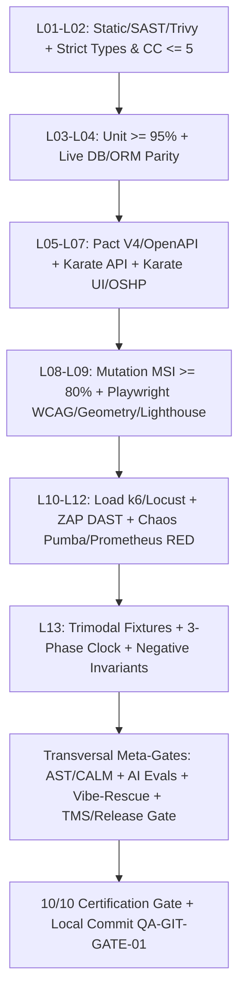

> 🌐 **Language:** **English (Canonical)** · [🇪🇸 Leer en Español](01_ARQUITECTURA_PIRAMIDE_11X.es.md)

# 🏛️ QA-11X v3.8 Quality Pyramid Architecture (13 Layers + Agentic Cross-Cutting Planes)

> **PURPOSE:** Canonical architectural specification defining the **13 quality layers**, the **agentic and security cross-cutting planes** of **QA-11X v3.8**, the **3 progressive adoption profiles** (`starter`, `standard`, `enterprise`), and the **3 proportional execution paths** (`DOCS_ONLY`, `MICRO_CHANGE`, `FULL_11X`).

---

## 1. Proportional Adoption Across 3 Paths and 3 Profiles

To prevent over-engineering on small tasks without relaxing controls on critical systems, QA-11X v3.8 decouples the **repository adoption profile** from the **per-change execution path**:

| Dimension | Classification | Activation Criteria | Validation Scope |
| :--- | :--- | :--- | :--- |
| **Profile** | **`starter`** | 30s quickstart (`quickstart`) | Secrets = 0, non-root containers (`Rule Zero`), `.qa-11x.json`, `AGENTS.md` connector (28 agents) |
| **Profile** | **`standard`** | Daily PRs by product teams | `starter` + coverage `>= 95%`, strict typing (`mypy --strict`, `tsc`, `PHPStan max`), AST CI sharding (`40%–60%` savings), and UI anti-pattern linter |
| **Profile** | **`enterprise`** | Regulated or multi-tenant systems | Full 13-layer pyramid + FINOS CALM, PostgreSQL 17 RLS + WORM, DISA STIG V6R5, Pact + k6, AI Evals, and Release Readiness Gate |
| **Path** | **`DOCS_ONLY`** | Changes strictly limited to human `*.md` or `docs/` (excludes `.agents/{skills,rules,schemas}/`) | `0` QA containers, `0` AST rebuilds; syncs manifest/docs and certifies `make lint-docs && make certify` |
| **Path** | **`MICRO_CHANGE`** | `<= 3` files, `0` new routes/ORM, Blast Radius `LOW` (`< 5` callers) | Focused stack unit/contract suite + `QA-TEST-SYNC-01` co-evolution + incremental AST refresh |
| **Path** | **`FULL_11X`** | `> 3` files, new APIs/Views, ORM, security, or `MEDIUM/HIGH` Blast Radius | Full 11-step, 13-layer workflow with mandatory 10/10 gate closure |

### Proportional BDD Rule: Karate Labs vs. JVM-Free Native Runners

* **Mandatory Karate Labs (`sinfallas/karatelabs`):** Required in `FULL_11X` multi-service applications with real transactional persistence, multi-role RBAC flows, or HTTP/Edge/OSHP/SSG contracts behind Nginx (`fastapi/test/`, `vue3/test/`, `mcp-server/test/`).
* **Authorized JVM-free native runners:** In lightweight microservices (`<= 3` endpoints), standalone libraries, or CLIs without complex state, **Consumer-Driven Pact** contracts (`pact-python`, `@pact-foundation/pact`), `pytest + httpx`, or `vitest` / Playwright API are authorized to avoid JVM overhead while preserving idempotency (`Idempotency-Key`) and trimodal fixtures.

---

## 2. QA-11X v3.8 Pyramid Topology (13 Layers + Cross-Cutting Planes)

### Breakdown of the 13 Layers and Transversal Meta-Gates

| Layer / Meta-Gate | Primary Responsibility | Monorepo Artifacts & Implementation |
| :--- | :--- | :--- |
| **L01** | Static analysis, linters (`--max-warnings 0`), secrets, CycloneDX SBOM, and Trivy `HIGH/CRITICAL = 0` | [`scripts/verificar-secretos.sh`](../scripts/verificar-secretos.sh), [`scripts/auditar-infra.sh`](../scripts/auditar-infra.sh), [`scripts/generar-sbom-cyclonedx.sh`](../scripts/generar-sbom-cyclonedx.sh) |
| **L02** | Strict static typing (`mypy --strict`, `tsc`, `PHPStan max`) and Radon Grade A (`CC <= 5`) / SonarJS (`<= 15`) | [`fastapi/pyproject.toml.example`](../fastapi/pyproject.toml.example), [`mcp-server/eslint.config.mjs`](../mcp-server/eslint.config.mjs), [`php/phpstan.neon.example`](../php/phpstan.neon.example) |
| **L03** | Hermetic isolated unit tests (`>= 95%` lines/branches/statements) | `pytest-cov`, `@vitest/coverage-v8`, `PCOV`, `BATS-core/kcov` |
| **L04** | Live DB schema & ORM migration parity on `postgres:17-alpine`, RLS + WORM `seq_num` | [`.agents/scripts/verify_alembic_orm_parity.py`](../.agents/scripts/verify_alembic_orm_parity.py), [`vibe-rescue/templates/rls_hardening.sql`](../vibe-rescue/templates/rls_hardening.sql) |
| **L05** | Consumer-Driven **Pact V4** contracts and OpenAPI fuzzing (`Schemathesis`) | [`fastapi/tests/contracts/test_pact_consumer.py`](../fastapi/tests/contracts/test_pact_consumer.py), [`node-backend/tests/contracts/provider.pact.test.ts`](../node-backend/tests/contracts/provider.pact.test.ts) |
| **L06** | Black-box API BDD contracts (**Karate Labs API** with dynamic `Idempotency-Key`, or authorized JVM-free runners) | [`fastapi/test/api_test.feature`](../fastapi/test/api_test.feature), [`node-backend/test/node_api.feature`](../node-backend/test/node_api.feature), [`mcp-server/test/mcp_cli_test.feature`](../mcp-server/test/mcp_cli_test.feature) |
| **L07** | Black-box UI HTTP/OSHP/SSG contracts (**Karate Labs UI** without headless browser + Dual Refresh) | [`vue3/test/ui_business_flow.feature`](../vue3/test/ui_business_flow.feature), [`react-frontend/test/ui_business_flow.feature`](../react-frontend/test/ui_business_flow.feature) |
| **L08** | Mutation testing (`MSI >= 80%`, anti-false positives) | `Mutmut`, `Stryker`, `Infection` |
| **L09** | **Playwright** multi-role Screenplay + Self-Healing DOM, WCAG 2.1 AA, Lighthouse CI, and UI linter (`QA-UI-ANTI-001..005`) | [`vue3/tests/screenplay/Actor.ts`](../vue3/tests/screenplay/Actor.ts), [`react-frontend/tests/utils/semanticLocator.ts`](../react-frontend/tests/utils/semanticLocator.ts), [`mobile-appium/tests/screenplay/MobileActor.ts`](../mobile-appium/tests/screenplay/MobileActor.ts), [`.agents/scripts/lint_test_antipatterns.py`](../.agents/scripts/lint_test_antipatterns.py) |
| **L10** | Performance, concurrency, and stress testing (`grafana/k6:2.4.0` / `Locust` / `Artillery`) | [`fastapi/tests/load/smoke.k6.js`](../fastapi/tests/load/smoke.k6.js), [`docs/03_TIPOS_DE_PRUEBAS_Y_COMO_UTILIZARLOS.md`](03_TIPOS_DE_PRUEBAS_Y_COMO_UTILIZARLOS.md) |
| **L11** | Dynamic security DAST (`OWASP ZAP`), OSHP security headers, and Fail-Secure state testing | [`docs/03_TIPOS_DE_PRUEBAS_Y_COMO_UTILIZARLOS.md`](03_TIPOS_DE_PRUEBAS_Y_COMO_UTILIZARLOS.md), [`SECURITY.md`](../SECURITY.md) |
| **L12** | Chaos engineering (`Pumba`) and pre-chaos RED telemetry (`/metrics` on `Prometheus`) | [`docs/03_TIPOS_DE_PRUEBAS_Y_COMO_UTILIZARLOS.md`](03_TIPOS_DE_PRUEBAS_Y_COMO_UTILIZARLOS.md), [`fastapi/docker-compose.qa.yml`](../fastapi/docker-compose.qa.yml) |
| **L13** | Trimodal fixtures (`Virgin`/`Nominal`/`Degraded`), 3-phase clock lifecycle, 10 Non-Negotiable Laws + 11 UAT Anti-Blindness Rules | [`.agents/rules/ground_truth_fixtures_and_negative_invariants.md`](../.agents/rules/ground_truth_fixtures_and_negative_invariants.md), [`docs/02_BUENAS_PRACTICAS_PROGRAMACION_11X.md`](02_BUENAS_PRACTICAS_PROGRAMACION_11X.md) |
| **Transversal: AST, CALM & 10/10 Gate** | **Architecture-as-Code FINOS CALM**, AST topological health, Blast Radius CI sharding, and 10-stage closure gate | [`architecture/qa-11x.calm.json`](../architecture/qa-11x.calm.json), [`.agents/scripts/validate_calm_architecture.sh`](../.agents/scripts/validate_calm_architecture.sh), [`.agents/scripts/select_tests_by_blast_radius.py`](../.agents/scripts/select_tests_by_blast_radius.py), [`.github/workflows/ci-tiered-qa.yml`](../.github/workflows/ci-tiered-qa.yml) |
| **Transversal: AI Evals & Shield** | Mode 1 offline `$0` (`make test-ai-offline`), Mode 2 `DeepEval` + `Promptfoo` OWASP LLM Top 10 (`make audit-llm`), WebRTC voice, PDF/OCR `Decimal`, `promptGuard`, and Ollama/vLLM profiles | [`ai-evals/README.md`](../ai-evals/README.md), [`mcp-server/src/security/promptGuard.ts`](../mcp-server/src/security/promptGuard.ts), [`specs/14_LOCAL_LLM_AND_A2A_PROFILES.md`](specs/14_LOCAL_LLM_AND_A2A_PROFILES.md) |
| **Transversal: Vibe-Rescue** | 5-stage rescue for AI-generated prototypes without breaking UX | [`vibe-rescue/README.md`](../vibe-rescue/README.md), [`vibe-rescue/audit_vibe_prototype.py`](../vibe-rescue/audit_vibe_prototype.py) |
| **Transversal: TMS, A2A & Release Gate** | Bidirectional `Jira`/`Zephyr`/`Xray`/`GitHub Issues` traceability, A2A agent card, and multi-signal gate (`GO`/`NO_GO`/`SKIPPED`) | [`specs/15_ENTERPRISE_TMS_TRACEABILITY.md`](specs/15_ENTERPRISE_TMS_TRACEABILITY.md), [`mcp-server/src/a2a/agentCard.ts`](../mcp-server/src/a2a/agentCard.ts), [`.agents/scripts/release_readiness_gate.py`](../.agents/scripts/release_readiness_gate.py) |

---

## 3. MCP Surface, Token Economy, and Human Closure Gate (`QA-GIT-GATE-01`)

* **MCP Server `@sinfallas/mcp-qa-11x` v3.8.0:** Publicly exposes **19 Tools** (12 core v1 + 6 v2.0 evaluators + **v3.1** `session_flight_recorder`) and **13 Resources** (`blueprint://*`, including **v3.1** `blueprint://skills/tactical-patterns-11x`) protected over `stdio` with `promptGuard` and `TaskStateGuard`.
* **Token Economy (`<= 12 KB` / `< 20 KB` / `<= 40` lines):** The orchestrator skill [`.agents/skills/qa-11x-architect/SKILL.md`](../.agents/skills/qa-11x-architect/SKILL.md) (`<= 12 KB`) hydrates 10 modular sub-skills on demand (including JIT `tactical-patterns-11x` `<= 2.5 KB`), projects `.agents/ACTIVE_TASK.md` deterministically via `checkpoint_ctl.py`, and uses [`.agents/scripts/compact_context_11x.py`](../.agents/scripts/compact_context_11x.py) + `Pass-Quiet / Fail-Verbose` formatting (`.agents/.cache/qa-11x-last-failure.json`).
* **Human Closure Guard (`QA-GIT-GATE-01`):** Every `FULL_11X` task completes the 11-step closure protocol (`AGENTS.md` §5), passes all 10 stages of the certification gate ([`.agents/scripts/certify_task_completion.sh`](../.agents/scripts/certify_task_completion.sh)), marks `CERTIFIED_CLEAN` via `checkpoint_ctl.py`, and stops at a local `git commit`. Per [`.agents/rules/git_closure_gate.md`](../.agents/rules/git_closure_gate.md), no agent may execute `git push` or `npm publish` without explicit human authorization.

---

## 4. Related Documentation

* [Global English-First Entrypoint (`README.md`)](../README.md) · [Spanish Mirror (`README.es.md`)](../README.es.md)
* [Master Resource Catalog (`RESOURCES.md`)](../RESOURCES.md)
* [AI Agent Governance (`05_ARQUITECTURA_Y_GOBERNANZA_AGENTES_IA.md`)](05_ARQUITECTURA_Y_GOBERNANZA_AGENTES_IA.md)
* [Secure Development Guide (`04_GUIA_DESARROLLO_SEGURO_Y_MITIGACION_DE_VULNERABILIDADES.md`)](04_GUIA_DESARROLLO_SEGURO_Y_MITIGACION_DE_VULNERABILIDADES.md)
