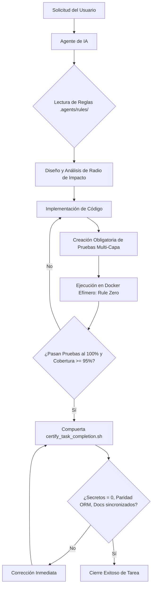

# 🤖 Arquitectura y Gobernanza de Agentes de Inteligencia Artificial (Nivel 11X)

> **PROPÓSITO:**  
> Este documento establece el estándar para orquestar, restringir y guiar a agentes de IA autónomos (Google Antigravity, Anthropic Claude Code / Claude Desktop, Hermes Agent de Nous Research, Cursor, Windsurf) para que operen como ingenieros Staff de QA y DevOps sin alucinaciones, sin deuda técnica y con total reproducibilidad.

---

## 1. De la Asistencia Pasiva a la Gobernanza Activa

Tratar a los modelos de lenguaje (LLMs) como simples autocompletadores de código genera código espagueti, mocks desconectados de la base de datos y regresiones silenciosas. En el estándar **11X**, el agente de IA es un operador autónomo sujeto a compuertas mecánicas estrictas:



---

## 2. La Estructura de Gobernanza `.agents/`

El directorio `.agents/` en la raíz de los proyectos representa el estándar moderno y portable de gobernanza:

1. **`rules/` (Reglas de Cumplimiento Innegociable):**
   - Directivas redactadas en Markdown que los agentes ingieren como System Prompts o reglas de proyecto.
   - Ejemplos: `mandatory_qa_pyramid_and_doc_sync.md`, `secure_development_and_testing_guidelines.md`, `anti_regression_and_side_effects_guardrail.md`.
2. **`skills/` (Habilidades y Playbooks de Dominio):**
   - Paquetes de instrucciones especializadas para flujos complejos (ej. `qa-11x-docker-certifier`, `docker-trivy-keydb-hardening`).
3. **`scripts/` (Compuertas Automatizadas en CLI):**
   - Scripts deterministas en Python y Bash que auditan el código antes de permitir el commit (`certify_task_completion.sh`, `verify_alembic_orm_parity.py`, `verify_zero_orphan_vue_components.py`).

---

## 3. Estrategia Lingüística y Optimización de Tokens ($\approx 35\%$ de Ahorro)

Un dilema común al gobernar agentes de IA es el idioma. En este ecosistema implementamos una **estrategia bimodal deliberada**:

### ¿Por qué las reglas internas están en inglés técnico de alta densidad?

1. **Economía de Tokens BPE (Byte-Pair Encoding):**
   - Los tokenizadores de frontera (Tiktoken de OpenAI, Claude Tokenizer, Gemini Tokenizer) fragmentan las palabras en español en un número significativamente mayor de tokens que el inglés técnico conciso.
   - Redactar `.agents/rules/` y `.agents/skills/` en inglés técnico ahorra aproximadamente un **35% de la ventana de contexto**, permitiendo que quepa más código fuente, esquemas de bases de datos y trazas de pruebas.
2. **Menor Latencia y Mayor Velocidad:**
   - Menos tokens de entrada equivalen a menor costo computacional y menor tiempo de respuesta por turno.
3. **Mayor Adherencia Lógica e Instruccional:**
   - Los modelos de frontera exhiben una adherencia más rigurosa a las directivas de seguridad y lógica cuando las restricciones están expresadas en la terminología canónica de la ingeniería de software (RFCs, OWASP, ISO).

### Garantía de Salida en Español para Humanos (`OUTPUT LANGUAGE CONSTRAINT`)

Para asegurar una experiencia óptima para el equipo humano, todas las reglas incluyen la cláusula inviolable:
```markdown
> **OUTPUT LANGUAGE CONSTRAINT:**
> Always communicate with the user, provide status updates, explain reasoning,
> and write commit messages / user-facing documentation in Spanish.
```
Toda la documentación (`docs/`, `CHANGELOG.md`, `README.md`, `TESTING.md`) y las respuestas al usuario se mantienen estrictamente en español.

---

## 4. Compatibilidad Multi-Agente

Esta arquitectura funciona de forma nativa e idéntica en las principales herramientas de desarrollo asistido:

| Herramienta | Mecanismo de Ingestión | Archivo de Entrada Principal |
| :--- | :--- | :--- |
| **Google Antigravity** | Carga automática de `.agents/rules/` y `.agents/skills/` | `.agents/` + `AGENTS.md` |
| **Anthropic Claude Code / Desktop** | Lectura contextual de directivas y configuración MCP | `AGENTS.md` + `.agents/skills/` |
| **Hermes Agent (Nous Research)** | Conexión vía MCP (`/sse` o `/mcp`) y CLI de terminal | `AI_MASTER_PROMPT.md` + `Makefile` |
| **Cursor / Windsurf** | Reglas de contexto de espacio de trabajo | `AGENTS.md` y `.agents/rules/` |

---

## 5. El Protocolo de Cierre Obligatorio (Closure Gate)

Para erradicar el hábito de los agentes de dar tareas por terminadas con pruebas a medias o documentación desfasada, el agente debe ejecutar el protocolo de cierre en 4 pasos:

1. **Creación Obligatoria de Pruebas 11X:** Ningún código nuevo puede carecer de pruebas unitarias (`>= 95%`) ni de escenarios BDD en Karate Labs para API y UI.
2. **Ejecución en Docker Efímero (`Rule Zero`):** Toda la suite debe ejecutarse y pasar al 100% dentro de contenedores (`make qa-all`).
3. **Sincronización Documental Continua:** Actualizar `docs/`, `CHANGELOG.md` (bajo `## [Unreleased]`), `TESTING.md` y `README.md`.
4. **Compuerta de Certificación:** Ejecutar `./.agents/scripts/certify_task_completion.sh`. Si algún paso falla, el agente tiene prohibido cerrar el turno.

---

## 6. Evolución Continua del Agente (`continuous_agent_evolution.md`)

Los agentes no deben ser estáticos. Si durante el desarrollo descubren:
- Una trampa recurrente (ej. un linter que falla por una regla de comillas),
- Una biblioteca que requiere un mock especial,
- Una oportunidad de optimizar el consumo de tokens,

el agente tiene la directiva explícita de **actualizar de forma autónoma las reglas y skills** en `.agents/`, documentando el cambio en el `CHANGELOG.md`. De esta forma, el sistema "aprende" y transfiere el conocimiento a sesiones futuras.
