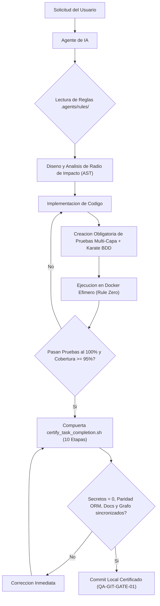

> 🌐 **Idioma:** [🇺🇸 English (Canonical)](05_ARQUITECTURA_Y_GOBERNANZA_AGENTES_IA.md) · **Español (Espejo 1:1)**

# 🤖 Arquitectura y Gobernanza de Agentes de Inteligencia Artificial (Nivel 11X)

> **PROPÓSITO:**  
> Este documento establece el estándar para orquestar, restringir y guiar a agentes de IA autónomos (Google Antigravity, Anthropic Claude Code / Claude Desktop, Hermes Agent de Nous Research, Cursor, Windsurf) para que operen como ingenieros Staff de QA y DevOps sin alucinaciones, sin deuda técnica y con total reproducibilidad.

---

## 1. De la Asistencia Pasiva a la Gobernanza Activa

Tratar a los modelos de lenguaje (LLMs) como simples autocompletadores de código genera código espagueti, mocks desconectados de la base de datos y regresiones silenciosas. En el estándar **11X**, el agente de IA es un operador autónomo sujeto a compuertas mecánicas estrictas:



---

## 2. La Estructura de Gobernanza `.agents/`

El directorio `.agents/` en la raíz de los proyectos representa el estándar moderno y portable de gobernanza:

1. **`rules/` (Reglas de Cumplimiento Innegociable):**
   - Directivas redactadas en Markdown que los agentes ingieren como System Prompts o reglas de proyecto.
   - Ejemplos: `mandatory_qa_pyramid_and_doc_sync.md`, `secure_development_and_testing_guidelines.md`, `anti_regression_and_side_effects_guardrail.md`.
2. **`skills/` (Habilidades y Playbooks de Dominio):**
   - Paquetes de instrucciones especializadas para flujos complejos (ej. `qa-11x-docker-certifier`, `docker-trivy-keydb-hardening`).
3. **`scripts/` (Compuertas Automatizadas en CLI):**
   - Scripts deterministas en Python y Bash que auditan el código antes de permitir el commit (`certify_task_completion.sh`, `verify_alembic_orm_parity.py`, `verify_zero_orphan_vue_components.py`).

---

## 3. Estrategia Lingüística, *Progressive Disclosure* y Economía Cognitiva de Tokens (~35% en Reglas y 65%–85% en Ejecución)

Un dilema común al gobernar agentes de IA es el idioma y el consumo de ventana de contexto. En este ecosistema implementamos una **estrategia bimodal deliberada** combinada con *3-Tier Progressive Disclosure* y un protocolo cognitivo de reducción de tokens:

### ¿Por qué las reglas internas están en inglés técnico de alta densidad?

1. **Economía de Tokens BPE (Byte-Pair Encoding):**
   - Los tokenizadores de frontera (Tiktoken de OpenAI, Claude Tokenizer, Gemini Tokenizer) fragmentan las palabras en español en un número significativamente mayor de tokens que el inglés técnico conciso.
   - Redactar `.agents/rules/` y `.agents/skills/` en inglés técnico ahorra aproximadamente un **35% de la ventana de contexto**, permitiendo que quepa más código fuente, esquemas de bases de datos y trazas de pruebas.
2. **Arquitectura de Revelación Progresiva en 3 Niveles (*3-Tier Progressive Disclosure*):**
   - **Nivel 1 (Siempre cargado):** Bloque conector compacto en `AGENTS.md` / `GEMINI.md` (~25 líneas).
   - **Nivel 2 (Bajo demanda al activar la Skill):** `SKILL.md` deduplicado que referencia reglas en lugar de repetir párrafos.
   - **Nivel 3 (Inyección Quirúrgica Just-In-Time):** Archivos en `.agents/rules/*.md` y `references/*.md` leídos únicamente cuando la tarea toca ese dominio específico.
3. **3 Vías Proporcionales de Ejecución (`DOCS_ONLY`, `MICRO_CHANGE`, `FULL_11X`):**
   - Evita ejecutar el pipeline pesado de 11 pasos en micro-fixes quirúrgicos (`<= 3` archivos, 0 cambios de API/ORM y `blast_radius == LOW` con `< 5` llamadores), reduciendo entre un **70% y 85%** el gasto de tokens en parches pequeños sin sacrificar cobertura (`>= 95%`) ni la compuerta final `certify_task_completion.sh`.
4. **Protocolo de Economía Cognitiva de Tokens (*High-IQ Token Economy* — 6 Estrategias en `qa-11x-architect`):**
   - (1) *AST/Grep-First, Windowed-Read-Second* (`StartLine`/`EndLine` de 40–80 líneas; prohibido leer archivos completos `> 150` líneas a ciegas), (2) *Zero Redundant Re-Read Invariant*, (3) *Parallel Tool Call Batching*, (4) *Subagent Context Isolation & Model Cascading* (retorno máximo de `<= 20` líneas con punteros `archivo:línea`), (5) *Pass-Quiet & RTK Terminal Output Filtering*, y (6) *Surgical Diff Edits & Compact Scratchpad Budget* (`ACTIVE_TASK.md <= 40` líneas + `/compact`).
5. **Mayor Adherencia Lógica e Instruccional:**
   - Los modelos de frontera exhiben una adherencia más rigurosa a las directivas de seguridad y lógica cuando las restricciones están expresadas en la terminología canónica de la ingeniería de software (RFCs, **DISA ASD STIG V6R5**, **OWASP Developer Guide v4.2 / ASVS / WSTG / API Top 10 / OSHP / CycloneDX SBOM**, FIPS 140-3, ISO).

### Garantía Bilingüe para Humanos y Salida Dinámica del Agente (`Spec 19`)

Bajo la **Spec 19**, la documentación humana y la interacción del agente siguen una arquitectura bilingüe determinista:
```markdown
> **OUTPUT LANGUAGE & DYNAMIC MIRRORING (Spec 19):**
> Interact and explain reasoning in the user's prompt language (unless explicitly pinned via `--lang es|en`).
> Keep `.agents/**` in concise technical English (~35% token savings) and maintain human docs as
> English Canonical (`*.md`) + 1:1 Spanish Mirror (`*.es.md`) pairs.
```
Los manuales humanos y documentos de gobernanza (`docs/*.md`, `CHANGELOG.md`, `TESTING.md`, `README.md`, `docs/agent-setup.md`) usan **Inglés Canónico (`*.md`)** acompañado de **Espejos 1:1 en Español (`*.es.md`)** (`docs/*.es.md`, `CHANGELOG.es.md`, `TESTING.es.md`, `README.es.md`, `docs/agent-setup.es.md`), mientras `.agents/**` permanece en inglés técnico conciso y los descriptores internacionales (`catalogs/agenticskills-submission.md`, `mcp-server/package.json`) se mantienen en inglés.

---

## 4. Compatibilidad Multi-Agente y Ecosistema MCP

Esta arquitectura funciona de forma nativa en **28 agentes de programación IA soportados** (`--agents auto|all|<csv>`, ver [`docs/agent-setup.es.md`](agent-setup.es.md)), incluyendo:

| Herramienta / Agente | Mecanismo de Ingestión MCP | Integración de Skills, Scripts y Conector | Archivo de Entrada / Configuración |
| :--- | :--- | :--- | :--- |
| **Google Antigravity** | `~/.gemini/antigravity/mcp_config.json` (fallback `~/.gemini/config/mcp_config.json`) | `npx -y @sinfallas/mcp-qa-11x@latest install-skill --target antigravity --init-agents --include-scripts` | `.agents/` + `AGENTS.md` |
| **Anthropic Claude Code / Desktop** | `claude_desktop_config.json` (`stdio`, multi-OS) | `npx -y @sinfallas/mcp-qa-11x@latest install-skill --target claude --init-agents --include-scripts` | `AGENTS.md` + `.agents/skills/` |
| **Hermes Agent (Nous Research)** | `config.yaml` (`mcp_servers`) / `mcp.json` | `npx -y @sinfallas/mcp-qa-11x@latest install-skill --target hermes --init-agents --include-scripts` | `AI_MASTER_PROMPT.es.md` + `Makefile` |
| **Cursor / Windsurf** | `.cursor/mcp.json` (`mcpServers`) | `npx -y @sinfallas/mcp-qa-11x@latest install-skill --target cursor --init-agents --include-scripts` | `AGENTS.md` y `.agents/rules/` |

---

## 5. El Servidor MCP Canónico (`@sinfallas/mcp-qa-11x`) y la Adopción Zero-Clone

Para evitar que los agentes deban clonar gigabytes de repositorios o saturar su ventana de contexto con cientos de archivos, el ecosistema se distribuye como servidor MCP oficial bajo el estándar de Anthropic / Linux Foundation (ver también [`docs/specs/13_SPEC_OPTIMIZACION_EXTREMA_TOKENS_MCP_3_VIAS_Y_PROGRESSIVE_DISCLOSURE.md`](specs/13_SPEC_OPTIMIZACION_EXTREMA_TOKENS_MCP_3_VIAS_Y_PROGRESSIVE_DISCLOSURE.md)):

1. **13 Recursos Dinámicos (`blueprint://*`):**
   - `blueprint://manifest`: Índice criptográfico con hashes SHA-256 de todos los stacks y archivos comunes.
   - `blueprint://core/philosophy`: Filosofía 11X y prompt maestro (`AI_MASTER_PROMPT.es.md`).
   - `blueprint://security/disa-owasp-22`: Síntesis técnica de los 22 patrones DISA ASD STIG V6R5 y OWASP v4.2.
   - `blueprint://{stack}/readme`: Especificación del stack hidratable solicitado (`python`, `fastapi`, `node-backend`, `vue3`, `react-frontend`, `bash-scripts`, `php`, `mobile-appium`, `ai-evals`, `vibe-rescue` — conformando junto con `architecture/` y `mcp-server/` los **12 entornos de matriz**).
   - `blueprint://ui/refactoring-ui/{topic}`: Directivas tácticas visuales y WCAG 2.1 AA (`skill`, `hierarchy`, `layout`, `type`, `color`, `depth`, `images`, `polish`, `dark-mode`, `tailwind`).
   - `blueprint://core/active-task-template`: Plantilla de seguimiento resiliente para agentes.
   - `blueprint://core/cleanup-script`: Script de saneamiento universal sin `sudo`.
   - `blueprint://core/roadmap-validator`: Validador de consistencia de hoja de ruta.
   - `blueprint://database/postgres-rls-worm`: Implementación de referencia de PostgreSQL 17 RLS Multi-Transacción (`after_begin`) y cadena forense WORM determinista (`seq_num` + `pg_advisory_xact_lock`).
   - `blueprint://ai/evals-redteam` *(v2.0)*: Guía de evaluación agéntica dual-mode DeepEval y Red Teaming OWASP LLM Top 10 con Promptfoo.
   - `blueprint://mobile-appium/readme` *(v2.0)*: Blueprint Screenplay móvil Appium 3 / W3C + WebdriverIO (`mobile-appium/`).
   - `blueprint://vibe-rescue/readme` *(v2.0)*: Protocolo *Vibe-to-Enterprise* en 5 etapas y endurecimiento RLS/WORM (`vibe-rescue/`).
   - `blueprint://skills/tactical-patterns-11x` *(v3.1)*: Patrones tácticos JIT compactos (`<= 2.5 KB`, `CC <= 5`, `SonarJS <= 15`, `max-params: 4`, Port/Adapter offline, Outbox transaccional) con soporte `?lang=es|en` y fallback local.

2. **19 Herramientas de Ejecución (`Tools`):**
   - `inspect_project_config`: Detección automática del stack, linters, disponibilidad de pruebas en navegador real (`BrowserTestingReadiness`) y estado de actualización `update_available` (comparación SemVer con caché TTL 24h *fail-open* contra `.qa-11x-version`).
   - `fetch_blueprint_bundle`: Descarga quirúrgica de plantillas con validación de hashes SHA-256 (soporta modo índice `include_content: false` en Hito 14).
   - `bootstrap_or_merge_11x`: Fusión no destructiva inyectando configuraciones QA en proyectos existentes.
   - `inspect_ast_blast_radius`: Auditoría AST previa de radio de impacto para cambios en funciones o símbolos y elegibilidad para `MICRO_CHANGE`.
   - `clean_workspace_11x`: Purga segura de cachés y artefactos sin necesidad de privilegios `sudo`.
   - `audit_security_stig_owasp`: Auditoría estática de reglas DISA/OWASP (`SEC-01` a `SEC-16`, `SEC-CI-ACTION-REF`), invariantes de calidad (`QA-KARATE-IDEMP`, `QA-COV-01`, `QA-MYPY-01`, `QA-PG17-RLS`, `QA-SMOKE-01`, `QA-HEALTH-01`, `QA-CLI-TTY-01`, `QA-DOCKER-TTY-01`, `QA-CI-ESCAPE-01`, `QA-MAKE-CURDIR-01`, `QA-CONTRACT-SDK-01`, `QA-DOCKER-LOCK-01`, `QA-PLAYWRIGHT-PIN-01`, `QA-SSR-HYDRATION-01`) y ergonomía visual, favicons PWA y cabeceras Edge (`UI-11X-01`, `UI-11X-02`, `UI-11X-03`) con agrupación compacta por regla.
   - `run_ephemeral_qa`: Lanzamiento de pruebas en Docker efímero bajo la Regla Cero con retorno estructurado en JSON y soporte `skip_if_docs_only`.
   - `certify_11x_gate`: Ejecución de la compuerta universal de certificación previa a la entrega de la tarea (incluyendo verificación de evidencia `lint` fresca y notificación `update_available`).
   - `audit_test_pyramid_gaps`: Auditoría de las 13 capas de la pirámide 11X, archivos huérfanos y plan de rescate priorizado con presupuesto de salida acotado (`max_items`).
   - `init_or_append_agents_md`: Inyector aditivo no destructivo del bloque conector QA 11X en `AGENTS.md`.
   - `propose_skill_evolution_pr`: Propuesta de evolución continua Zero-Trust Dual-Consumer hacia `qa-testing-blueprints`.
   - `reconcile_agents_governance`: Reconciliador y deduplicador automático de reglas en `.agents/` con respaldo en `.agents/backups/`.
   - `validate_calm_architecture` *(v2.0)*: Validador bloqueante de arquitectura como código FINOS CALM (`architecture/qa-11x.calm.json`).
   - `evaluate_release_gate` *(v2.0)*: Calculador cuantitativo `GO`/`NO_GO` de disponibilidad para liberación (`>= 95%`, Trivy = 0, MSI, CALM).
   - `evaluate_agent_trajectory` *(v2.0)*: Evaluador offline AST-First y DeepEval para trayectorias multi-paso de agentes de IA.
   - `run_llm_red_team` *(v2.0)*: Auditor Promptfoo OWASP LLM Top 10 con sondas `promptGuard` y ejecución condicional en Docker.
   - `audit_vibe_prototype` *(v2.0)*: Detector de riesgos `VIBE-SEC-001..QA-005` en prototipos IA con planes `dryRun` hacia RLS/WORM.
   - `sync_enterprise_tms` *(v2.0)*: Sincronizador bidireccional Zero-Infra (`inventory`, `push-results`, `pull-stories`) mediante JUnit XML hacia Jira, Zephyr Scale, Xray y GitHub Issues protegido con `TaskStateGuard`.
   - `session_flight_recorder` *(v3.1)*: Flight Recorder Atómico Unificado (`save` | `recover` | `clear`) que persiste `.agents/.cache/session_checkpoint.json` (`0600`) y proyecta determinísticamente `.agents/ACTIVE_TASK.md` (`<= 40` líneas) cruzado con el estado real de Git.

3. **Onboarding `quickstart`, 12 Subcomandos CLI y Sync Automático de 11 Skills Modulares:**
   Cualquier desarrollador o agente puede adoptar la pirámide en 30 segundos en **28 agentes de programación IA** con `npx -y @sinfallas/mcp-qa-11x@latest quickstart`, operar cualquiera de los **12 subcomandos CLI** (`quickstart`, `install-skill`, `init-agents`, `reconcile-agents`, `tms-sync`, `doctor`, `upgrade`, `certify`, `audit`, `blast-radius`, `mcp-config`, `completion`), o autoinstalar las skills modulares, scripts operativos (`.agents/scripts/*`, `scripts/*`) y conector `AGENTS.md` mediante `install-skill --init-agents --include-scripts --reconcile` (estampando `.qa-11x-version`, `--lang auto` por defecto). Además, al arrancar en modo `stdio`, el servidor MCP sincroniza en segundo plano (`SHA-256` contra `manifest.json`) las skills globales instaladas.

---

## 6. Colaboración Híbrida Humano + Agentes de IA

El estándar 11X no reemplaza al desarrollador humano ni lo relega a tareas secundarias; establece una simbiosis técnica estructurada:

* **El Rol del Humano:** Define requerimientos funcionales, valida la experiencia de usuario y aprueba decisiones arquitectónicas estratégicas.
* **El Rol del Agente de IA:** Asume el rol de Staff QA & DevOps Automation Engineer. Audita el radio de impacto AST, implementa código siguiendo tipado estricto, genera obligatoriamente pruebas unitarias y de integración (`>= 95%`), diseña escenarios BDD en Karate Labs, ejecuta la suite en Docker efímero (`Rule Zero`) y mantiene sincronizada la documentación técnica.
* **La Compuerta Objetiva:** Ni el humano ni el agente pueden eludir la compuerta universal de certificación. El pase de calidad se determina por asertos verificados, no por opiniones o complacencia.

---

## 7. Protocolo Obligatorio de Cierre en 11 Pasos y Compuerta de Certificación en 10 Etapas

Para erradicar el hábito de los agentes de dar tareas por terminadas con pruebas a medias o documentación desfasada, el agente debe ejecutar de forma implacable el **protocolo de cierre en 11 pasos** (`AGENTS.md` §5) culminando en la **compuerta de certificación en 10 etapas** (`certify_task_completion.sh`):

1. **Creación Obligatoria de Pruebas 11X:** Ningún código nuevo puede carecer de pruebas unitarias (`>= 95%`) ni de escenarios BDD en Karate Labs para API y UI.
2. **Ejecución en Docker Efímero (`Rule Zero`):** Toda la suite debe ejecutarse y pasar al 100% dentro de contenedores efímeros (`make qa-all`).
3. **Sincronización Documental Continua y Cierre del Flight Recorder:** Actualizar `docs/`, `CHANGELOG.es.md` (bajo `## [Unreleased]`), `ROADMAP.es.md`, `TESTING.es.md`, `README.es.md` y cerrar `.agents/ACTIVE_TASK.md` como `CERTIFIED_CLEAN` mediante `.agents/scripts/checkpoint_ctl.py` (o MCP `session_flight_recorder`, sin edición manual en Markdown).
4. **Compuerta de Certificación en 10 Etapas (`10/10`):** Ejecutar `./.agents/scripts/certify_task_completion.sh` verificando:
   - Secret Scanning (`verificar-secretos.sh`).
   - Auditoría de infraestructura y CVEs (Trivy, `auditar-infra.sh`).
   - Anti-colisión en claves de diccionarios JSON.
   - Cero componentes UI huérfanos sin pruebas unitarias.
   - Cero endpoints de API huérfanos entre frontend y backend.
   - Salud topológica y límites arquitectónicos AST.
   - Paridad ORM entre modelos SQLAlchemy y migraciones Alembic.
   - Sincronización criptográfica del manifiesto SHA-256 (`manifest.json`).
   - Consistencia estricta de `ROADMAP.es.md` y `ACTIVE_TASK.md`.
   - Sincronización incondicional de documentación y pruebas obligatorias.

Si cualquiera de los pasos falla, el agente tiene prohibido cerrar el turno.

### 📈 Evolución Incremental Implementada y Planificada (Hitos 21–23)

Con el objetivo de reforzar el estándar sobre la superficie pública estabilizada (**19 herramientas** y **13 recursos** MCP junto a **8 reglas canónicas** en `.agents/rules/` y **11 skills modulares**, incorporando el Flight Recorder unificado `checkpoint_ctl.py` + `session_flight_recorder` y la micro-skill JIT `tactical-patterns-11x`), la evolución incremental avanza sobre [`ROADMAP.es.md`](../ROADMAP.es.md):
1. **Cobertura Diferencial (`Hito 21` — Implementado):** [`16_SPEC_COBERTURA_DIFERENCIAL_MULTISTACK_Y_ANTI_EVASION.md`](specs/16_SPEC_COBERTURA_DIFERENCIAL_MULTISTACK_Y_ANTI_EVASION.md) (`100%` en líneas delta, `>= 90%` en ramas delta y bloqueo de exclusiones no autorizadas).
2. **Cortacircuitos Anti-Loop (`Hito 22` — Implementado):** [`17_SPEC_CORTACIRCUITOS_ANTI_LOOP_Y_ESTADO_HALLAZGOS.md`](specs/17_SPEC_CORTACIRCUITOS_ANTI_LOOP_Y_ESTADO_HALLAZGOS.md) implementó [`.agents/scripts/track_findings_state.py`](../.agents/scripts/track_findings_state.py) y su integración en [`mcp-server/src/services/qa-evidence.ts`](../mcp-server/src/services/qa-evidence.ts), [`mcp-server/src/tools/ephemeral-runner.ts`](../mcp-server/src/tools/ephemeral-runner.ts) (`run_ephemeral_qa`) y [`.agents/scripts/certify_task_completion.sh`](../.agents/scripts/certify_task_completion.sh): persiste huellas SHA-256 invariantes a números de línea en `.agents/.cache/certify_state.json` (`0600`, aisladas por `{branch}:{merge_base_sha}` y stage) y dispara el bloqueo determinista **`BREAKER-42` (`exit 42`)** cuando `consecutive_streak >= 3` o se detecta oscilación `A -> B -> A` (`oscillations >= 1`), obligando a detener parches a ciegas e invocar `inspect_ast_blast_radius` y `qa-11x-systematic-debugging` (el flag `--reset-state` está reservado al operador humano).
3. **Modo Diff en Blast Radius y Veredicto PR (`Hito 23` — Implementado):** [`18_SPEC_MODO_DIFF_BLAST_RADIUS_Y_VEREDICTO_PR.md`](specs/18_SPEC_MODO_DIFF_BLAST_RADIUS_Y_VEREDICTO_PR.md) implementó [`mcp-server/src/utils/diff-bundle.ts`](../mcp-server/src/utils/diff-bundle.ts) y la extensión retrocompatible de `inspect_ast_blast_radius` (`changed_since_ref`, `max_tokens_budget` en [`mcp-server/src/types.ts`](../mcp-server/src/types.ts), [`mcp-server/src/tools/blast-radius.ts`](../mcp-server/src/tools/blast-radius.ts) y [`mcp-server/src/server.ts`](../mcp-server/src/server.ts), preservando la superficie previa a v3.1 que hoy alcanza `19` tools y `13` resources MCP) con poda semántica en 4 niveles (`PRUNED_NOISE`, `CRITICAL_FULL`, `CORE_LOGIC`, `TESTS_SUMMARY`), redacción vía `promptGuard.ts`, alerta `MISSING_KARATE_API_FEATURE` y fronteras opcionales en `.agents/ACTIVE_TASK.md`; además incorporó [`.agents/scripts/generate_pr_verdict.py`](../.agents/scripts/generate_pr_verdict.py) (`make pr-verdict`) para consolidar `release_readiness_gate.py`, `.agents/.qa-evidence.json`, `.agents/.cache/certify_state.json` y `verify_diff_coverage.py` en `.agents/artifacts/PR_VERDICT.md` y `.agents/artifacts/pr_verdict_attestation.json` (`0600`, `SHA-256` / `HMAC-SHA256` opcional, `exit 0` o `30`).

---

## 8. Evolución Continua del Agente y Prevención de Colisiones en Proyectos Consumidores (`continuous_agent_evolution.md`)

Los agentes no deben ser estáticos. Si durante el desarrollo descubren:
- Una trampa recurrente (ej. un linter que falla por una regla de comillas),
- Un antipatrón funcional en UAT (como *Silo Mock Blindness*, omisión del ciclo temporal de 3 fases o mocks ciegos en `write_audit_log`),
- Una oportunidad de optimizar el consumo de tokens o simplificar un procedimiento,

el agente tiene la directiva explícita de **actualizar de forma autónoma las reglas y skills** en `.agents/`, documentando el cambio en el `CHANGELOG.es.md`.

### 🛡️ Separación entre Reglas Globales Canónicas y Reglas de Dominio Local (Caso `rosgrid`)
Para evitar que las directivas creadas por un agente en un proyecto consumidor (ej. `rosgrid`) choquen o se dupliquen con las reglas globales de `qa-testing-blueprints`:
1. **Los 8 archivos canónicos en `.agents/rules/`** (`mandatory_qa_pyramid_and_doc_sync.md`, `secure_development_and_testing_guidelines.md`, `frontend_parity_and_closure.md`, `continuous_agent_evolution.md`, `anti_regression_and_side_effects_guardrail.md`, `ground_truth_fixtures_and_negative_invariants.md`, `active_task_and_planning_resilience.md`, `git_closure_gate.md`) pertenecen exclusivamente al estándar global `qa-testing-blueprints`.
2. **Aislamiento de Reglas de Negocio (`domain_<proyecto>_*.md`):** Toda regla específica del dominio del proyecto consumidor (ej. comandos MikroTik RouterOS v7, reglas de WinBox o tablas exclusivas de `rosgrid`) debe residir en `.agents/rules/domain_<proyecto>_*.md` o en `AGENTS.md` fuera del bloque conector `<!-- QA_11X_MCP_CONNECTOR_START --> ... <!-- QA_11X_MCP_CONNECTOR_END -->`.
3. **Promoción y Limpieza de Duplicados:** Cuando un hallazgo universal descubierto en un proyecto consumidor se promueve a `qa-testing-blueprints` (vía `propose_skill_evolution_pr`), se elimina la copia ad-hoc local en el proyecto consumidor (manualmente o mediante `reconcile-agents`, ver [`docs/specs/12_SPEC_RECONCILIACION_Y_DEDUPLICACION_GOBERNANZA_AGENTS_PROYECTOS.md`](specs/12_SPEC_RECONCILIACION_Y_DEDUPLICACION_GOBERNANZA_AGENTS_PROYECTOS.md)) para evitar duplicación de tokens y contradicciones entre prompts.
