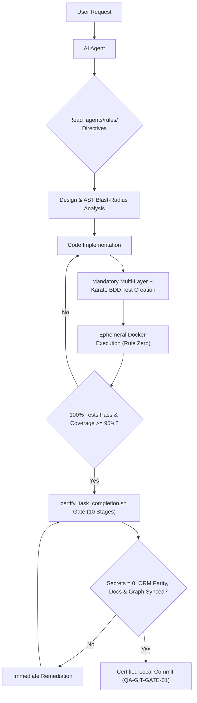

> 🌐 **Language:** **English (Canonical)** · [🇪🇸 Leer en Español](05_ARQUITECTURA_Y_GOBERNANZA_AGENTES_IA.es.md)

# 🤖 AI Agent Architecture and Governance (Level 11X)

> **PURPOSE:**  
> This document defines the standard for orchestrating, constraining, and guiding autonomous AI agents (Google Antigravity, Anthropic Claude Code / Claude Desktop, Hermes Agent by Nous Research, Cursor, Windsurf) so they operate as Staff QA and DevOps engineers with zero hallucinations, zero technical debt, and full reproducibility.

---

## 1. From Passive Assistance to Active Governance

Treating large language models (LLMs) as simple code autocompleters produces spaghetti code, mocks disconnected from real databases, and silent regressions. Under the **11X** standard, the AI agent is an autonomous operator governed by strict mechanical gates:



---

## 2. The `.agents/` Governance Structure

The `.agents/` directory at the root of each project represents the modern, portable governance standard:

1. **`rules/` (Non-Negotiable Compliance Rules):**
   - Markdown directives ingested by agents as System Prompts or project rules.
   - Examples: `mandatory_qa_pyramid_and_doc_sync.md`, `secure_development_and_testing_guidelines.md`, `anti_regression_and_side_effects_guardrail.md`.
2. **`skills/` (Domain Playbooks & Capabilities):**
   - Specialized instruction packages for complex workflows (e.g., `qa-11x-docker-certifier`, `docker-trivy-keydb-hardening`).
3. **`scripts/` (Automated CLI Gates):**
   - Deterministic Python and Bash scripts that audit code before allowing commits (`certify_task_completion.sh`, `verify_alembic_orm_parity.py`, `verify_zero_orphan_vue_components.py`).

---

## 3. Language Strategy, *Progressive Disclosure*, and Cognitive Token Economy (~35% in Rules and 65%–85% in Execution)

A common dilemma when governing AI agents is language choice versus context window consumption. In this ecosystem we implement a **deliberate bimodal strategy** combined with *3-Tier Progressive Disclosure* and a cognitive token-reduction protocol:

### Why are internal rules written in high-density technical English?

1. **BPE (Byte-Pair Encoding) Token Economy:**
   - Frontier tokenizers (OpenAI Tiktoken, Claude Tokenizer, Gemini Tokenizer) fragment Spanish prose into significantly more tokens than concise technical English.
   - Writing `.agents/rules/` and `.agents/skills/` in technical English saves roughly **35% of the context window**, leaving more room for source code, database schemas, and test traces.
2. **3-Tier Progressive Disclosure & True Thin-Client Budgets:**
   - **Tier 1 (Always loaded):** Compact True Thin-Client connector blocks (`<= 1,536 B`) across `$HOME` agent connectors (`.gemini/GEMINI.md`, `.claude/CLAUDE.md`, `.codex/AGENTS.md`, `.codeium/windsurf/memories/global_rules.md`, `.config/opencode/AGENTS.md`, `.config/zed/AGENTS.md`) and `<project>/AGENTS.md` (with upstream monorepo `AGENTS.md <= 8,192 B`, while non-canonical vendor skills `>= 20 KB` in consumer repos emit non-blocking `WARN` notices).
   - **Tier 2 (On-demand upon Skill activation):** Deduplicated `SKILL.md` referencing rules instead of repeating paragraphs.
   - **Tier 3 (Just-In-Time Surgical Injection):** Files under `.agents/rules/*.md` and `references/*.md` read only when the task touches that specific domain.
3. **3 Proportional Execution Paths (`DOCS_ONLY`, `MICRO_CHANGE`, `FULL_11X`):**
   - Avoids running the heavy 11-step pipeline on surgical micro-fixes (`<= 3` files, 0 API/ORM changes, and `blast_radius == LOW` with `< 5` callers), cutting token spend by **70% to 85%** on small patches without sacrificing coverage (`>= 95%`) or the final `certify_task_completion.sh` gate. Consumer governance maintenance commits qualify for the Governance Maintenance Fast-Path inside `certify_task_completion.sh`, while `verify_docs_invariants.py` scopes consumer checks strictly to universal invariants.
4. **Cognitive Token Economy & Objective Critique (*Anti-Sycophancy & Anti-Contrarianism Guard*):**
   - (1) *AST/Grep-First, Windowed-Read-Second* (`StartLine`/`EndLine` of 40–80 lines; blind full reads of files `> 150` lines prohibited), (2) *Zero Redundant Re-Read Invariant*, (3) *Parallel Tool Call Batching*, (4) *Subagent Context Isolation & Model Cascading* (`<= 20`-line max return with `file:line` pointers), (5) *Pass-Quiet & RTK Terminal Output Filtering*, (6) *Surgical Diff Edits & Compact Scratchpad Budget* (`ACTIVE_TASK.md <= 40` lines + `/compact`), and (7) *Objective Pre-Execution Critique* (skip praise openers; verify non-trivial premises against live repo state before coding; approve cleanly without artificial debate when solid, and execute routine explicit commands immediately).
5. **Stronger Logical and Instructional Adherence:**
   - Frontier models adhere more strictly to security and logic constraints when expressed in canonical software engineering terminology (RFCs, **DISA ASD STIG V6R5**, **OWASP Developer Guide v4.2 / ASVS / WSTG / API Top 10 / OSHP / CycloneDX SBOM**, FIPS 140-3, ISO).

### Bilingual Human Documentation Guarantee & Dynamic Agent Output (`Spec 19`)

Under **Spec 19**, human-facing documentation and agent interaction follow a deterministic bilingual architecture:
```markdown
> **OUTPUT LANGUAGE & DYNAMIC MIRRORING (Spec 19):**
> Interact and explain reasoning in the user's prompt language (unless explicitly pinned via `--lang es|en`).
> Keep `.agents/**` in concise technical English (~35% token savings) and maintain human docs as
> English Canonical (`*.md`) + 1:1 Spanish Mirror (`*.es.md`) pairs.
```
Human manuals and governance files (`docs/*.md`, `CHANGELOG.md`, `TESTING.md`, `README.md`, `docs/agent-setup.md`) use **English Canonical (`*.md`)** paired with **1:1 Spanish Mirrors (`*.es.md`)** (`docs/*.es.md`, `CHANGELOG.es.md`, `TESTING.es.md`, `README.es.md`, `docs/agent-setup.es.md`), while `.agents/**` remains in concise technical English and international registry descriptors (`catalogs/agenticskills-submission.md`, `mcp-server/package.json`) remain in English.

---

## 4. Multi-Agent Compatibility and MCP Ecosystem

This architecture works natively across **28 supported AI coding agents** (`--agents auto|all|<csv>`, see [`docs/agent-setup.md`](agent-setup.md)), including:

| Tool / Agent | MCP Ingestion Mechanism | Skills, Scripts & Connector Integration | Entry / Config File |
| :--- | :--- | :--- | :--- |
| **Google Antigravity / Gemini CLI** | `~/.gemini/antigravity/mcp_config.json` (fallback `~/.gemini/config/mcp_config.json`; Gemini CLI `~/.gemini/settings.json`) | `npx -y @sinfallas/mcp-qa-11x@latest install-skill --target antigravity --init-agents --include-scripts` | `.agents/` + `AGENTS.md` |
| **Anthropic Claude Code / Desktop** | `~/.claude.json` / `.mcp.json` (Claude Code); `claude_desktop_config.json` (Desktop, multi-OS) | `npx -y @sinfallas/mcp-qa-11x@latest install-skill --target claude --init-agents --include-scripts` | `AGENTS.md` + `.agents/skills/` |
| **Hermes Agent (Nous Research)** | `config.yaml` (`mcp_servers`) / `mcp.json` | `npx -y @sinfallas/mcp-qa-11x@latest install-skill --target hermes --init-agents --include-scripts` | `AI_MASTER_PROMPT.md` + `Makefile` |
| **Cursor / Windsurf** | `.cursor/mcp.json` (Cursor); `~/.codeium/windsurf/mcp_config.json` (Windsurf) | `npx -y @sinfallas/mcp-qa-11x@latest install-skill --target cursor --init-agents --include-scripts` | `AGENTS.md` and `.agents/rules/` |

---

## 5. The Canonical MCP Server (`@sinfallas/mcp-qa-11x`) and Zero-Clone Adoption

To prevent agents from cloning gigabytes of repositories or saturating their context window with hundreds of files, the ecosystem is distributed as an official MCP server under the Anthropic / Linux Foundation standard (see also [`docs/specs/13_SPEC_OPTIMIZACION_EXTREMA_TOKENS_MCP_3_VIAS_Y_PROGRESSIVE_DISCLOSURE.md`](specs/13_SPEC_OPTIMIZACION_EXTREMA_TOKENS_MCP_3_VIAS_Y_PROGRESSIVE_DISCLOSURE.md)):

1. **13 Dynamic Resources (`blueprint://*`):**
   - `blueprint://manifest`: Cryptographic index with SHA-256 hashes of all stacks and common files.
   - `blueprint://core/philosophy`: 11X philosophy and master prompt (`AI_MASTER_PROMPT.md`).
   - `blueprint://security/disa-owasp-22`: Technical synthesis of the 22 DISA ASD STIG V6R5 and OWASP v4.2 patterns.
   - `blueprint://{stack}/readme`: Specification of the requested hydratable stack (`python`, `fastapi`, `node-backend`, `vue3`, `react-frontend`, `bash-scripts`, `php`, `mobile-appium`, `ai-evals`, `vibe-rescue` — forming with `architecture/` and `mcp-server/` the **12 matrix environments**).
   - `blueprint://ui/refactoring-ui/{topic}`: Tactical visual and WCAG 2.1 AA directives (`skill`, `hierarchy`, `layout`, `type`, `color`, `depth`, `images`, `polish`, `dark-mode`, `tailwind`).
   - `blueprint://core/active-task-template`: Resilient tracking template for agents.
   - `blueprint://core/cleanup-script`: Universal cleanup script without `sudo`.
   - `blueprint://core/roadmap-validator`: Roadmap consistency validator.
   - `blueprint://database/postgres-rls-worm`: Reference implementation of Multi-Transaction PostgreSQL 17 RLS (`after_begin`) and deterministic WORM forensic chain (`seq_num` + `pg_advisory_xact_lock`).
   - `blueprint://ai/evals-redteam` *(v2.0)*: Dual-mode DeepEval agent evaluation and OWASP LLM Top 10 Red Teaming guide with Promptfoo.
   - `blueprint://mobile-appium/readme` *(v2.0)*: Appium 3 / W3C + WebdriverIO mobile Screenplay blueprint (`mobile-appium/`).
   - `blueprint://vibe-rescue/readme` *(v2.0)*: 5-stage *Vibe-to-Enterprise* protocol and RLS/WORM hardening (`vibe-rescue/`).
   - `blueprint://skills/tactical-patterns-11x` *(v3.1)*: Compact JIT tactical design patterns (`<= 2.5 KB`, `CC <= 5`, `SonarJS <= 15`, `max-params: 4`, offline Port/Adapter, Transactional Outbox) with `?lang=es|en` and embedded offline fallback.

2. **19 Execution Tools (`Tools`):**
   - `inspect_project_config`: Automatic stack detection, linters, real-browser testing availability (`BrowserTestingReadiness`), and `update_available` check (SemVer comparison with 24h TTL *fail-open* cache against `.qa-11x-version`).
   - `fetch_blueprint_bundle`: Surgical template download with SHA-256 hash verification (supports index mode `include_content: false` in Milestone 14).
   - `bootstrap_or_merge_11x`: Non-destructive merge injecting QA configurations into existing projects.
   - `inspect_ast_blast_radius`: Pre-change AST blast-radius audit for functions/symbols and `MICRO_CHANGE` eligibility.
   - `clean_workspace_11x`: Safe purge of caches and artifacts without `sudo` privileges.
   - `audit_security_stig_owasp`: Static audit of DISA/OWASP rules (`SEC-01` through `SEC-16`, `SEC-CI-ACTION-REF`, `SEC-WS-PUBSUB-01`), quality invariants (`QA-KARATE-IDEMP`, `QA-COV-01`, `QA-MYPY-01`, `QA-PG17-RLS`, `QA-SMOKE-01`, `QA-HEALTH-01`, `QA-CLI-TTY-01`, `QA-DOCKER-TTY-01`, `QA-DOCKER-LOOP-01`, `QA-CI-ESCAPE-01`, `QA-MAKE-CURDIR-01`, `QA-CONTRACT-SDK-01`, `QA-DOCKER-LOCK-01`, `QA-PLAYWRIGHT-PIN-01`, `QA-SSR-HYDRATION-01`, `QA-STRYKER-CFG-01`), and visual ergonomics, PWA favicons, and Edge headers (`UI-11X-01`, `UI-11X-02`, `UI-11X-03`) with compact per-rule grouping.
   - `run_ephemeral_qa`: Launches tests in ephemeral Docker under Rule Zero returning structured JSON with `skip_if_docs_only` support.
   - `certify_11x_gate`: Runs the universal pre-delivery certification gate (including fresh `lint` evidence verification and `update_available` notification).
   - `audit_test_pyramid_gaps`: Audits all 13 layers of the 11X pyramid, orphan files, and prioritized rescue plan with bounded output budget (`max_items`).
   - `init_or_append_agents_md`: Additive, non-destructive injector of the QA 11X connector block in `AGENTS.md`.
   - `propose_skill_evolution_pr`: Zero-Trust Dual-Consumer continuous evolution proposal toward `qa-testing-blueprints`.
   - `reconcile_agents_governance`: Automatic `.agents/` rule reconciler and deduplicator with backups in `.agents/backups/`.
   - `validate_calm_architecture` *(v2.0)*: Blocking validator for FINOS CALM Architecture-as-Code (`architecture/qa-11x.calm.json`).
   - `evaluate_release_gate` *(v2.0)*: Quantitative `GO`/`NO_GO` release readiness evaluator (`JUnit` pass rate/failures/skip rate + optional telemetry `latency`/`5xx`/MSI/coverage and defects SLAs; returns `SKIPPED` on `smoke`).
   - `evaluate_agent_trajectory` *(v2.0)*: Offline AST-First and DeepEval evaluator for multi-step AI agent trajectories.
   - `run_llm_red_team` *(v2.0)*: Promptfoo OWASP LLM Top 10 auditor with `promptGuard` probes and conditional Docker execution.
   - `audit_vibe_prototype` *(v2.0)*: `VIBE-SEC-001..QA-005` risk detector in AI prototypes with `dryRun` migration plans toward RLS/WORM.
   - `sync_enterprise_tms` *(v2.0)*: Bidirectional Zero-Infra traceability synchronizer (`inventory`, `push-results`, `pull-stories`) using JUnit XML toward Jira, Zephyr Scale, Xray, and GitHub Issues guarded by `TaskStateGuard`.
   - `session_flight_recorder` *(v3.1)*: Unified Atomic Flight Recorder (`save` | `recover` | `clear`) persisting `.agents/.cache/session_checkpoint.json` (`0600`) and deterministically projecting `.agents/ACTIVE_TASK.md` (`<= 40` lines) cross-checked against live Git status.

3. **`quickstart` Onboarding, 12 CLI Subcommands & Automatic Sync of 11 Modular Skills:**
   Any developer or agent can adopt the pyramid in 30 seconds across **28 AI coding agents** via `npx -y @sinfallas/mcp-qa-11x@latest quickstart`, operate any of the **12 CLI subcommands** (`quickstart`, `install-skill`, `init-agents`, `reconcile-agents`, `tms-sync`, `doctor`, `upgrade`, `certify`, `audit`, `blast-radius`, `mcp-config`, `completion`), or auto-install the modular skills, operational scripts (`.agents/scripts/*`, `scripts/*`), and `AGENTS.md` connector using `install-skill --init-agents --include-scripts --reconcile` (stamping `.qa-11x-version`, `--lang auto` default). Furthermore, on startup in `stdio` mode, the MCP server syncs installed global skills in the background (`SHA-256` against `manifest.json`).

---

## 6. Hybrid Human + AI Agent Collaboration

The 11X standard neither replaces the human developer nor relegates them to secondary chores; it establishes a structured technical symbiosis:

* **The Human Role:** Defines functional requirements, validates user experience, and approves strategic architectural decisions.
* **The AI Agent Role:** Assumes the role of Staff QA & DevOps Automation Engineer. Audits AST blast radius, implements code with strict typing, mandatorily generates unit and integration tests (`>= 95%`), designs Karate Labs BDD scenarios, executes suites in ephemeral Docker (`Rule Zero`), and keeps technical documentation synchronized.
* **The Objective Gate:** Neither human nor agent can bypass the universal certification gate. Quality sign-off is determined by verified assertions, never opinions or complacency.

---

## 7. Mandatory 11-Step Closure Protocol & 10-Stage Certification Gate

To eradicate the habit of agents marking tasks done with half-finished tests or stale documentation, the agent must relentlessly execute the **11-step closure protocol** (`AGENTS.md` §5) culminating in the **10-stage certification gate** (`certify_task_completion.sh`):

1. **Mandatory 11X Test Creation:** No new code may lack unit tests (`>= 95%`) or Karate Labs BDD scenarios for API and UI.
2. **Ephemeral Docker Execution (`Rule Zero`):** The entire suite must execute and pass 100% inside ephemeral containers (`make qa-all`).
3. **Continuous Documentation Sync & Flight Recorder Closure:** Update `docs/*.{md,es.md}`, `CHANGELOG.{md,es.md}` (under `## [Unreleased]`), `ROADMAP.{md,es.md}`, `TESTING.{md,es.md}`, `README.{md,es.md}`, and close `.agents/ACTIVE_TASK.md` as `CERTIFIED_CLEAN` via `.agents/scripts/checkpoint_ctl.py` (or MCP `session_flight_recorder`, never manual Markdown editing).
4. **10-Stage Certification Gate (`10/10`):** Run `./.agents/scripts/certify_task_completion.sh`, verifying:
   - Secret Scanning (`verificar-secretos.sh`).
   - Infrastructure and CVE audit (Trivy, `auditar-infra.sh`).
   - JSON dictionary key collision prevention.
   - Zero orphan UI components without unit tests.
   - Zero orphan API endpoints between frontend and backend.
   - Topological health and AST architectural boundaries.
   - ORM parity between SQLAlchemy models and Alembic migrations.
   - Cryptographic SHA-256 manifest synchronization (`manifest.json`).
   - Strict consistency of `ROADMAP.{md,es.md}` and `ACTIVE_TASK.md`.
   - Unconditional synchronization of bilingual documentation and mandatory tests.

If any step fails, the agent is forbidden from closing the turn.

### 📈 Implemented Incremental Evolution (Milestones 21–23)

To strengthen the standard on top of the stabilized public surface (**19 tools** and **13 resources** in MCP alongside **8 canonical rules** in `.agents/rules/` and **11 modular skills**, including the unified Flight Recorder `checkpoint_ctl.py` + `session_flight_recorder` and JIT `tactical-patterns-11x`), incremental evolution advances along [`ROADMAP.md`](../ROADMAP.md):
1. **Differential Coverage (`Milestone 21` — Implemented):** [`16_SPEC_COBERTURA_DIFERENCIAL_MULTISTACK_Y_ANTI_EVASION.md`](specs/16_SPEC_COBERTURA_DIFERENCIAL_MULTISTACK_Y_ANTI_EVASION.md) (`100%` on delta lines, `>= 90%` on delta branches, and blocking unauthorized exclusions).
2. **Anti-Loop Circuit Breaker (`Milestone 22` — Implemented):** [`17_SPEC_CORTACIRCUITOS_ANTI_LOOP_Y_ESTADO_HALLAZGOS.md`](specs/17_SPEC_CORTACIRCUITOS_ANTI_LOOP_Y_ESTADO_HALLAZGOS.md) implemented [`.agents/scripts/track_findings_state.py`](../.agents/scripts/track_findings_state.py) and its integration in [`mcp-server/src/services/qa-evidence.ts`](../mcp-server/src/services/qa-evidence.ts), [`mcp-server/src/tools/ephemeral-runner.ts`](../mcp-server/src/tools/ephemeral-runner.ts) (`run_ephemeral_qa`), and [`.agents/scripts/certify_task_completion.sh`](../.agents/scripts/certify_task_completion.sh): persists line-number-invariant SHA-256 fingerprints in `.agents/.cache/certify_state.json` (`0600`, isolated by `{branch}:{merge_base_sha}` and stage) and triggers the deterministic **`BREAKER-42` (`exit 42`)** block when `consecutive_streak >= 3` or `A -> B -> A` oscillation (`oscillations >= 1`) is detected, forcing blind patching to stop and invoking `inspect_ast_blast_radius` and `qa-11x-systematic-debugging` (the `--reset-state` flag is reserved for the human operator).
3. **Blast Radius Diff Mode and PR Verdict (`Milestone 23` — Implemented):** [`18_SPEC_MODO_DIFF_BLAST_RADIUS_Y_VEREDICTO_PR.md`](specs/18_SPEC_MODO_DIFF_BLAST_RADIUS_Y_VEREDICTO_PR.md) implemented [`mcp-server/src/utils/diff-bundle.ts`](../mcp-server/src/utils/diff-bundle.ts) and the backward-compatible extension of `inspect_ast_blast_radius` (`changed_since_ref`, `max_tokens_budget` in [`mcp-server/src/types.ts`](../mcp-server/src/types.ts), [`mcp-server/src/tools/blast-radius.ts`](../mcp-server/src/tools/blast-radius.ts), and [`mcp-server/src/server.ts`](../mcp-server/src/server.ts), preserving the pre-v3.1 surface now expanded to `19` MCP tools and `13` MCP resources) with 4-tier semantic pruning (`PRUNED_NOISE`, `CRITICAL_FULL`, `CORE_LOGIC`, `TESTS_SUMMARY`), redaction via `promptGuard.ts`, `MISSING_KARATE_API_FEATURE` alert, and optional boundaries in `.agents/ACTIVE_TASK.md`; it also introduced [`.agents/scripts/generate_pr_verdict.py`](../.agents/scripts/generate_pr_verdict.py) (`make pr-verdict`) to consolidate `release_readiness_gate.py`, `.agents/.qa-evidence.json`, `.agents/.cache/certify_state.json`, and `verify_diff_coverage.py` into `.agents/artifacts/PR_VERDICT.md` and `.agents/artifacts/pr_verdict_attestation.json` (`0600`, `SHA-256` / optional `HMAC-SHA256`, `exit 0` or `30`).
4. **Longitudinal Git Signals, Disjoint `[P]` Waves & Native Plugin Manifests (`Milestone 28` / `v3.5.0` — Implemented):** Extended `inspect_blast_radius.py` (`--git-signals`) and `inspect_ast_blast_radius` (`include_git_signals`, backed by `mcp-server/src/utils/git-signals.ts`) with `-M --numstat` rename normalization, fix-weighted hotspots, cross-module temporal coupling, and bus-factor alerts; formalized strictly disjoint `[P]` parallel worker waves (`F_i ∩ F_j = ∅`) for `/teamwork` and subagents (`10-sdd-ears-traceability.md`); and added native Claude Code plugin distribution manifests in `.claude-plugin/{plugin,marketplace}.json` pointing directly to `./.agents/skills`.

---

## 8. Continuous Agent Evolution and Collision Prevention in Consumer Projects (`continuous_agent_evolution.md`)

Agents must not remain static. Whenever during development they uncover:
- A recurring trap (e.g., a linter failing due to a quoting rule),
- A functional UAT anti-pattern (such as *Silo Mock Blindness*, omitting the 3-phase clock lifecycle, or blind mocks on `write_audit_log`),
- An opportunity to optimize token consumption or streamline a procedure,

the agent has an explicit directive to **autonomously update rules and skills** in `.agents/`, documenting the change in `CHANGELOG.{md,es.md}`.

### 🛡️ Separation Between Canonical Global Rules and Local Domain Rules (Thin-Repo Case)
To prevent directives authored by an agent in a consumer project (e.g., `acme-service`) from colliding with or duplicating the global rules of `qa-testing-blueprints`:
1. **The 8 canonical files in `.agents/rules/`** (`mandatory_qa_pyramid_and_doc_sync.md`, `secure_development_and_testing_guidelines.md`, `frontend_parity_and_closure.md`, `continuous_agent_evolution.md`, `anti_regression_and_side_effects_guardrail.md`, `ground_truth_fixtures_and_negative_invariants.md`, `active_task_and_planning_resilience.md`, `git_closure_gate.md`) belong exclusively to the global `qa-testing-blueprints` standard.
2. **Business Rule Isolation (`domain_<project>_*.md`):** Every domain-specific rule of the consumer project (e.g., vendor CLI protocols, proprietary billing rules, or domain tables exclusive to `acme-service`) must live in `.agents/rules/domain_<project>_*.md` or in `AGENTS.md` outside the `<!-- QA_11X_MCP_CONNECTOR_START --> ... <!-- QA_11X_MCP_CONNECTOR_END -->` connector block.
3. **Promotion and Conservative Duplicate Cleanup (`reconcile-agents` v2):** When a universal finding discovered in a consumer project is promoted upstream to `qa-testing-blueprints` (via `propose_skill_evolution_pr`), local duplicates in canonical files, `AGENTS.md`, `domain_*_rules.md`, multi-agent shadow directories, and standalone bridges (`--prune-bridges`) are cleaned conservatively (preserving hybrid sections for manual review and scanning multi-repo workspaces safely via `--scan-workspaces --dry-run`; see [`docs/specs/12_SPEC_RECONCILIACION_Y_DEDUPLICACION_GOBERNANZA_AGENTS_PROYECTOS.md`](specs/12_SPEC_RECONCILIACION_Y_DEDUPLICACION_GOBERNANZA_AGENTS_PROYECTOS.md)).

---

## 9. Explicit Adoption Tiers (`.qa-11x.json` v3), Non-Destructive Governance Detection & Assisted Templates (Milestone 33)

To make adoption transparent and conflict-free across greenfield and brownfield repositories without expanding the MCP tool surface (`19` tools / `13` resources):

1. **Single Source of Truth (`.qa-11x.json` v3):** Stores `schemaVersion: 3`, `tier: "starter" | "standard" | "enterprise"`, `tierConfirmedByUser: boolean`, `lang`, `stacks`, and `governanceDocs: Record<string, "enabled" | "declined" | "legacy_preserved">`. Non-interactive runs, CI, and repositories lacking `.qa-11x.json` default consistently to **`standard`**, while interactive TTY `qa-11x quickstart` prompts explicitly for the desired tier.
2. **Visible Status Banner & Single-Prompt Onboarding:** At the start of every task, agents read `.qa-11x.json` (or `inspect_project_config`) and announce `[QA-11X | Tier: <tier> | Path: <DOCS_ONLY|MICRO_CHANGE|FULL_11X>]`. Only when `!tierConfirmedByUser` or applicable `missing_unprompted`/`present_legacy` governance docs exist does the agent present a single consolidated onboarding prompt and persist the user's choice (`init_or_append_agents_md` / `qa-11x init-agents`) so future sessions never nag twice.
3. **Non-Destructive 8-File Governance Detection (`governanceDetector.ts`):** `inspect_project_config` classifies 4 core files (`CHANGELOG.md`, `ROADMAP.md`, `TESTING.md`, `SECURITY.md`) and 4 contextual files (`.agents/boundaries.json`, `architecture/calm.json`, `docs/adr/0001-record-architecture-decisions.md`, `.github/CODEOWNERS`) across `present_compatible`, `present_legacy`, `missing_unprompted`, `declined`, and `not_applicable` without modifying disk.
4. **Contextual Dynamic Templates & Proportional Blocking (`governanceTemplates.ts`):** `init_or_append_agents_md`, `qa-11x quickstart`, and `qa-11x init-agents` generate project-contextual templates (`--governance-docs`, `--decline-governance-docs`, opt-in `--bilingual-mirrors`) compatible with `verify_roadmap_consistency.py`, `validate_calm_architecture`, and `verify_topological_health.py` (with surgical `## [Unreleased]` insertion + `0600` `.11x-backup` on legacy `CHANGELOG.md`). Certification gates (`certify_11x_gate` and `.agents/scripts/certify_task_completion.sh`) honor `declined` and `legacy_preserved` entries proportionally instead of hard-blocking brownfield repositories.
5. **Active Daily Agent Lifecycle:** During `/plan`, agents read active `ROADMAP.md` / `TESTING.md` / `.agents/boundaries.json` in bounded `<= 80L` slices; before local commit (`QA-GIT-GATE-01`), agents synchronize `CHANGELOG.md` (`## [Unreleased]`), `TESTING.md` (when tests/coverage change), and `ROADMAP.md` (when milestones advance).
