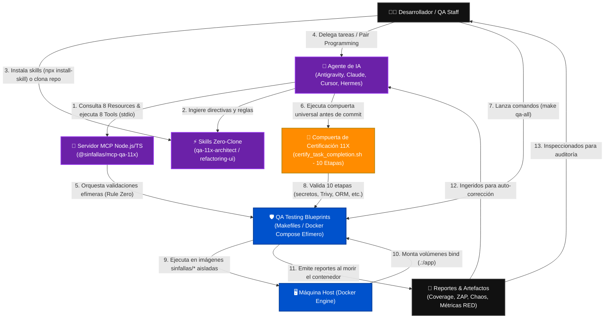
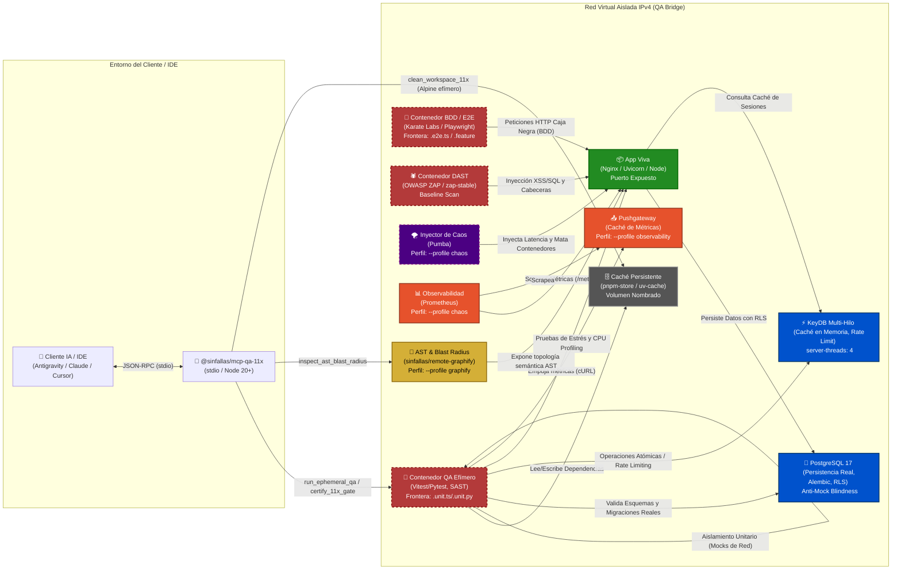
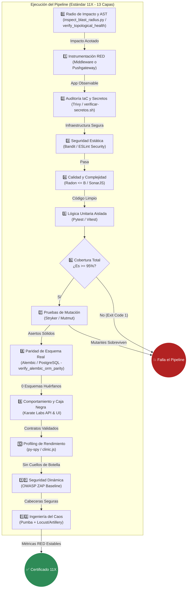

# Arquitectura del Ecosistema de Pruebas (Modelo C4)

Este documento describe gráficamente cómo interactúan las herramientas, contenedores y redes dentro de **QA Testing Blueprints**. Utilizamos una adaptación del Modelo C4 orientada a infraestructura efímera para ilustrar el aislamiento estricto de nuestras pruebas, incluyendo las nuevas capas de Seguridad Dinámica (DAST), Ingeniería del Caos y Observabilidad (Nivel 11X).

---

## Nivel 1: Diagrama de Contexto (System Context — Ecosistema Híbrido Humano + IA)
Muestra el panorama general: cómo los desarrolladores humanos y los agentes de IA interactúan con el sistema mediante el servidor MCP, las skills y la ejecución efímera.

---

## Nivel 2: Diagrama de Contenedores y Ecosistema MCP (Container Diagram)
Muestra la interacción entre los clientes de IA, el servidor MCP en Node.js/TypeScript y el orquestador `docker-compose.qa.yml` con su red virtual aislada y perfiles de ejecución.

---

## Nivel 3: Diagrama de Componentes (Component Diagram - Flujo Interno)
Cadena de ejecución innegociable de 13 capas. Si un eslabón falla, el pipeline se aborta (Principio de Fallo Rápido).

---

## Patrones Arquitectónicos Clave

1. **Shift-Left Security:** Obligamos a ejecutar validaciones IaC (Trivy) y SAST (Lefthook) localmente antes de gastar poder de cómputo en CI/CD.
2. **Sidecar / Atacante-Defensor:** Herramientas como ZAP o Locust actúan como atacantes temporales que bombardean a la App Viva. Nunca se instalan dentro de la imagen de producción.
3. **Resiliencia por Caos (Chaos Engineering):** Probar si la API funciona no es suficiente. Usamos Pumba para degradar intencionalmente la red interna (Jitter, Packet Loss) y Prometheus para certificar que la latencia (P99) no se dispare indefinidamente.
4. **Blackbox Network Isolation (Fronteras):** Los contenedores BDD (Karate) o E2E (Playwright) están estrictamente separados de las pruebas unitarias mediante convenciones de archivo (`.e2e.ts` vs `.unit.ts`). No tienen acceso al código fuente; se comunican por peticiones HTTP puras simulando a un usuario real.
