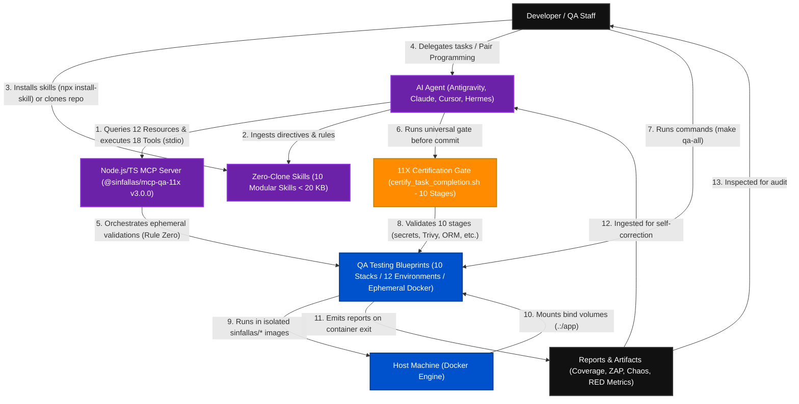
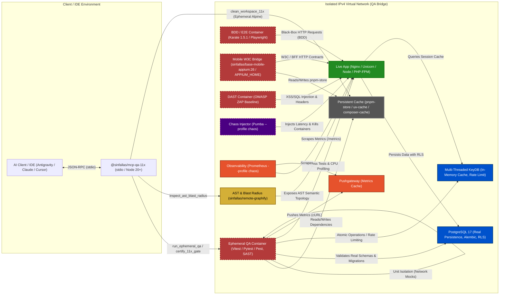
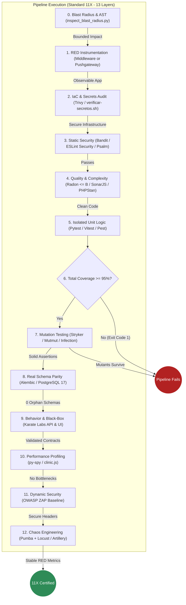

> 🌐 **Language / Idioma:** **English (Canonical)** | [🇪🇸 Español (ARCHITECTURE_C4.es.md)](ARCHITECTURE_C4.es.md)

# Test Ecosystem Architecture (C4 Model)

This document graphically describes how tools, containers, and networks interact within **QA Testing Blueprints (`QA-11X v3.0`)**. We use an adaptation of the C4 Model tailored to ephemeral infrastructure to illustrate strict test isolation across **10 stacks / 12 environments**, including Dynamic Security (DAST), Chaos Engineering, Mobile W3C Bridge (`sinfallas/base-mobile-appium:26`), and Observability (Level 11X).

---

## Level 1: System Context Diagram (Human + AI Hybrid Ecosystem)
Shows the high-level picture: how human developers and AI agents interact with the system through the MCP server, modular skills, and ephemeral execution.

---

## Level 2: Container & MCP Ecosystem Diagram
Shows the interaction between AI clients, the Node.js/TypeScript MCP server, and the `docker-compose.qa.yml` orchestrator with its isolated virtual network and execution profiles.

---

## Level 3: Component Diagram (Internal Execution Flow)
Non-negotiable 13-layer execution chain. If any link fails, the pipeline aborts immediately (Fail-Fast Principle).

---

## Key Architectural Patterns

1. **Shift-Left Security:** We enforce local IaC (Trivy) and SAST (Lefthook) validations before spending compute cycles in CI/CD.
2. **Sidecar / Attacker-Defender:** Tools such as ZAP or Locust act as temporary attackers bombarding the Live App. They are never installed inside the production image.
3. **Chaos Engineering Resilience:** Testing whether the API works under ideal lab conditions is no longer sufficient. We use Pumba to intentionally degrade the internal network (Jitter, Packet Loss) and Prometheus to certify that P99 latency does not spike indefinitely.
4. **Blackbox Network Isolation (Boundaries):** BDD containers (Karate) or E2E containers (Playwright, `sinfallas/base-mobile-appium:26`) are strictly separated from unit tests through file naming conventions (`.e2e.ts` vs `.unit.ts`). They have no access to source code and communicate over pure HTTP or W3C WebDriver protocols simulating a real user.
